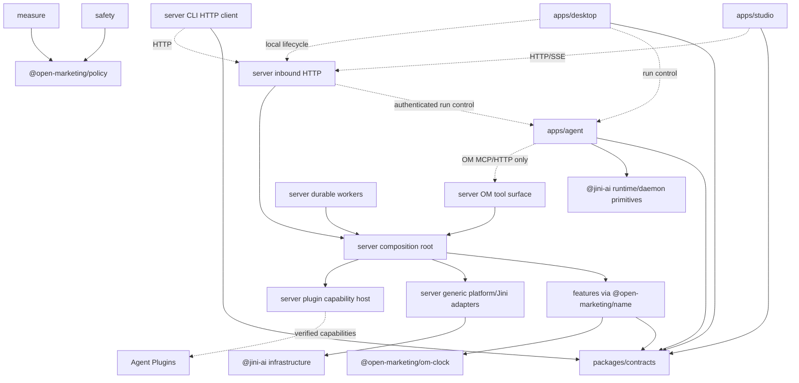

Software Architect(Direct): Persona loaded from `/Users/la/Programming/Open-Marketing/AI-Dev-Shop/agents/software-architect/skills.md`.

# Open Marketing target repository and module architecture — v2

**Date:** 2026-10-01  
**Version:** 2  
**Status:** Revised architecture proposal incorporating the owner’s final decisions of 2026-10-01. Remaining recommendations are identified explicitly. No implementation or production validation is claimed.  
**Revision source:** `ADS-project-knowledge/reports/2026-10-01-om-target-architecture.md`  
**Intended artifact:** `ADS-project-knowledge/reports/2026-10-01-om-target-architecture-v2.md`; carried into `ADS-memory/reports/` when the knowledge workspace moves.  
**Repository:** [AINSEP/Open-Marketing](https://github.com/AINSEP/Open-Marketing)

OM is an agent-native modular monolith with a separate agent process, one Vite/React operator application, and an Electron shell. Backend features have independent public contracts, tests, and builds. Vendor integrations are installable Agent Plugins. Shared Jini infrastructure is consumed through verified `@jini-ai/*` releases or explicitly documented temporary shims. Useful Tovu code may be copied with provenance; OM never imports the Tovu repository.

All inspection for this revision was read-only. No files were edited, moved, or deleted. No installations, builds, tests, migrations, or live vendor operations were run.

## Changes from v1

| Owner decision | Where it landed |
|---|---|
| Remove Open Design before skeleton construction; preserve only named OM work and AI Dev Shop | §§1, 3, 8; j00; Appendix A. Removed the alongside-build strategy and cutover job. |
| Use `studio`, `desktop`, `server`, and a separate `agent` process | §§2–5, 7; all affected job scopes. Defined transport, authentication, ownership, and restart behavior. |
| Place feature workspace packages in top-level `features/`; external imports use package names only | §§3–5; COMMON.md rule 1; Article I; j00 boundary fixtures. |
| Gate cognitive complexity at 10 and nesting at 3; report cyclomatic complexity | §5; COMMON.md rule 5; Article V; j00 and Appendix A fixtures, including the 14-arm exhaustive switch. |
| No MVP budget envelope; stop-only halt exception; typed conversions; always-on production server; daily generation allowance | §§2, 4, 6, 10–12; safety, creative, plugin, worker, UI, and integration jobs. |
| Adopt `io.github.ainsep.openmarketing` | §§3, 6; plugin fixtures and jobs. |
| Ratify B1–B8 and the canonical React rule | §4 conventions; §9 COMMON.md; §10 constraints; §11 constitution. “Design for user ease first” remains an OM constitution principle. |
| Define OM commands and gates from scratch; complete prompt-ready jobs; maximum five parallel | §§5, 9; Appendix A. Jobs now run j00–j25, with readiness renumbered after cutover removal. |

## 1. Evidence, decisions, and limits

### Confirmed observations and evidence provenance

V1 was re-read in full. Its unaffected observations, contracts, and citations are retained below. Observations from its inspection are historical evidence, not claims that this revision repeated every inspection.

- V1’s `git status --short` showed modified root instructions, daemon CLI, web entry, and lockfile, plus the OM packages, OM chat component, app-control CLI, research pointer, and knowledge workspace named in the dispatch.
- V1 inventoried six application directories and twenty-one package directories. That inventory no longer determines preservation: the owner’s explicit preserve list does.
- Tovu’s inspected tree included `apps/admin`, `apps/desktop`, `apps/site-chat`, and `apps/website`. Its backend features were under `apps/website/src/features`.
- OM deliberately differs: four named applications and top-level feature workspace packages.
- Tovu’s START-HERE document described an earlier website/Runner separation. Current source and the later Jini learnings are stronger evidence for process ownership.
- The inspected Higgsfield package placed product-specific declarations in `plugin.json` extensions. OM replaces its Tovu namespace with `io.github.ainsep.openmarketing`.
- OM’s `spine` contains the three pure gates, but positional public signatures need adaptation.
- `om-clock` contains useful clock contracts/doubles and a module-level real clock. The hidden singleton must become an injected adapter.
- `om-outbox` contains useful lease fencing and uncertain-result behavior. Preserve that behavior and adapt its signatures.
- `om-pg/migrations/0001_spine.sql` combines several future ownership domains. Applied migration history remains unknown; an applied migration must never be rewritten.
- No OM constitution or governance ADR index was found in the inspected knowledge workspace. This revision also found neither conventional governance directory.
- The current app-control file was read again. It validates a navigation argument and prints an acknowledgement without contacting the backend or proving browser execution. Its route examples are Open Design routes. Preserve the OM action intent and reusable parsing behavior; replace its acknowledgement semantics and route vocabulary.

The graph was preferred for code discovery. The OM repository is already indexed under `Users-la-Programming-Open-Marketing`. Queries for app-control and Tovu’s agent-daemon source returned insufficient results; direct source reads followed. No indexing was performed.

The persona’s coupling reference cannot establish TypeScript Ca/Ce or abstractness values here. No such measurements are asserted.

### Separate-agent evidence

[Jini’s Tovu learnings, §1a](/Users/la/Programming/Jini/tovu-learnings.md) records the correction from embedding agent execution in the API process to a separate OS process. It also records the later remote tool-event bridge, which makes Jini run lifecycle and tool execution separable.

The current [Tovu agent-daemon server](/Users/la/Programming/Tovu/apps/website/src/server/inbound/assistant/agent-daemon-server.ts) demonstrates authenticated process communication and run ownership. It also contains product-specific database access and vendor federation in the agent daemon. Those latter responsibilities are not carried into OM.

OM uses the process-separation lesson while establishing a stricter boundary: the agent has no product database connection, vendor credentials, or vendor MCP configuration.

The preserved [agentic-chat handoff](/Users/la/Programming/Open-Marketing/handoffs/2026-07-09-agentic-chat-debate-and-spike.md) supplies evidence about pending actions, blocked-tool timeouts, cancellation, event fidelity, and distinguishing requested navigation from completed navigation. Its old runtime and transport recommendations are historical, superseded where they conflict with this document.

### External facts checked

Google’s official MCP guide identifies the current server as read-only and excludes campaign mutations. OM therefore needs a plugin-contained write implementation for Google Search. [Google Ads MCP developer guide](https://developers.google.com/google-ads/api/docs/developer-toolkit/mcp-server)

Google’s average daily budget is not an exact daily spending ceiling. For most campaigns, the documented daily spending limit is twice the average daily budget; same-day budget changes can affect that limit using the highest budget set that day. OM must represent the documented billing bound accurately. [Spending limits](https://support.google.com/google-ads/answer/10486637?hl=en), [budget changes](https://support.google.com/google-ads/answer/10487143?hl=en)

**Unverified:** Meta’s proposed hosted endpoint, available mutation tools, PAUSED creation, activation, OAuth details, and cap guarantees. These remain capability-admission prerequisites.

Agent Plugins v1.1.0 informs the portable manifest and extension design. [Agent Plugins specification v1.1.0](https://github.com/agentplugins/agent-plugins-spec/blob/main/spec/1.1.0.md)

Current Google conversion documentation also identifies restrictions on the older upload path for newly enabled integrations. The Google plugin must verify account eligibility and select a currently supported ingestion API; it must not assume historical upload access. [Google offline conversion guide](https://developers.google.com/google-ads/api/docs/conversions/upload-offline)

### Architectural decision

Select a **feature-owned modular monolith inside `apps/server`**, with ports and adapters, durable workers, and a separately supervised `apps/agent`.

| Candidate | Fit band | Adaptability | Evidence basis | Pros | Cons / tradeoff | Verdict |
|---|---|---|---|---|---|---|
| Feature-owned server monolith plus separate agent | Strong fit | High | Owner decisions; Tovu/Jini prior art; analogical assessment | Local transactions, replaceable adapters, bounded job ownership; API reload does not terminate agent execution | Server outage affects several business features; process communication needs authentication and replay | Selected |
| Broad server-wide service/repository layers plus separate agent | Viable fit | Medium | Conventional architecture | Simple initial organization | Domain changes cross shared technical layers; weaker independent delivery | Runner-up |
| Microservices per feature | Weak fit | High at service boundaries | Analogical assessment | Independent scaling and deployment | Distributed consistency and operational work without a supplied requirement | Defer |
| Agent embedded in API process | Rejected | Medium | Tovu/Jini process-separation evidence; owner decision | Fewer process boundaries | API reload terminates active agents | Forbidden |
| Desktop-only production runtime | Rejected | Low | Owner decision; always-on conversions and supervision | Simple local setup | Laptop sleep/closure interrupts production responsibilities | Sandbox/read-only ad-account mode only |

The principal tradeoff is accepting coordinated deployment of server features in exchange for simpler operations and stronger local consistency. Agent execution is independently supervised because its lifetime must survive API reloads.

### Quality-attribute assessment

These are design predictions, not benchmarks.

| Axis | Score / confidence | Strength and rationale | Weakness / assumption | Mitigation and review trigger |
|---|---|---|---|---|
| Modifiability | 4 / analogical | Public feature packages and caller-owned ports localize changes | Contracts may still become too broad | Review when one change repeatedly touches unrelated features |
| Modularity | 4 / analogical | Executable package, process, and data-ownership boundaries | Composition is a shared integration hotspot | One integrator; boundary fixtures; review public API growth |
| Scalability | 3 / assumed | Durable bounded jobs support asynchronous workloads | Initial single-server/PGlite deployment has finite capacity | Measure before adopting Postgres or independent worker deployment |
| Reliability | 4 / prior_art | Separate agent process, durable outbox, reconciliation | Server failure still interrupts business dispatch | Restart and restore tests; review queue lag and unknown outcomes |
| Security | 4 / analogical | Server-only credentials, scoped run grants, fail-closed dispatch | Trusted plugins and agent isolation remain implementation risks | Security review and hostile-boundary tests before production |
| Operability | 3 / prior_art | One business backend; correlated traces and explicit readiness | Two process lifecycles and durable-state recovery | Runbooks, independent supervision, API-reload acceptance |
| Cost | 4 / analogical | No per-feature service fleet; generation allowance limits delegated usage | Always-on server and provider costs remain | Record actual cost; review deployment spend and allowance overruns |
| Testability | 4 / analogical | One shared contract suite per port; injected time and I/O | Provider behavior cannot be proven entirely offline | Recorded fixtures plus approved non-spending vendor acceptance |
| Data consistency | 4 / analogical | Activated by money reservations, jobs, and asynchronous outcomes; one server transaction boundary | External effects remain uncertain after failures | One outbox; stable keys; unknown-outcome reconciliation |
| Auditability | 4 / analogical | Activated by money/consent requirements; append-only ledgers | Retention and privacy requirements remain unspecified | Owner retention decision before production |
| Integration complexity | 3 / prior_art | Activated by Higgsfield, Google, Meta, and Jini; vendor code isolated in plugins | Provider API/schema drift | Fingerprints, capability admission, contract fixtures |
| Cognitive load | 4 / analogical | Activated by parallel jobs and operator workflow; explicit ownership and one studio | Excessive ports/helpers could increase indirection | Library-first rule; reviewer checks fragmentation |
| Deployment independence | 4 / prior_art | Activated by the required server/agent lifetime separation | Server features still deploy together | Independent process supervision; review only when feature deployment becomes a real driver |

Compared with the runner-up, the selected design adds public-package discipline and some adapter work while reducing cross-feature change propagation. No traffic, throughput, latency, RPO, or RTO values are invented.

This is Direct Mode architecture work under the supplied dispatch. Missing formal pipeline artifacts do not block this revision. No pipeline preflight PASS, approved spec hash, accepted governance ADR, or implementation certification is claimed.

## 2. Runtime topology

### Applications and execution

| Application | Owns | Does not own |
|---|---|---|
| `apps/studio` | Single Vite/React operator UI, navigation, working canvas, chat panel, confirmation presentation | Authoritative safety decisions, credentials, database, workers |
| `apps/desktop` | Electron windows, secure preload, studio hosting, local server/agent supervision, remote-server connection | Marketing domain logic, vendor federation, production background processing |
| `apps/server` | HTTP API, OM MCP/tool surface, database, credentials, plugin federation, safety, jobs, conversions, pacing, reporting, durable transcript/audit storage | Agent subprocess execution or in-memory Jini run lifecycle |
| `apps/agent` | Jini daemon/agent-runtime, session execution, agent subprocesses, live run lifecycle, local tool proxies, event buffering/replay | Vendor credentials/configuration, product database, durable business workers, direct vendor tools |

Studio uses:

- Feature navigation on the left.
- The active working canvas in the center.
- AI chat in a right-side FAB/panel.
- Settings and connection status within the same application.

There is one operator UI. No separate admin or website application is created.

Production ad-account writes and conversion delivery require an always-on `apps/server`. Desktop is the console. Closing studio or desktop does not stop production conversions, reporting, or pacing.

Desktop may start a local server and agent. Local ad-account mode is sandbox or read-only. Starting a local process does not establish production authority.

### Server ↔ agent contract

**Transport**

- Versioned JSON HTTP for run control and server callbacks.
- SSE for ordered run events.
- Streamable HTTP MCP at the server’s OM tool endpoint for agent tool discovery and calls.
- Loopback binding for colocated local processes; authenticated TLS connections for cross-host deployment.
- Shared schemas and protocol versions live in `packages/contracts`.

Recommended endpoints:

| Direction | Endpoint | Purpose |
|---|---|---|
| Server → agent | `POST /internal/v1/runs` | Start a run with verified scope and a server-issued run grant |
| Server → agent | `POST /internal/v1/runs/:runId/cancel` | Cancel agent execution |
| Server → agent | `GET /internal/v1/runs/:runId/events` | Subscribe/reconnect to ordered runtime events |
| Server → agent | `GET /internal/v1/health` | Agent readiness and protocol compatibility |
| Agent → server | `/api/agent/v1/mcp` | OM-owned tool discovery and execution |
| Agent → server | `/api/agent/v1/runs/:runId/events` | Persist/reconcile validated run events |
| Agent → server | `/api/agent/v1/runs/:runId/context` | Obtain permitted context, instructions, attachment references, and catalog revisions |
| Agent → server | `/api/agent/v1/model/*` when required | Server-brokered model access without provider credentials in the agent |

The last four are part of the server’s OM agent HTTP surface. The agent cannot call owner settings, credential administration, or arbitrary server URLs.

**Authentication**

Use separate credentials for separate directions and authorities:

1. A service credential authenticates server run-control calls to the agent.
2. A server-issued, short-lived run grant authenticates agent calls to OM tools/context/event endpoints.
3. Owner browser/CLI sessions remain separate from both.

The proposed MVP implementation uses cryptographically random opaque bearer credentials, with run grants stored as hashes by the server. Run grants bind:

- Agent instance identity.
- Owner and workspace.
- Conversation and run.
- Permitted OM capability set.
- Expiry and revocation state.
- Protocol version and authentication epoch.

A run grant cannot answer confirmation cards or mint a wider grant. The server resolves scope from the authenticated grant; it never trusts an owner/workspace identifier supplied by the agent.

Every agent control route checks the service credential before parsing a request body. Run operations also check recorded ownership. Loopback does not bypass authentication. Missing configuration fails closed.

Local bootstrap transfers service credentials through a protected inherited channel or OS-protected secret mechanism, never command-line arguments or studio JavaScript. Deployment secrets are provisioned explicitly.

Service credentials remain stable across a development API reload. Rotation is an explicit reauthentication operation; it does not require killing a healthy agent process. Compromise, owner logout, or run cancellation may revoke run authority immediately.

**Ownership and event semantics**

- Server owns durable conversation records, business state, approvals, and authoritative tool outcomes.
- Agent owns the active Jini `RunLifecycle`, executor, and live event stream.
- Agent tool registrations are proxies to the OM server surface.
- The server performs the actual business effect and records its authoritative outcome.
- The proxy records corresponding Jini tool-use/tool-result events in the agent’s lifecycle.
- Server transcript persistence deduplicates events by run and event identity/sequence.
- An agent cannot fabricate a successful business operation by submitting a transcript event. Business success is resolved against the server operation record.

Use the released Jini remote event bridge only when its verified API is useful for this wiring. Do not assume old co-location constraints remain mandatory, and do not emit duplicate tool events through both mechanisms.

**Restart and failure behavior**

- An API reload does not terminate or respawn the agent.
- While the server is unavailable, new tool effects fail closed with an explicit unavailable outcome.
- Event buffering is bounded; it contains no credentials and follows the same sensitive-data policy as transcripts.
- Reconnection resumes from an acknowledged event cursor.
- Retrying an OM operation uses its original idempotency key and arguments digest.
- Server restart recovers approvals, jobs, reservations, and operation outcomes from durable state.
- Agent restart marks interrupted runs honestly and uses only supported resume semantics. It does not fabricate continuity.
- A cancelled run grant prevents new interactive tool calls. Independently authorized backend conversions and halt-stop jobs remain server workflows.

Production supervision belongs to the deployment process manager. Development supervision belongs to OM’s new development runner. Desktop supervises only its local child processes. The API process must not be the agent’s lifetime owner.

### Agent isolation

The agent sees OM tool schemas and sanitized instruction content, not vendor MCP manifests, OAuth secrets, SDK clients, or raw credential records.

Its runtime must prevent access to inherited vendor credentials, operator credential files, product database files, arbitrary shell tools, and direct vendor network destinations. Merely omitting vendor tools from a prompt is insufficient.

Where an agent adapter needs model-provider access, use server-brokered model access compatible with the “no vendor credentials in agent” boundary. An adapter that requires uncontrolled local credentials or unrestricted egress is not accepted until it can satisfy the boundary.

### Data and ownership

Propose **PGlite as the initial application database**, with a single owning server process and injected database machinery. This preserves PostgreSQL-shaped SQL and a later Postgres option. Existing migrations still require compatibility tests.

- Features own their tables and domain queries.
- Server platform owns opening, transactions, migration coordination, and backup plumbing.
- No feature queries another feature’s tables.
- Agent never opens the application database.
- In-memory repositories are test doubles.
- Media bytes use `BlobStorePort`; metadata and references reside in feature-owned tables.
- Durable chat/run storage is server-owned and separate from audit and business state.

OM defines its own runtime configuration. Recommended configuration includes an explicitly resolved `OM_STATE_ROOT`, database configuration, blob configuration, and separate agent scratch configuration. Validate these once in application bootstrap and inject resolved values. There is no inherited Open Design data-root contract or fallback.

The exact installed paths and desktop URI identity remain packaging decisions.

### Three important distinctions

1. **Ad financial authorization is bound to an exact operation.** It creates no reusable budget envelope or reallocation authority.
2. **Local halt blocks normal ad-account dispatch.** Remote serving is a separate observed state; only typed pause/stop calls may continue after halt.
3. **Conversions are a typed server workflow.** Their measurement service grant is not an agent tool approval.

## 3. Target repository tree

```text
Open-Marketing/
├── AGENTS.md                         # New OM entry point, boundaries, commands, gates.
├── START-HERE.md                     # Product/runtime orientation.
├── README.md                         # Install, connect, create, launch, measure.
├── CLAUDE.md                         # Thin framework/OM entry-point pointer.
├── LICENSE                           # OM licensing and retained legal obligations.
├── NOTICE                            # Attribution for preserved/copied implementation.
├── CONTRIBUTING.md                   # OM delivery and migration rules.
├── PRIVACY.md                        # Implemented credential/identifier/retention behavior.
├── MARKETING-RESEARCH.md              # Preserved external research pointer; update repo identity.
├── package.json                      # OM scripts and pinned toolchain.
├── pnpm-workspace.yaml
├── pnpm-lock.yaml
├── tsconfig.json
├── eslint.config.mts                 # Cognitive/nesting/signature/React enforcement.
├── dependency-cruiser.config.mts      # OM import and cycle rules.
├── .github/                          # Newly authored OM CI and PR workflow.
├── apps/
│   ├── studio/
│   │   ├── src/
│   │   │   ├── index.ts               # App entry delegates to composition.
│   │   │   ├── app/                  # Composition, router, providers, global styles.
│   │   │   ├── pages/                # Feature canvases and settings.
│   │   │   ├── widgets/              # Chat panel, cards, navigation, report panels.
│   │   │   ├── features/             # Connect, generate, crop, launch, halt, inspect.
│   │   │   ├── entities/             # Asset/campaign/account/job presentation.
│   │   │   └── shared/               # API client, UI wrappers, neutral browser ports.
│   │   ├── tests/
│   │   └── package.json
│   ├── desktop/
│   │   ├── src/
│   │   │   ├── index.ts
│   │   │   ├── composition/
│   │   │   ├── main/
│   │   │   └── preload/
│   │   ├── tests/
│   │   └── package.json
│   ├── server/
│   │   ├── src/
│   │   │   ├── index.ts
│   │   │   ├── composition/          # Only server-wide concrete wiring.
│   │   │   ├── cli/                  # om HTTP client; no privileged local shortcut.
│   │   │   ├── contracts/            # Transport mappings; shared DTO re-exports.
│   │   │   ├── inbound/
│   │   │   │   ├── http/
│   │   │   │   ├── om-mcp/
│   │   │   │   ├── conversions/
│   │   │   │   └── agent/
│   │   │   ├── workers/              # Jobs, conversions, reporting, pacing, halt stops.
│   │   │   ├── agent-client/         # Authenticated run control and event subscription.
│   │   │   ├── lifecycle/
│   │   │   └── platform/
│   │   │       ├── db/
│   │   │       ├── blobs/
│   │   │       ├── http/
│   │   │       ├── process/          # Server-owned plugin subprocess supervision.
│   │   │       ├── observability/
│   │   │       └── jini-compat/
│   │   │           ├── db/
│   │   │           ├── oauth/
│   │   │           ├── federation/
│   │   │           ├── secrets/
│   │   │           ├── agent-plugins/
│   │   │           ├── identity/
│   │   │           └── chat-store/
│   │   ├── tests/
│   │   └── package.json
│   └── agent/
│       ├── src/
│       │   ├── index.ts
│       │   ├── composition/
│       │   ├── inbound/              # Authenticated run-control HTTP/SSE.
│       │   ├── runtime/              # Jini run lifecycle and session execution.
│       │   ├── om-client/            # OM MCP/HTTP proxies only.
│       │   ├── events/               # Ordered event persistence/replay adapter.
│       │   ├── isolation/            # Environment, filesystem, tool and egress bounds.
│       │   └── lifecycle/
│       ├── tests/
│       └── package.json
├── packages/
│   ├── contracts/
│   │   ├── src/{api,agent,events,values}/
│   │   ├── src/index.ts
│   │   └── tests/
│   └── om-clock/                     # Preserved pure clock contracts/doubles.
│       ├── src/index.ts
│       └── tests/
├── features/
│   ├── workspaces/
│   ├── policy/                       # Preserved spine gates and policy evidence.
│   ├── audit/
│   ├── credentials/
│   ├── plugins/
│   ├── federation/
│   ├── safety/                       # Exact approvals, limits, halt, generation allowance.
│   ├── jobs/                         # Preserved outbox.
│   ├── media-library/
│   ├── creative/
│   ├── campaigns/
│   └── measure/
├── content/
│   └── agent-plugins/
│       ├── higgsfield-media/
│       ├── google-ads/
│       ├── meta-ads/
│       └── om-playbook/
├── development/
│   ├── docs/
│   ├── e2e/
│   ├── scripts/                      # New OM development/package/check tooling.
│   ├── eslint-rules/
│   ├── fixtures/
│   ├── evals/
│   ├── parked/
│   │   ├── segments/                 # Preserved, outside MVP workspace/runtime.
│   │   └── render/                   # Preserved, outside MVP workspace/runtime.
│   └── experiments/
├── deploy/                           # Always-on server and independent agent definitions.
├── ops/
├── handoffs/
│   └── 2026-07-09-agentic-chat-debate-and-spike.md
├── ADS-memory/                       # Preserved knowledge workspace.
└── AI-Dev-Shop/                      # Preserved, separately governed framework.
```

Every backend feature uses:

```text
features/<name>/
├── index.ts                          # ONLY public surface; explicit named exports.
├── package.json                      # @open-marketing/<name>; exports "." only.
├── tsconfig.json
├── __specs__/
├── src/
│   ├── types.ts
│   ├── ports.ts
│   ├── rules.ts
│   ├── service.ts
│   ├── adapters/
│   └── memory.ts
├── migrations/
└── tests/
```

Create internal files only when needed. The shape is an ownership map, not a requirement to create unused abstractions.

### Feature relocation rule

**Every external consumer imports a feature only as `@open-marketing/<name>`.**

Forbidden examples:

```ts
import { createSafetyService } from "../../features/safety/index.js";
import { createSafetyService } from "@features/safety";
import { createSafetyService } from "@open-marketing/safety/src/service";
```

Allowed:

```ts
import { createSafetyService } from "@open-marketing/safety";
```

Relative imports inside the owning package remain normal. External relative imports to even its public `index.ts` are forbidden.

Package names remain stable when folders move. Relocating a feature requires `git mv` and changing one `pnpm-workspace.yaml` glob; consumers do not change. Build and boundary tooling discover packages from workspace metadata rather than a second hardcoded feature-root map.

### Parked work

`segments` and `render` remain preserved under `development/parked/`, outside workspace globs, production dependency graphs, and MVP surfaces. They are not repurposed as campaign targeting or ad rendering.

Parking does not create a lint exemption for first-party executable source. Preserved source requires the same applicable coding gates before it can enter a passing skeleton or later become active. Promotion into a workspace is a separate approved feature job with contract and migration review.

## 4. Contract conventions and module catalogue

### Shared conventions

All signatures below are proposed OM contracts, not assertions about published Jini APIs.

```ts
type Outcome<T> =
  | { readonly ok: true; readonly value: T }
  | { readonly ok: false; readonly error: AppError };

interface Scope {
  readonly ownerId: string;
  readonly workspaceId: string;
}

interface CallContext {
  readonly scope: Scope;
  readonly principal: Principal;
  readonly correlationId: string;
  readonly traceId: string;
  readonly runId?: string;
}

interface CallOptions {
  readonly signal?: AbortSignal;
}

interface ClockPort {
  now(required: Record<string, never>): number;
}
```

- Owned functions, methods, factories, and helpers take at most two object arguments: required values first, optional behavior second.
- Dependencies and app-specific configuration are required inputs.
- Factories do not open databases, migrate, connect, or start workers. Lifecycle effects are explicit.
- Module-boundary failures use typed `Outcome` values. SDK exceptions are caught and mapped at adapter edges.
- Validate HTTP, MCP results, manifests, CLI input, and environment configuration at their entry boundary. Third-party output remains tainted until schema validation succeeds.
- Bound pagination, batches, payloads, timeouts, retries, and buffered events with validated configuration.
- Inject all I/O, IDs, clocks, credentials, loggers, processes, and application configuration.
- Each app has one composition root. Modules never construct their own dependencies.
- Every port has an instance-based in-memory double and **one shared contract suite** that runs against that double and the real adapter.
- Every external write has a stable idempotency identity and uses the single jobs outbox. No feature creates a second delivery queue.
- Persist domain intent and outbox enqueue atomically through the server’s transaction capability.
- Where a provider lacks idempotency support, retain the OM operation key and reconcile uncertain effects; do not promise exactly-once remote execution.
- Financial, conversion, audit, and effect histories are append-only. Corrections append linked records.
- Propagate correlation/trace IDs from agent run through server operations, jobs, logs, and outbound calls.
- SDK/framework callback signatures use narrow documented wrappers. The gate tests must distinguish foreign ABI wrappers from owned APIs.

Feature repositories expose domain operations, not unrestricted SQL handles. A feature’s SQL adapter owns only that feature’s tables.

### 4.1 `workspaces`

**Responsibility:** Resolve authenticated owner/workspace context and bind accounts/connections to that scope. MVP has one authenticated owner; no speculative enterprise RBAC.

```ts
export function createWorkspaceService(
  required: {
    repo: WorkspaceRepoPort;
    identity: IdentityPort;
    ids: IdPort;
    clock: ClockPort;
  },
  optional?: { observer?: WorkspaceObserverPort },
): WorkspaceService;

export interface WorkspaceService {
  resolveContext(
    required: { session: SessionReference; workspaceId: string },
    optional?: CallOptions,
  ): Promise<Outcome<CallContext>>;

  bindAccount(
    required: { context: CallContext; binding: AccountBinding },
    optional?: CallOptions,
  ): Promise<Outcome<AccountBinding>>;
}
```

**Exports:** Service, account-binding and identity contracts, repository port, factory, memory repository.

**Owns ports:** Workspace repository, identity verification, account-binding lookup.  
**Consumes:** Injected clock and IDs; identity adapter.  
**Jini seam:** `@jini-ai/identity` server API when available.  
**Tables:** `workspace`, `workspace_account_binding`; identity integration owns its session tables.  
**Tests:** Forged scope denied; other-owner connection/account denied; repeated external account identifiers remain scoped; authenticated owner avoids redundant account-approval ceremonies. Shared repository suite runs against memory and SQL.

### 4.2 `policy`

**Responsibility:** Canonical subject/identifier and consent evidence; one implementation of sendability, shareability, and spendability.

```ts
export function createPolicyService(
  required: {
    repo: PolicyRepoPort;
    clock: ClockPort;
    ids: IdPort;
  },
  optional?: { observer?: PolicyObserverPort },
): PolicyService;

export function sendability(
  required: {
    subject: SubjectPolicy;
    channel: MessageChannel;
    purpose: string;
    now: number;
  },
  optional?: Record<string, never>,
): GateDecision;

export function shareability(
  required: {
    subject: SubjectPolicy;
    destination: ShareDestination;
    purpose: string;
    now: number;
  },
  optional?: Record<string, never>,
): GateDecision;

export function spendability(
  required: {
    account: AdAccountPolicy;
    amount: Money;
    window: TimeWindow;
    now: number;
  },
  optional?: Record<string, never>,
): GateDecision;
```

**Exports:** Gates, policy snapshots, typed decisions, service/repository contracts, memory repository.

**Owns ports:** Policy evidence repository and canonical identity resolution.  
**Consumes:** Clock/IDs; verified evidence from authenticated ingress.  
**Jini seam:** Neutral core utilities and generic DB machinery where useful.  
**Tables:** `subject`, `subject_identifier`, `subject_merge`, `consent`, `suppression`; preserve existing holdout evidence if present.  
**Tests:** Withdrawal precedence; exact purpose/destination; deny by default; suppression versus sharing withdrawal; merge isolation; half-open windows; overflow-safe money; halted/revoked/expired authority denied.

Spendability is a pure decision. It does not reserve exposure, approve a tool, or authorize a reusable budget envelope. Safety supplies the exact operation authority and performs atomic effects.

Sendability remains a tested policy contract; messaging and lifecycle workflows are outside MVP.

### 4.3 `audit`

**Responsibility:** Durable evidence of attempted actions, approvals, dispatch, provider outcomes, and reconciliation. Audit does not make all application state event-sourced.

```ts
export function createAuditService(
  required: {
    repo: AuditRepoPort;
    clock: ClockPort;
    ids: IdPort;
    redactor: AuditRedactorPort;
  },
  optional?: { observer?: AuditObserverPort },
): AuditService;

export interface AuditService {
  record(
    required: { context: CallContext; entry: AuditEntry },
    optional?: CallOptions,
  ): Promise<Outcome<AuditReceipt>>;

  list(
    required: { context: CallContext; query: AuditQuery },
    optional?: CallOptions,
  ): Promise<Outcome<AuditPage>>;
}
```

**Exports:** Entry/result types, service/repository/redaction ports, factory, memory repository.

**Owns ports:** Append-only audit repository and redaction/export.  
**Consumes:** Clock/IDs; caller-owned audit interfaces.  
**Jini seam:** Compatible protocol correlation conventions and generic DB machinery.  
**Tables:** `audit_entry`, `audit_export`.  
**Tests:** Scope isolation; credential/identifier redaction; immutable dispatch evidence; approval-to-outcome linkage; bounded export; required intent-audit failure prevents a new effect; corrections append rather than overwrite.

Exact reviewed arguments are retained securely where required. Operational logs carry references/digests, not raw sensitive arguments. Retention and privacy deletion remain owner decisions.

### 4.4 `credentials`

**Responsibility:** Encrypted connection credentials, OAuth state, serialized refresh, revocation, and narrow credential use. Runs only in the server.

```ts
export function createCredentialService(
  required: {
    repo: CredentialRepoPort;
    sealer: SecretSealerPort;
    keyring: KeyringPort;
    oauth: OAuthClientPort;
    clock: ClockPort;
    locks: CredentialLockPort;
    audit: CredentialAuditPort;
  },
  optional?: { observer?: CredentialObserverPort },
): CredentialService;

export interface CredentialService {
  beginConnect(
    required: { context: CallContext; request: ConnectRequest },
    optional?: CallOptions,
  ): Promise<Outcome<ConnectChallenge>>;

  completeConnect(
    required: { callback: VerifiedOAuthCallback },
    optional?: CallOptions,
  ): Promise<Outcome<ConnectionSummary>>;

  revoke(
    required: { context: CallContext; connectionId: string },
    optional?: CallOptions,
  ): Promise<Outcome<RevocationReceipt>>;
}
```

**Exports:** Public summaries/challenges, service and ports. Secret-bearing broker operations are server-only capabilities, absent from UI/agent DTOs.

**Owns ports:** Credential repository, OAuth client/store, broker and refresh lock.  
**Consumes:** Sealer/keyring, guarded fetch, clock, audit.  
**Jini seams:** `@jini-ai/oauth`; platform secret and credential-set APIs when published. OAuth does not import MCP.  
**Tables:** `credential_set`, `connection_secret`, `oauth_transaction`, `oauth_client_registration`.  
**Tests:** No plaintext at rest; AAD binds scope/connection/version; wrong key/scope denied; PKCE/state; refresh race; revoke-before-dispatch; no secrets in cards, transcripts, logs, agent environment, or MCP discovery.

Keyring factories require explicit `hkdfSalt`, `envVarName`, and `keyFilePath` configuration. Bootstrap supplies the chosen OS/deployment mechanism.

### 4.5 `plugins`

**Responsibility:** Validate, install, enable, update, disable, and uninstall self-contained Agent Plugins.

```ts
export function createPluginService(
  required: {
    repo: PluginRepoPort;
    lifecycle: PluginLifecyclePort;
    layout: AgentPluginLayoutPort;
    provisioning: AgentPluginMcpProvisioningPort;
    trust: PluginTrustPort;
    audit: PluginAuditPort;
  },
  optional?: { observer?: PluginObserverPort },
): PluginService;

export interface PluginService {
  install(
    required: { context: CallContext; source: PluginSource },
    optional?: CallOptions,
  ): Promise<Outcome<InstalledPlugin>>;

  setEnabled(
    required: { context: CallContext; pluginId: string; enabled: boolean },
    optional?: CallOptions,
  ): Promise<Outcome<InstalledPlugin>>;

  uninstall(
    required: { context: CallContext; pluginId: string },
    optional?: CallOptions,
  ): Promise<Outcome<UninstallReceipt>>;
}
```

**Exports:** References, lifecycle contracts, extension descriptors, service, factory, memory repository.

**Owns ports:** Installation metadata, trust/verification, lifecycle, extension discovery.  
**Consumes:** Server filesystem/layout/archive/fetch boundaries, federation provisioning, audit.  
**Jini seams:** Agent Plugin validation/lifecycle APIs when published.  
**Tables:** `installed_plugin`, `plugin_version`, `plugin_capability_binding`.  
**Tests:** Portable-format fixtures; invalid entry isolation; path/symlink escape; unregister/dispose; updated digest invalidates authority; uninstall handles running jobs; replacement preserves generic domain contracts.

Server owns vendor MCP configuration and executable plugin capabilities. Agent receives sanitized instruction content and OM tool schemas only.

Installation or enablement does not authorize writes or spending.

### 4.6 `federation`

**Responsibility:** Server-owned MCP gateway: admission, namespaced catalog, fingerprints, confirmation, credential injection, bounded execution/results, and audit.

```ts
export function createFederationHost(
  required: {
    connections: FederationConnectionRepoPort;
    transport: McpTransportPort;
    credentials: FederationCredentialPort;
    permissionGate: FederatedToolPermissionGate;
    confirmation: FederatedCallConfirmation;
    approvalRepo: ExternalMcpToolApprovalRepoPort;
    dispatchGate: FederatedDispatchGatePort;
    audit: FederationAuditPort;
    registry: ToolRegistryPort;
    clock: ClockPort;
  },
  optional?: { observer?: FederationObserverPort },
): FederationHost;

export interface FederationHost {
  invoke(
    required: { context: CallContext; call: ExternalToolCall },
    optional?: CallOptions,
  ): Promise<Outcome<ExternalToolResult>>;

  reload(
    required: { context: CallContext; connectionId: string },
    optional?: CallOptions,
  ): Promise<Outcome<ReloadReceipt>>;
}
```

**Exports:** Host, call/result types, connection/transport contracts, factory, test transport.

**Owns ports:** Connection repository, transport, catalog instance, admission.  
**Consumes:** Credentials, safety, audit, all through caller-owned ports.  
**Jini seams:** Verified federation HTTP/stdio public APIs.  
**Tables:** `federation_connection`, `federated_tool_catalog`, `federation_admission`; safety owns approval grants.  
**Tests:** Read-only admission; displayed/sent argument identity; schema drift; revocation after card; missing gate denied; namespace collision; reconnect/dispose; output bounds; schema-validated results; no vendor configuration or secret reaches agent.

Useful Tovu mechanisms include frozen arguments, namespacing, revocation, and result envelopes. Optional safety gates and old permissive behavior are not copied.

### 4.7 `safety`

**Responsibility:** Exact operation financial authority, universal confirmations, trusted effect classification, platform limit evidence, exposure reservations, halt, pacing decisions, and generation allowance.

```ts
export function createSafetyService(
  required: {
    repo: SafetyRepoPort;
    policy: SpendPolicyPort;
    confirmations: ConfirmationExchangePort;
    effects: VerifiedEffectResolverPort;
    platformLimits: PlatformLimitEvidencePort;
    accountLocks: AccountDispatchLockPort;
    clock: ClockPort;
    ids: IdPort;
    audit: SafetyAuditPort;
  },
  optional?: { observer?: SafetyObserverPort },
): SafetyService;

export interface SafetyService {
  prepareApproval(
    required: { context: CallContext; request: EffectRequest },
    optional?: CallOptions,
  ): Promise<Outcome<ConfirmationCard>>;

  authorizeDispatch(
    required: { context: CallContext; request: FrozenDispatchRequest },
    optional?: CallOptions,
  ): Promise<Outcome<DispatchPermit>>;

  haltAccount(
    required: { context: CallContext; adAccountId: string },
    optional?: CallOptions,
  ): Promise<Outcome<HaltReceipt>>;

  authorizeHaltStop(
    required: { context: ServiceContext; request: HaltStopRequest },
    optional?: CallOptions,
  ): Promise<Outcome<HaltStopPermit>>;

  setGenerationAllowance(
    required: {
      context: CallContext;
      settings: GenerationAllowanceSettings;
    },
    optional?: CallOptions,
  ): Promise<Outcome<GenerationAllowanceSettings>>;

  assessGeneration(
    required: {
      context: CallContext;
      request: FrozenGenerationRequest;
      quote: GenerationCostQuote;
    },
    optional?: CallOptions,
  ): Promise<Outcome<GenerationApprovalRequirement>>;
}
```

**Exports:** Exact authorization/permit/card types, stop-only types, allowance/quote/assessment types, service/ports, memory repository.

**Owns ports:** Safety repository, confirmation exchanges, tool grants, verified effects, limits, atomic reservations, account dispatch serialization.  
**Consumes:** Canonical policy spendability; clock/IDs/audit.  
**Jini seams:** Federation approval and UI/protocol bridges where compatible.  
**Tables:** `ad_account`, `operation_authorization`, `exposure_reservation`, `spend_ledger`, `tool_confirmation`, `tool_approval_grant`, `platform_limit_evidence`, `pacing_observation`, `account_halt`, `generation_allowance_setting`, `generation_allowance_reservation`.

**Tests:** Exact spend confirmation; no envelope/reallocation grant; stale/missing cap denied; halt race; stop-only permit cannot activate/change budget/create; concurrent reservations; currency/window mismatch; unknown effect fails closed; plugin hints cannot downgrade; unknown outcome retains exposure; fingerprints revoke grants; daily allowance boundaries, concurrency, rollover, settings revision, unknown cost, and over-allowance grant rejection.

The spend ledger distinguishes authorization, reserved exposure, submitted configuration, estimated cost, and observed charges. A submitted budget is not money already charged.

### 4.8 `jobs`

**Responsibility:** The single durable outbox and worker state machine: claims, fencing, retry, cancellation, idempotency conflict, and uncertain-result reconciliation.

```ts
export function createJobService(
  required: {
    repo: JobRepoPort;
    dispatcher: JobDispatchPort;
    authorization: JobAuthorizationPort;
    clock: ClockPort;
    ids: IdPort;
    retryPolicy: RetryPolicy;
  },
  optional?: { observer?: JobObserverPort },
): JobService;

export interface JobService {
  enqueue(
    required: { context: CallContext; job: JobRequest },
    optional?: CallOptions,
  ): Promise<Outcome<JobReceipt>>;

  processOne(
    required: { worker: WorkerIdentity },
    optional?: CallOptions,
  ): Promise<Outcome<ProcessResult>>;
}
```

**Exports:** State machine, service/ports, factory, memory repository, transaction-enqueue contract.

**Owns ports:** Job repository and dispatch/authorization requirements.  
**Consumes:** Injected handler instances, clock/IDs, retry configuration.  
**Jini seam:** Generic transactions/locks/migrations; no assumption that Jini provides OM’s outbox semantics.  
**Tables:** `job`, `job_attempt`, `job_handler_binding`.  
**Tests:** Digest conflict; stale lease; crash before/after dispatch; uncertain remote outcome; no blind retry; restart; cancellation; atomic domain-intent/enqueue rollback.

Preserved `om-outbox` is the characterization and implementation starting point. Conversion delivery, generation, campaign writes, and halt stops all use this outbox.

### 4.9 `media-library`

**Responsibility:** Canonical assets, provenance, estimated/actual costs, rights evidence, safe import, and non-destructive crops.

```ts
export function createMediaLibrary(
  required: {
    repo: MediaRepoPort;
    blobs: BlobStorePort;
    importer: GuardedAssetImportPort;
    transforms: ImageTransformPort;
    clock: ClockPort;
    ids: IdPort;
    audit: MediaAuditPort;
  },
  optional?: { observer?: MediaObserverPort },
): MediaLibrary;

export interface MediaLibrary {
  importAsset(
    required: { context: CallContext; request: AssetImportRequest },
    optional?: CallOptions,
  ): Promise<Outcome<Asset>>;

  createCrop(
    required: { context: CallContext; request: PlacementCropRequest },
    optional?: CallOptions,
  ): Promise<Outcome<PlacementCrop>>;

  list(
    required: { context: CallContext; query: AssetQuery },
    optional?: CallOptions,
  ): Promise<Outcome<AssetPage>>;
}
```

**Exports:** Asset/crop/provenance/cost types, service/ports, factory, memory repository.

**Owns ports:** Media repository and blob/import/transform requirements.  
**Consumes:** Guarded fetch, blob and image adapters, clock/IDs/audit.  
**Jini seam:** Generic storage/asset primitives where useful.  
**Tables:** `media_asset`, `media_provenance`, `media_cost`, `media_crop`, `media_import`.  
**Tests:** Dedupe; SSRF/redirect/MIME/size rejection; cleanup; original preserved; dimensions; currencies; provenance across reimports; cross-workspace denial; generation cost links survive absent or delayed output.

No provider model names, OAuth rules, CDN assumptions, or tool identifiers enter core.

### 4.10 `creative`

**Responsibility:** Generation lifecycle, quotes, asynchronous provider jobs, reconciliation, and media import.

```ts
export function createCreativeService(
  required: {
    repo: CreativeRepoPort;
    generation: GenerationCapabilityPort;
    assets: CreativeAssetPort;
    jobs: CreativeJobPort;
    safety: CreativeSpendPort;
    clock: ClockPort;
    ids: IdPort;
    audit: CreativeAuditPort;
  },
  optional?: { observer?: CreativeObserverPort },
): CreativeService;

export interface CreativeService {
  requestGeneration(
    required: { context: CallContext; request: GenerationRequest },
    optional?: CallOptions,
  ): Promise<Outcome<GenerationReceipt>>;

  refreshJob(
    required: { context: CallContext; generationId: string },
    optional?: CallOptions,
  ): Promise<Outcome<GenerationStatus>>;
}
```

**Exports:** Requests/statuses, quote/cost evidence, service and capability ports, factory, memory repository.

**Owns ports:** Generation repository and generic capability.  
**Consumes:** Plugin generation/quote capability, media, jobs, safety, clock/IDs/audit.  
**Jini seam:** App-level runtime/tool integration only; vendor adapters remain in plugins.  
**Tables:** `generation_request`, `generation_attempt`, `generation_cost_observation`, `generation_asset_link`.  
**Tests:** Async job ID; bounded polling; restart; duplicate import; possible charge on timeout; unknown/estimated/actual cost; quote expiry or drift; cancellation does not imply refund; missing capability yields connect/install action.

Safety owns allowance authority. Creative records quote and provider-cost evidence; media preserves asset provenance.

### 4.11 `campaigns`

**Responsibility:** Vendor-neutral drafts, creative references, PAUSED creation, exact launch proposals, and observed platform state.

```ts
export function createCampaignService(
  required: {
    repo: CampaignRepoPort;
    capabilities: CampaignCapabilityPort;
    assets: CampaignAssetPort;
    safety: CampaignSafetyPort;
    jobs: CampaignJobPort;
    clock: ClockPort;
    ids: IdPort;
    audit: CampaignAuditPort;
  },
  optional?: { observer?: CampaignObserverPort },
): CampaignService;

export interface CampaignService {
  createPaused(
    required: { context: CallContext; draft: CampaignDraft },
    optional?: CallOptions,
  ): Promise<Outcome<CampaignReceipt>>;

  proposeLaunch(
    required: { context: CallContext; campaignId: string; flight: FlightProposal },
    optional?: CallOptions,
  ): Promise<Outcome<LaunchProposal>>;

  launch(
    required: { context: CallContext; request: ApprovedLaunchRequest },
    optional?: CallOptions,
  ): Promise<Outcome<LaunchReceipt>>;
}
```

**Exports:** Draft/flight/proposal/observed-state contracts, capability/service ports, factory, memory repository.

**Owns ports:** Campaign repository and generic platform requirements.  
**Consumes:** Plugin capability, media, safety, jobs, clock/IDs/audit.  
**Jini seam:** Server federation adapters only.  
**Tables:** `campaign`, `campaign_revision`, `campaign_placement`, `campaign_platform_ref`, `campaign_operation`.  
**Tests:** PAUSED hierarchy; readback; no activation through drafting; creative digest; partial creation recovery; unknown activation; desired versus observed state; account isolation; every subsequent spend mutation requires a new exact confirmation.

A flight describes scheduling and expected exposure. It is not a reusable authorization envelope.

### 4.12 `measure`

**Responsibility:** Tracked links, verified signup/trial ingestion, consent-gated server delivery, immutable platform snapshots, declared attribution, and CAC.

```ts
export function createMeasureService(
  required: {
    repo: MeasureRepoPort;
    policy: MeasurementShareabilityPort;
    conversions: ConversionDeliveryPort;
    reports: PlatformReportingPort;
    jobs: MeasureJobPort;
    links: TrackedLinkPort;
    clock: ClockPort;
    ids: IdPort;
    audit: MeasureAuditPort;
  },
  optional?: { observer?: MeasureObserverPort },
): MeasureService;

export interface MeasureService {
  createTrackedLink(
    required: { context: CallContext; request: TrackedLinkRequest },
    optional?: CallOptions,
  ): Promise<Outcome<TrackedLink>>;

  ingestConversion(
    required: { source: VerifiedConversionSource; event: ConversionInput },
    optional?: CallOptions,
  ): Promise<Outcome<ConversionReceipt>>;

  reportCac(
    required: { context: CallContext; query: CacQuery },
    optional?: CallOptions,
  ): Promise<Outcome<CacReport>>;
}
```

**Exports:** Link/conversion/snapshot/attribution/report contracts, narrow measurement-grant types, service/ports, factory, memory repository.

**Owns ports:** Repository, conversion delivery, reporting, tracked links.  
**Consumes:** Canonical shareability, typed plugin backend capabilities, jobs, clock/IDs/audit.  
**Jini seam:** Generic HTTP/DB adapters.  
**Tables:** `tracked_link`, `touch`, `conversion_event`, `conversion_delivery`, `measurement_service_grant`, `platform_metric_snapshot`, `attribution_result`, `report_watermark`.  
**Tests:** Destination allowlist; UTM/click IDs; source authentication; duplicate/conflicting events; dispatch-time withdrawal; plugin normalization; no agent session; restricted grant; zero denominator; restatement; currency/timezone boundaries; local-mode delivery denial.

The initial conversion is signup or trial. Identifier collection/export is explicit and purpose-bound. Hashing does not establish anonymity or permission.

Google delivery must follow the currently supported account/API contract and consent requirements. [Google offline conversion guide](https://developers.google.com/google-ads/api/docs/conversions/upload-offline)

### Supporting application modules

- **Studio:** Presentation and browser-executed action acknowledgements. Uses shared HTTP/event schemas.
- **Server inbound:** Parses/authenticates requests and invokes feature services. Native OM tools and HTTP endpoints share those services.
- **Server CLI:** An `om` HTTP client with `--json` and `--prompt-file`; no direct DB, secret, or platform shortcut.
- **Server workers:** Typed handlers composed over the single jobs outbox. No dependency on an active agent.
- **Server platform:** Generic I/O and temporary Jini seams; no campaign, consent, media-provider, or vendor business rules.
- **Agent:** Jini session execution and OM tool proxies; no feature imports.
- **Desktop:** Secure app hosting and local process supervision.

Each owned module has an explicit public boundary. None becomes a catch-all domain service.

## 5. Dependency rules, contracts, and enforcement

### Allowed graph

Solid arrows below represent source dependencies; dotted arrows represent runtime communication.



### Exact dependency rules

1. External feature imports use only `@open-marketing/<name>`, resolving to that package’s root public entry.
2. No external relative, alias, absolute-path, subpath, dynamic-import, re-export, test, or type-only bypass.
3. Default feature-to-feature dependency is none. Composition adapts public services to caller-owned ports.
4. `safety` and `measure` may import canonical pure gate contracts/functions from `@open-marketing/policy`.
5. Feature core imports neither concrete platform implementations nor its own adapters.
6. Feature SQL adapters may use generic DB contracts/approved Jini APIs; they cannot query another feature’s tables.
7. Composition consumes factories/adapters through package public entries.
8. Features never import applications.
9. Studio, desktop, and agent never import backend features, server private source, or plugin implementation/configuration.
10. Agent imports only its own runtime code, neutral contracts/utilities, and approved Jini runtime infrastructure. All product interaction goes through server OM MCP/HTTP.
11. Server never imports agent private source, and does not instantiate an agent executor.
12. CLI does not import feature implementations or server composition.
13. Plugin code is dynamically admitted through generic contracts. It is not statically imported by feature core.
14. Vendor SDKs, domains, payloads, OAuth rules, MCP configuration, and codecs reside inside vendor plugins.
15. No source dependency points into sibling Tovu/Jini checkouts, whether relative, alias, `file:`, `link:`, or workspace-linked.
16. Published Jini dependencies use verified registry releases. Unpublished seams use documented local shims.
17. Registries are instances with unregister/reset/dispose.
18. Runtime and type-only cycles fail.
19. Production imports of tests, parked work, fixtures, or experiments fail.
20. Every application has one composition root; only it assembles concrete runtime dependencies.

### Contracts and surfaces

`packages/contracts` contains pure shared DTOs, schemas, events, error codes, money/time representations, agent control/run-grant envelopes, frontend actions, and generic capability envelopes.

It contains no Node filesystem/process, React, Electron, server internals, database driver, or vendor dependency.

Feature domain types and ports remain feature-owned. Vendor schemas stay plugin-owned.

HTTP uses explicit versioned schemas and OpenAPI-compatible contracts. MCP exposes the same use cases through validated tool schemas. JSON HTTP/SSE is preferred over a second RPC stack for the server/agent boundary. A protocol major mismatch fails readiness; additive optional fields are allowed only under declared compatibility.

Expected failures use stable typed codes. Collections use bounded cursor pagination. Clients retry reads according to bounded policy; writes retry only with the original operation key/digest. Sensitive or privileged properties are allowlisted.

| Capability | HTTP | CLI | Studio |
|---|---|---|---|
| Plugin lifecycle | `/api/plugins/*` | `om plugins …` | Settings/plugins |
| Connect/revoke | `/api/connections/*` | `om connections …` | Connections |
| Creative jobs | `/api/creative/*` | `om creative …` | Creative canvas |
| Assets/crops | `/api/media/*` | `om media …` | Media library |
| Campaigns/launch | `/api/campaigns/*` | `om campaigns …` | Campaign canvas |
| Exact approvals/halt/allowance | `/api/safety/*` | `om approvals …`, `om ads halt …`, `om settings generation …` | Cards/account status/settings |
| Measurement | `/api/measure/*` | `om measure …` | Measurement canvas |
| Audit/jobs | `/api/audit/*`, `/api/jobs/*` | `om audit …`, `om jobs …` | Activity/reconciliation |
| Chat/runs | `/api/chat/*`, `/api/runs/*` | `om chat …`, `om runs …` | Right-side chat panel |

Commands accept `--json`; long inputs accept `--prompt-file <path|->`. There is no `od` compatibility entry.

All user-facing capabilities close API, studio, and CLI in the same feature delivery. Backend service-only conversion dispatch and internal run-control endpoints are not new interactive capabilities; configuration/status still have surface parity.

### Dependency-cruiser sketch

Use a TypeScript configuration or programmatic runner whose loader is pinned and tested by j00. Do not assume a tool can load TypeScript configuration without its documented loader.

```ts
import { makeFeatureBoundaryRules } from
  "./development/scripts/src/boundary-rules.js";

export default {
  forbidden: [
    {
      name: "no-cycles",
      severity: "error",
      from: {},
      to: { circular: true },
    },
    {
      name: "no-unresolved-imports",
      severity: "error",
      from: {},
      to: { couldNotResolve: true },
    },
    {
      name: "clients-never-import-backend",
      severity: "error",
      from: { path: "^apps/(studio|desktop|agent)/" },
      to: { path: "^(apps/server|features|content/agent-plugins)/" },
    },
    {
      name: "server-never-imports-agent",
      severity: "error",
      from: { path: "^apps/server/" },
      to: { path: "^apps/agent/" },
    },
    {
      name: "features-never-import-apps",
      severity: "error",
      from: { path: "^features/" },
      to: { path: "^apps/" },
    },
    {
      name: "contracts-stay-neutral",
      severity: "error",
      from: { path: "^packages/contracts/" },
      to: { path: "^(apps|features|content|development)/" },
    },
    {
      name: "production-never-imports-parked",
      severity: "error",
      from: { path: "^(apps|features|packages)/" },
      to: { path: "^development/(parked|experiments|fixtures)/" },
    },
    ...makeFeatureBoundaryRules({
      workspaceManifest: "pnpm-workspace.yaml",
      cataloguePath: "development/module-catalogue.json",
    }),
  ],
  options: {
    tsConfig: { fileName: "tsconfig.json" },
    tsPreCompilationDeps: true,
    doNotFollow: { path: "node_modules" },
  },
};
```

Resolved graph checks alone cannot enforce package-name syntax: a relative import to `index.ts` resolves to the same target. Add an AST/module-specifier check that verifies the original import, export, `require`, and literal dynamic-import specifier.

Generated rules also enforce:

- Core-to-adapter restrictions.
- Default forbidden feature edges and the two policy exceptions.
- FSD layer order, same-layer slice isolation, and public APIs in studio.
- CLI’s HTTP-only boundary.
- Agent infrastructure allowlist.
- No sibling source dependencies.
- No vendor code/configuration outside plugins, with precise handling for explanatory docs and recorded fixtures.
- No production-to-test dependencies.
- One composition root per app.

Conformance fixtures prove two- and three-node cycles, a cycle through unchanged source, deep import, relative-to-public-index import, alias bypass, type-only bypass, forbidden layer edge, and agent-to-feature/plugin imports. An acyclic high-fan-out graph is a negative control.

A relocation fixture moves a sample feature package, changes the workspace glob, and verifies unchanged consumers still build. No second hardcoded path list may require an edit.

### Complexity and React configuration

```ts
import tsParser from "@typescript-eslint/parser";
import sonarjs from "eslint-plugin-sonarjs";
import omRules from "./development/eslint-rules/index.js";

export default [
  {
    ignores: [
      "**/node_modules/**",
      "**/dist/**",
      "**/coverage/**",
      ".git/**",
      ".tmp/**",
      "AI-Dev-Shop/**",
    ],
  },
  {
    files: ["**/*.{ts,tsx,mts,cts,js,jsx,mjs,cjs}"],
    languageOptions: {
      parser: tsParser,
      parserOptions: {
        ecmaVersion: "latest",
        sourceType: "module",
        ecmaFeatures: { jsx: true },
      },
    },
    linterOptions: {
      noInlineConfig: true,
      reportUnusedDisableDirectives: "error",
    },
    plugins: { sonarjs, om: omRules },
    rules: {
      complexity: "off",
      "sonarjs/cognitive-complexity": ["error", 10],
      "max-depth": ["error", 3],
      "om/two-object-arguments": "error",
      "om/no-functions-in-component-body": "error",
    },
  },
];
```

**Cognitive complexity ≤10 and maximum nesting depth ≤3 are errors on all first-party extensions. Cyclomatic complexity is reported, never gated.**

Use an OM metric-report command that emits measured per-function cyclomatic values, cognitive values where available, nesting, and NLOC with tool/version/source metadata. A report with missing required measurements is inconclusive; do not invent values. Cyclomatic magnitude never determines success or failure.

J00 must verify the actual nesting rule’s treatment of supported control structures. If `max-depth` leaves a required structure unmeasured, add a tested OM rule rather than calling the result clean.

The framework’s sensor distinguishes gated cognitive/nesting signals from reported cyclomatic context. Its generic provisional review bands do not replace the owner’s explicit stricter OM errors. See [testable-design-patterns](/Users/la/Programming/Open-Marketing/AI-Dev-Shop/skills/testable-design-patterns/SKILL.md) and [code-structure-quality](/Users/la/Programming/Open-Marketing/AI-Dev-Shop/harness-engineering/sensors/code-structure-quality.md).

React’s canonical rule is [react-skill-operations.md](/Users/la/Programming/Open-Marketing/AI-Dev-Shop/framework/operations/react-skill-operations.md): **no functions in `.tsx` component bodies; inline JSX arrows count.** Extract handlers, callbacks, effects, and derived logic into adjacent hooks/rules modules. Components retain markup and composition.

The copy inspected during this revision did not yet contain that owner-described rule. The supplied owner decision is authoritative; OM references the canonical home and implements the rule without weakening it.

No warning downgrade, inline disable, test exclusion, extension escape, or hidden first-party source under generated-output exclusions. AI Dev Shop is separately governed; this exclusion does not apply to OM code.

**Required gate fixtures**

- Cognitive 10 passes; 11 fails.
- Nesting 3 passes; 4 fails.
- A typed 14-arm exhaustive switch with a `never` default passes lint and compilation.
- Its measured cyclomatic value is reported despite exceeding 10.
- Guard clauses do not receive a cyclomatic gate.
- TSX nested function declarations, function expressions, arrows, JSX arrows, and effect callbacks fail.
- Two-object owned signatures pass; prohibited signatures fail; foreign ABI wrappers behave as documented.
- Resolve and verify lint configuration for every listed extension.

Store deliberately invalid fixture programs as text/virtual inputs and invoke the real analyzer against them. Do not create a blanket ignored directory of executable first-party violations.

### OM root commands

J00 defines these commands from scratch:

| Command | Purpose |
|---|---|
| `corepack pnpm om:lint` | ESLint errors plus directive/exclusion integrity |
| `corepack pnpm om:boundaries` | Dependency graph, import-specifier, workspace, and process boundaries |
| `corepack pnpm om:typecheck` | All active workspace TypeScript checks |
| `corepack pnpm om:gate-tests` | Enforcement conformance fixtures |
| `corepack pnpm om:metrics` | Non-gating metric report; analyzer integrity still required |
| `corepack pnpm om:check` | Required aggregate: lint, boundaries, typecheck, gate fixtures, metric-report integrity |
| `corepack pnpm om:dev` | OM development runner with independently supervised apps |
| `corepack pnpm om:package` | Desktop/package orchestration when implemented |
| `corepack pnpm om:serve` | Production server launch when implemented |

Package tests/builds remain package-scoped. OM inherits no Open Design lifecycle command, guard script, sidecar stamp, release-channel gate, or Nix lock-hash obligation.

## 6. Plugins, federation policy, and the money boundary

### Plugin layout and namespace

The adopted extension namespace is **`io.github.ainsep.openmarketing`**.

```text
content/agent-plugins/<plugin>/
├── plugin.json
├── mcp.json
├── skills/
│   └── <skill>/
│       ├── SKILL.md
│       └── references/
├── io.github.ainsep.openmarketing/
│   ├── capabilities.json
│   ├── src/
│   ├── tests/
│   └── dist/
├── LICENSE
└── NOTICE
```

Portable manifests/configuration follow version 1.1.0. OM-specific declarations use extensions or the namespace directory. Server entries contain only permitted transport fields. Validation uses locally supported rules rather than runtime schema downloads. [Agent Plugins v1.1.0, §§5–9](https://github.com/agentplugins/agent-plugins-spec/blob/main/spec/1.1.0.md)

Vendor MCP configuration is read only by the server’s plugin host. It is never injected into the agent runtime.

### Higgsfield

Copy the useful inspected Tovu package with attribution and failure-mode references. Update product language, imports, namespace, and cost-policy guidance.

```json
{
  "$schema": "https://agent-plugins.org/schemas/1.1.0/mcp.schema.json",
  "mcpServers": {
    "higgsfield": {
      "type": "streamable-http",
      "url": "https://mcp.higgsfield.ai/mcp"
    }
  }
}
```

Proposed extension:

```json
{
  "extensions": {
    "io.github.ainsep.openmarketing": {
      "version": 1,
      "servers": {
        "higgsfield": {
          "authMode": "oauth",
          "defaultTools": {
            "discover": ["models_explore", "job_status"]
          },
          "riskHints": {
            "generate_image": ["write", "spend"],
            "job_status": ["read"]
          }
        }
      },
      "capabilities": {
        "image-generation.v1": {
          "server": "higgsfield",
          "binding": "./io.github.ainsep.openmarketing/capabilities.json"
        }
      }
    }
  }
}
```

Discovery defaults do not grant execution or prove read-only behavior.

The plugin supplies generic generation and cost-quote bindings. It owns provider-specific model/rate/credit interpretation and job polling. Unknown or unverifiable pricing produces an unknown quote, never a zero-cost quote.

Skills teach browser connection, asynchronous generation, bounded status polling, media import, and the host allowance policy. Current vendor behavior requires acceptance verification; copied Tovu instructions are not a vendor guarantee.

### Google Ads Search

MVP uses an OM-written stdio MCP server contained entirely within the Google plugin.

```json
{
  "$schema": "https://agent-plugins.org/schemas/1.1.0/mcp.schema.json",
  "mcpServers": {
    "google-ads": {
      "type": "stdio",
      "command": "node",
      "args": [
        "${PLUGIN_ROOT}/io.github.ainsep.openmarketing/dist/mcp-server.mjs"
      ],
      "cwd": "${PLUGIN_ROOT}"
    }
  }
}
```

Server host selects the approved Node runtime. No runtime `npx` download.

Narrow tools/capabilities:

- Read accessible accounts, campaigns, budgets, and reports.
- Create a bounded Search plan PAUSED.
- Activate an exact reviewed paused plan.
- Change an exact bounded budget.
- Pause/stop a specified existing campaign.
- Reconcile a stable operation identifier.
- Deliver conversions through a typed backend capability, not an agent tool.

No unrestricted mutate, arbitrary authenticated HTTP, shell, or code tool.

The official Google MCP can later replace reporting through the same generic contract; its read-only implementation cannot replace the proposed mutation surface. [Google MCP guide](https://developers.google.com/google-ads/api/docs/developer-toolkit/mcp-server)

Authentication, API access requirements, and conversion API eligibility are verified at plugin adoption, not frozen from old examples.

### Meta Ads

Proposed hosted configuration, pending primary-source/account verification:

```json
{
  "$schema": "https://agent-plugins.org/schemas/1.1.0/mcp.schema.json",
  "mcpServers": {
    "meta-ads": {
      "type": "streamable-http",
      "url": "https://mcp.facebook.com/ads"
    }
  }
}
```

The plugin contains skills, discovered tool bindings, campaign/creative/report codecs, conversion backend code, cap/status evidence, stop-only mappings, and reconciliation.

Unsupported or unverified writes remain unavailable. A replaceable bundled Meta write server remains a recommendation requiring owner acceptance if the hosted connector cannot meet the required contract. It would remain inside the plugin.

### OM playbook

Skill-only configuration:

```json
{
  "$schema": "https://agent-plugins.org/schemas/1.1.0/mcp.schema.json",
  "mcpServers": {}
}
```

Guidance covers briefing, draft review, exact launches, interpretation, reconnect, halt, and unknown outcomes. It calls generic OM tools and duplicates neither vendor instructions nor authority logic.

### Universal interactive-tool approval policy

| Call class | Default behavior | Grant behavior |
|---|---|---|
| Host-admitted read-only | Run and audit | No confirmation required |
| Ordinary write/unannotated tool | Exact-argument card | Chat or persistent grant available within policy |
| Destructive | Exact-argument card | No Always allow; no grant may waive exact destructive confirmation |
| Ad spend or any spend outside the generation allowance exception | Exact-argument spend confirmation for every call | No Always allow; no chat-wide spend waiver |
| Charging generation within daily allowance | Normal write card | Always allow and chat grant available, still bounded by allowance |
| Generation exceeding allowance or with unknown cost | Explicit exact-argument spend approval | No Always allow or chat-wide spend waiver |
| Unknown effect on a spend-capable connection | Fail closed until verified/classified | None |

The generic card supports **Allow / Allow for this chat / Always allow / Cancel**, filtered by the server’s classification.

An “Always allow” choice for eligible generation delegates future matching generation writes within the daily allowance; every dispatch still rechecks allowance, scope, fingerprint, revocation, and current quote.

Plugins cannot weaken the policy or supply execution allowlists. Missing annotations are not read-only. Untrusted hints can add friction only.

Grants bind owner, workspace, connection, plugin digest, schema fingerprint, operation scope, policy revision, and expiry. Exact approval binds the frozen displayed arguments to dispatch. CLI uses the same exchange. `--json` is not an approval bypass.

### Verified effect contract

```ts
interface EffectEnvelope {
  readonly operationId: string;
  readonly connectionId: string;
  readonly accountId: string | null;
  readonly effects: readonly EffectCategory[];
  readonly argumentsDigest: string;
  readonly moneyExposure: MoneyExposure | null;
  readonly requiredLimit: DailyLimitRequirement | null;
}
```

Vendor mapping stays in the plugin. Host verifies the binding against reviewed package and current schema fingerprints. Safety validates scope, effects, arguments, financial authority, limits, and reservations.

Invalid, contradictory, missing, or stale spend mappings fail closed. Arbitrary mutation tools cannot be admitted as bounded campaign capabilities. Metadata cannot prove a remote implementation is honest; admission, testing, revocation, and constrained capabilities address that residual risk.

### Platform controls and exact ad-spend authorization

Every normal ad-account mutation requires valid account scope, appropriate approval, an unhalted account, and the evidence relevant to its effect. Budget-changing and activating operations require current bounded limit evidence and exact financial authority.

Evidence records:

- Configured budget, currency, and platform timezone.
- Controlled serving entities.
- Average-budget, hard-limit, or maximum-billed semantics.
- Effective period, readback time, and same-day budget history.
- Conservative exposure for the exact operation/flight.
- Verified plugin/schema version.

Google’s nominal daily budget cannot be labelled an exact cap. Its documented exposure must fit the reviewed operation’s authority. Unsupported bounded control fails production activation closed. [Google spending limits](https://support.google.com/google-ads/answer/10486637?hl=en)

The pacing worker is secondary defense. It cannot substitute for platform controls or guarantee stopping while offline.

**No MVP budget envelope exists.** Every spend-capable call requires confirmation of its exact arguments. Approving activation does not authorize later budget changes, reallocations, new campaigns, or expanded placements.

A multi-step operation must expose its exact constituent spend calls. A changed call requires a new card. Retry of the same idempotent operation does not create new authority; policy and current safety state are still checked.

### Halt and the stop-only exception

`haltAccount` durably establishes the local halt under account dispatch serialization. Normal ad-account writes cannot cross the host boundary after the halt barrier.

Already transmitted operations may finish and must be reconciled.

After halt, the backend may enqueue and dispatch only a verified `HaltStopRequest`:

- Existing account and existing campaign/entity identifiers.
- A pause or stop action.
- A specific halt record/epoch.
- A verified plugin stop-only binding.
- A stable operation key.
- No arbitrary arguments, budget change, creation, activation, targeting, or creative mutation.

The stop permit is unavailable to agents as a generic bypass. It does not clear halt or grant future spend. The server validates it again immediately before egress and audits request/outcome.

Stop-only calls do not require the halted account to satisfy the normal unhalted/spend-admission path. They still require valid account scope, current credentials, trusted binding, bounded payload, and audit evidence.

UI/CLI distinguish:

- OM normal dispatch halted.
- Remote pause/stop pending.
- Remote serving confirmed stopped, still active, partially stopped, or unknown.

A platform link remains useful for direct owner recovery when remote stop fails.

### Typed conversion service grant

Conversions run in `apps/server`, through plugin-contained typed backend capabilities and the single jobs outbox.

The measurement grant binds workspace, connection/account, event type, destination/purpose, payload schema/version, and expiry/revocation. It authorizes only the configured conversion workflow.

At dispatch the server rechecks:

- Current shareability/consent.
- Verified conversion identity.
- Measurement grant.
- Connection and account state.
- Production mode.
- Destination/method/payload bounds.

A generic egress broker injects credentials, records correlated audit evidence, and applies vendor idempotency/reconciliation semantics.

No agent `tools/call` is involved, and no per-conversion confirmation card appears. The service grant cannot invoke campaign mutation, arbitrary export, arbitrary MCP, or credential administration.

Ad-serving halt and measurement consent are separate controls. A stop-only permit cannot authorize conversion delivery; conversion delivery must satisfy its own grant and consent checks.

### Daily image-generation allowance

**Owner decision:** Default allowance is **$10/day**, owner-editable in settings.

**Ownership:** Safety owns the setting, atomic reservation, admission decision, and accounting linkage. Creative/media own quote and cost provenance.

Recommended MVP setting:

```ts
interface GenerationAllowanceSettings {
  readonly amount: Money;
  readonly dayTimezone: string;
  readonly revision: number;
}
```

Default is USD 1,000 cents per UTC calendar day. The day timezone is explicit and displayed. Alternative timezone/currency support must preserve unambiguous day boundaries and audited policy revisions.

**Quote and provenance**

A generic quote records:

- Provider/plugin and version.
- Model/configuration digest.
- Exact generation arguments digest.
- Estimated amount and currency.
- Conservative authorized upper bound where available.
- Pricing evidence/version and expiry.
- Status: known, unknown, or expired.

Plugin code owns provider-specific pricing calculations. Creative persists quote evidence and generation attempts. Media provenance links the generated asset to prompt/configuration, operation, provider job, quote, reservation, and actual charge observations.

Cost exists even if generation fails or produces no imported asset; do not store costs only on successful assets.

**Admission**

- Assess settled costs plus unresolved reserved exposure for the applicable day.
- Atomically reserve the bounded amount before dispatch.
- At or below remaining allowance: normal write confirmation/grant path.
- Above remaining allowance: explicit spend card; no Always allow.
- Unknown, stale, or incomparable cost: over-allowance path.
- Recheck immediately before dispatch, including concurrent reservations and settings revisions.
- Never silently split a call to evade the threshold.

An unknown quote still needs explicit spend review. If the implementation cannot establish an enforceable or supported maximum exposure, it must fail closed rather than interpret approval as unlimited charging.

**Settlement and rollover**

Actual provider cost is appended and reconciles the reservation. Repeated observations are deduplicated. Corrections append linked adjustments.

Dispatch-day reservations survive midnight and restarts; rollover does not erase unknown charges or release uncertain operations. Settings changes are audited and cannot wipe incurred cost or grant ad-spend authority.

If an actual charge exceeds the estimate/approved bound, record the discrepancy, prevent further delegated generation as appropriate, and require reconciliation. Do not rewrite history to make allowance usage appear compliant.

## 7. Jini seams and temporary shims

Final released exports and versions must be verified at adoption. Local manifests are development evidence, not publication proof.

| Seam | OM port / contract | Temporary location | Swap |
|---|---|---|---|
| OAuth discovery, PKCE, registration, refresh/device flow | OAuth client/store, guarded fetch/clock | Server `platform/jini-compat/oauth/` | Released `@jini-ai/oauth`; retain OM stores/configuration |
| HTTP federation | MCP transport/lifecycle | Server `…/federation/http/` | Released federation adapter; rerun admission/confirmation suites |
| Stdio federation | Process/MCP session ports | Server `…/federation/stdio/` | Released stdio adapter; retain host isolation |
| Approval fingerprint/repository bridge | Confirmation/permission/repository ports | Server `…/federation/approvals/` | Released bridge; safety policy/tables remain OM-owned |
| Secret sealing/keyring | Sealer/keyring ports | Server `…/secrets/` | Released platform secrets; preserve ciphertext/AAD vectors |
| Credential-set primitives | Credential repository bridge | Server `…/secrets/credential-sets/` | Released API; retain feature scope/query ownership |
| Plugin validation | Plugin validation port | Server `…/agent-plugins/validation/` | Released Agent Plugins validation; retain OM extension validation |
| Plugin lifecycle | Lifecycle/layout/provisioning | Server `…/agent-plugins/lifecycle/` | Released lifecycle API; retain trust/admission policy |
| Generic DB machinery | Connection/kernel/transaction/migration | Server `…/db/` | Released DB core/kernel/driver/migrate |
| Authenticated identity | Identity port | Server `…/identity/` | Released identity API; workspace ownership stays OM |
| Durable chat persistence | Chat-store/scope mapping | Server `…/chat-store/` | Planned chat-store API; server retains storage ownership |
| Agent execution and live run lifecycle | OM run-control/runtime ports | `apps/agent` adapter; shim only if required | Verified daemon/agent-runtime exports |
| Run event persistence/proxy execution | OM event and tool-proxy ports | Agent event/client adapters | Verified Jini event seams; preserve OM auth and server-only effects |

The inspected DB plan’s layout includes:

- `@jini-ai/db/core`
- `@jini-ai/db/{sqlite,pglite,postgres}`
- `@jini-ai/db/kernel`
- `@jini-ai/db/kernel/{sqlite,pglite,postgres}`
- `@jini-ai/db/migrate`

Do not use `@jini-ai/sqlite`.

### Shim rules

1. Copy only needed licensed code and dependency closure. Record source path/commit or snapshot, license, deviations, and removal trigger.
2. No sibling source dependency.
3. Unpublished APIs remain behind OM interfaces; no fake ambient declarations.
4. Correct hidden dependencies and singleton behavior at the seam.
5. Preserve cryptographic formats where data exists.
6. Keep one active implementation per seam.
7. Swap one adapter/composition binding, pin a real release, rerun the same contract suite and packed-consumer checks, then remove the shim.
8. A shim requiring feature-core changes at removal has failed its purpose.
9. Server shims do not leak into agent imports.
10. Agent adapters do not acquire DB/federation/credential responsibilities to match Tovu’s implementation.

Published runtime/chat/UI/HTTP infrastructure may be used through verified public exports without speculative clones.

## 8. Current repository disposition

### PRESERVE

| Existing OM work | Target / treatment |
|---|---|
| `packages/spine` | `features/policy`; preserve gates, evidence, and regression tests |
| `packages/om-clock` | `packages/om-clock`; preserve contracts/doubles; inject real clock in app composition |
| `packages/om-outbox` | `features/jobs`; preserve fencing, idempotency, and uncertainty behavior |
| `packages/om-pg` | Generic machinery to server `platform/jini-compat/db`; preserve migration evidence and history pending explicit data decision |
| `packages/segments` | `development/parked/segments`; preserved, outside MVP |
| `packages/render` | `development/parked/render`; preserved, outside MVP |
| `apps/web/src/components/om-chat` | `apps/studio`; preserve OM interaction intent and useful source/tests; adapt to Jini/OM contracts |
| `apps/daemon/src/tools-app-control-cli.ts` | Preserve OM navigation intent/reusable validation only; replace old routes and false execution acknowledgement in server/studio integration |
| `ADS-project-knowledge/` | `ADS-memory/`; preserve knowledge and evidence |
| `MARKETING-RESEARCH.md` | Preserve research pointer; correct stale repository identity/orientation |
| `handoffs/2026-07-09-agentic-chat-debate-and-spike.md` | Preserve historical chat/action evidence |
| `AI-Dev-Shop/` | Preserve framework |

**Everything else is removed before j00.**

No Open Design application, documentation tree, tooling, package, compatibility CLI, command alias, data-root rule, sidecar protocol, release-channel rule, Nix requirement, or inherited guard survives into the OM skeleton.

Necessary legal notices for preserved or newly copied code remain obligations and are represented in OM’s newly authored license/provenance files. This is not permission to retain unrelated Open Design source or docs.

Checkpoint/backup and the actual removal operation belong to the Coordinator outside this document.

### Preserved-state constraints

Removal of old application code does not authorize an unreviewed live-data migration.

Before importing preserved durable state:

- Determine whether `0001_spine.sql` was applied.
- Establish ownership and migration checksums.
- Use explicit additive migration/backfill/reconciliation where required.
- Preserve stable identifiers, currency units, consent evidence, uncertain job states, and ciphertext/AAD formats.
- Never automatically replay uncertain writes or reactivate campaigns.

There is no later repository cutover job. Any approved durable-state import is a separately bounded database operation, not a revival of the removed application.

## 9. Codex delivery jobs

**Execution profile:** Codex `gpt-6.1-sol`, high reasoning. Independent jobs; no jobs were launched for this document.

Each job specification below is prompt-ready when combined with the COMMON.md block and the cited sections. The Coordinator supplies exact accepted contract versions and a file-ownership map. Jobs can read OM, Tovu, and Jini; they cannot edit another running job’s files.

Shared contracts, root manifests, lockfile, workspace catalogue, composition, and migration coordination have one integrator. Feature jobs propose changes through `NEEDS`; the integrator serializes them.

### Gates required for every job

**G — shared gate bundle**

1. `corepack pnpm om:check`.
2. `corepack pnpm --filter <owned-package> test` and `build`, including matching port contract tests.
3. One shared port suite passes for memory and real adapters. Real external adapters use controlled local transport/provider fixtures; approved non-spending vendor acceptance remains separately identified.
4. Regression-first red/green evidence for bug fixes.
5. Matching API/studio/CLI acceptance for exposed capabilities before the integrated feature delivery closes.
6. Migration/checksum/rollback evidence for persistent changes, using temporary databases only.
7. No live spend, destructive provider effect, or live migration in automated acceptance.
8. Dependency publication/provenance evidence and import isolation.
9. Explicit typed errors, injected time, trace propagation, and append-only evidence where applicable.

There are no inherited Open Design gates.

### j00 — Preserve-only OM skeleton and enforcement

**Dependencies:** Coordinator has completed removal; only the preserve list and required repository metadata remain. Owner decisions in this document are binding.

**Scope map:** Root OM manifests/configuration/instructions; `development/scripts`, lint rules and gate tests; four application shells; `packages/contracts`; `packages/om-clock`; feature package manifests/public entries; plugin skeletons; mechanical relocation/compatibility adaptation of preserved OM work; parked source placement.

**Contract:** Independently buildable workspace, package-name feature imports, shared boundary schemas, one composition root per app, inert app shells, and enforceable OM gates. No vendor call or live migration.

**Acceptance tests:**

- All four apps and active packages independently typecheck/build.
- Feature exports expose only the public package entry.
- Relative, alias, deep, type-only, cycle, layer, cross-app, agent-feature/plugin, and sibling-source fixtures fail.
- Relocation fixture passes without consumer changes.
- Cognitive 10/11 and nesting 3/4 fixtures behave exactly as required.
- Fourteen-arm exhaustive switch passes and produces a non-gating cyclomatic report.
- All first-party extensions resolve the required error configuration.
- TSX function/JSX-arrow and signature fixtures work.
- Fresh temporary bootstrap does not open/migrate/start workers during imports.
- No Open Design runtime dependency or command remains.

**Gates:** G; full Appendix A prompt. Preserved source cannot be hidden behind ignored paths to pass j00. Adapt minimally where required; do not change preserved algorithms or infer migration history.

### j01 — Server platform and Jini compatibility seams

**Dependencies:** j00.

**Scope map:** Server `platform/{db,http,blobs,process,observability,jini-compat}` and their public boundaries/tests; generic deploy skeleton. No domain features or agent executor.

**Contract:** Injected DB/transaction/migration, guarded network, blob, process, secret, and lifecycle adapters matching §§2, 4, 7. Root integration remains integrator-owned.

**Acceptance tests:**

- Real temporary DB and in-memory double pass the same transaction/kernel suite.
- Open/close ownership; rollback; migration checksum conflict; partial bootstrap cleanup.
- Guarded fetch rejects private destinations, redirects, oversized responses, invalid MIME, and timeouts.
- Plugin process receives bounded allowlisted environment; reset/dispose works.
- Secret vectors/AAD pass without plaintext leakage.
- Trace IDs survive external-call adapters.
- Sibling imports fail; every shim has provenance and a removal trigger.

**Gates:** G; adapter isolation and packed-consumer checks. No live migration or provider credential.

### j02 — Workspace authentication and account scope

**Dependencies:** j00.

**Scope map:** `features/workspaces`; its memory/SQL adapters/tests; scoped identity compatibility adapter assigned by integrator.

**Contract:** `WorkspaceService` and `IdentityPort` from §4.1; owner/workspace/account resolution independent of browser or agent claims.

**Acceptance tests:**

- Valid owner resolves context and binds owned account.
- Forged owner/workspace, other-owner connection, and conflicting account binding fail.
- Reused vendor account IDs remain scoped.
- Memory and SQL share one suite.
- Identity failures return typed values and preserve trace context.

**Gates:** G; no agent-supplied principal becomes authority; no redundant account approval flow.

### j03 — Append-only audit

**Dependencies:** j00.

**Scope map:** `features/audit` only.

**Contract:** §4.3 audit append/list/export, durable intent receipts, redaction, correction lineage.

**Acceptance tests:**

- Memory/SQL shared suite verifies append-only behavior and scope isolation.
- Intent receipt survives restart.
- Required audit failure prevents a new effect.
- Secrets/PII are redacted from operational output.
- Exact-review evidence is secured and linked to operation/result.
- Exports are bounded; corrections do not replace entries.

**Gates:** G; retention policy remains explicit, not invented.

### j04 — Policy and preserved spine

**Dependencies:** j00.

**Scope map:** `features/policy`; preserved gate/evidence tests; `om-clock` changes only through integrator.

**Contract:** §4.2 canonical gates and consent/identity evidence, object signatures, injected time.

**Acceptance tests:**

- Characterize preserved approved behavior before substantive changes.
- Withdrawal precedence, suppression distinction, exact purpose/destination.
- Half-open intervals and currency/overflow adversarial cases.
- Identity merges cannot cross workspace.
- Halted/revoked/expired exact authority fails spendability.
- Memory/SQL evidence repository passes one suite.
- No duplicate gate implementation elsewhere.

**Gates:** G; sendability remains available as a tested contract but creates no MVP messaging surface.

### j05 — Media library and crops

**Dependencies:** j00.

**Scope map:** `features/media-library`; owned blob/import/transform adapters and tests.

**Contract:** §4.9 canonical assets, rights/provenance/cost links, guarded import, non-destructive crops.

**Acceptance tests:**

- Memory/SQL metadata and memory/real temporary blob adapters pass shared suites.
- Dedupe and repeated import preserve provenance.
- SSRF/redirect/type/size rejection.
- Partial blob failure cleans up safely.
- Crop preserves original and validates placement dimensions.
- Cost/provenance links support failed or delayed generation outcomes.
- Cross-workspace access denied.

**Gates:** G; no vendor-specific assumptions in core.

### j06 — Single durable outbox

**Dependencies:** j00.

**Scope map:** `features/jobs`; preserved outbox characterization and adapter tests.

**Contract:** §4.8 job state machine, stable operation key/digest, transactional enqueue, leases/fences, bounded retry/reconciliation.

**Acceptance tests:**

- Memory/SQL run one suite.
- Duplicate key/same digest deduplicates; different digest conflicts.
- Stale lease cannot complete or dispatch anew.
- Crash before/after dispatch remains recoverable.
- Unknown non-idempotent effect is not blindly retried.
- Cancellation and restart preserve honest state.
- Domain intent and enqueue commit/rollback together.
- Handler registry disposes; no second feature-specific outbox exists.

**Gates:** G; fault-injection and lease-ordering tests required.

### j07 — Server-only credentials and OAuth

**Dependencies:** j01, j02, j03.

**Scope map:** `features/credentials`, owned adapters/tests; assigned OAuth/sealer seam changes.

**Contract:** §4.4 connection lifecycle, encrypted records, host-only credential broker, serialized refresh/revocation.

**Acceptance tests:**

- One shared repository/broker suite for doubles and real adapters.
- PKCE/state/redirect validation.
- Wrong scope/key/version fails AAD checks.
- Refresh races perform one refresh.
- Revocation between confirmation and dispatch denies.
- No token in UI DTO, transcript, log, agent config/environment, or tool result.
- Reconnect produces a useful typed status.

**Gates:** G; cryptographic-format and credential-boundary security review before production use.

### j08 — Exact approvals, halt, limits, generation allowance

**Dependencies:** j02, j03, j04.

**Scope map:** `features/safety`; approval, money, halt, allowance fixtures/tests.

**Contract:** §4.7 and §6. No envelope API/table/grant; exact ad-spend approval; narrowly typed backend stop exception; atomic generation allowance.

**Acceptance tests:**

- Every distinct ad-spend call requires its exact card.
- Reallocation and broad chat/persistent ad-spend grants fail.
- Reviewed arguments equal dispatched digest/value.
- Missing/stale/forged effect or cap evidence fails closed.
- Concurrent reservations cannot oversubscribe authority/allowance.
- Normal mutation loses race to completed halt.
- Halt-stop permits allow pause/stop only; payload inflation or activation fails.
- Default generation allowance is USD $10/day; setting edits are versioned/audited.
- Under-allowance card offers Always allow; above/unknown does not.
- Midnight, settings changes, quote drift, timeout, and late cost settlement preserve accounting.
- Memory and SQL use one suite.

**Gates:** G; irreversible/security ordering tests and property tests. Owner decisions are implemented without reopening them.

### j09 — Plugin lifecycle and capability admission

**Dependencies:** j01, j02, j03.

**Scope map:** `features/plugins`; assigned plugin-validation/lifecycle seams; plugin fixture harness.

**Contract:** §4.5 lifecycle, portable-format validation, namespace extension validation, trust/digest admission, sanitized agent instruction export.

**Acceptance tests:**

- Valid/invalid v1.1 fixtures.
- Unknown/invalid extension and server entry handling is explicit.
- Archive/path/symlink escape rejected.
- Enable/disable/update/uninstall unregisters and disposes correctly.
- Running jobs are handled explicitly during update/removal.
- Digest/schema update invalidates prior authority.
- Installation cannot grant writes/spend.
- Agent instruction view contains no MCP configuration or credentials.
- Memory/real filesystem/repository adapters share their suites.

**Gates:** G; extension namespace must be `io.github.ainsep.openmarketing`.

### j10 — Server federation gateway

**Dependencies:** j07, j08, j09.

**Scope map:** `features/federation`; owned HTTP/stdio adapters and tests. No agent vendor integration.

**Contract:** §4.6 only external MCP invocation path; trusted catalog/effects, immutable confirmations, credential broker, dispatch gates, bounded validated results.

**Acceptance tests:**

- Shared transport/admission suites for test transport and real local HTTP/stdio fixture servers.
- Read-only admission and unknown-tool policy.
- Displayed arguments equal outbound arguments.
- Revocation/schema drift after confirmation denies.
- Missing gate fails closed.
- Namespace collisions, reconnect, reset/dispose.
- Tainted/oversized/invalid MCP result rejected or mapped explicitly.
- Agent receives only OM schemas/results; no vendor secret/config.
- Operation IDs and traces reach outbound calls/audit.

**Gates:** G; no optional money or halt gate.

### j11 — Higgsfield plugin

**Dependencies:** j00; host integration after j10; creative binding after j14.

**Scope map:** `content/agent-plugins/higgsfield-media` only.

**Contract:** §6 portable plugin, OAuth/discovery hints, generation/status/quote generic capabilities, cost provenance and verified effect binding.

**Acceptance tests:**

- Spec/namespace validation.
- Copied-code provenance.
- Async job, bounded status polling, import reference, failure/timeout fixtures.
- Known, expired, and unknown pricing evidence.
- Charging generation is classified correctly; plugin cannot choose confirmation policy.
- Estimated/actual charge observations include currency, provider job, and operation.
- Host integration observes allowance policy and credential containment.

**Gates:** G plus plugin build/test. Current vendor behavior requires approved non-spending acceptance evidence.

### j12 — Google Search/reporting/conversion plugin

**Dependencies:** j00; host integration after j10.

**Scope map:** `content/agent-plugins/google-ads` only.

**Contract:** §6 narrow Search tools; paused hierarchy; exact activation/budget mutation; stop-only capability; reporting; typed conversion delivery; reconciliation.

**Acceptance tests:**

- Portable plugin and namespace fixtures.
- Bundled stdio server starts without runtime package download.
- Scoped account validation and PAUSED hierarchy readback.
- Arbitrary mutation/HTTP tool unavailable.
- Budget fixtures represent actual billing semantics and same-day changes.
- Stable operation identity handles duplicates/timeouts/partial creation.
- Stop binding cannot activate or change budget.
- Conversion mapping, consent fields, dedupe, and API eligibility fixtures.
- Credentials remain within server/plugin host path.
- Real local MCP adapter and double satisfy shared capability suites.

**Gates:** G; verified current Google API/authentication and non-spending account evidence. Unsupported conversion API access remains an explicit unavailable capability.

### j13 — Meta plugin and evidence

**Dependencies:** j00; host integration after j10.

**Scope map:** `content/agent-plugins/meta-ads` only.

**Contract:** Verified Meta tool/capability binding, PAUSED creation, limits/readback, stop-only mapping, CAPI backend capability, reporting/reconciliation.

**Acceptance tests:**

- Capture primary-source evidence and actual tool schema; separate verified from proposed claims.
- Portable plugin/namespace validation.
- PAUSED creation and exact activation fixtures.
- Cap evidence/readback and unsupported-control denial.
- Stop-only mapping rejects non-stop effects.
- CAPI normalization/dedupe/consent fixtures.
- Timeout/retry/unknown-outcome fixtures.
- Hosted adapter and double pass shared applicable suites.

**Gates:** G; unverified writes remain unavailable. A bundled write-server fallback requires its recorded owner decision before implementation.

### j14 — Creative lifecycle and cost provenance

**Dependencies:** j05, j06, j08; provider integration after j11.

**Scope map:** `features/creative` only.

**Contract:** §4.10 quote → safety assessment → outbox generation lifecycle → observed cost → asset provenance, through generic ports.

**Acceptance tests:**

- Shared memory/SQL and capability-adapter suites.
- Async generation persists without an agent session.
- Original quote/arguments bind approval and dispatch.
- Under/over/unknown allowance cases route through correct card policy.
- Status recovery after server restart.
- Possible charge on timeout remains reserved/unknown.
- Duplicate asset import does not duplicate cost.
- Failed generation still records cost.
- Cancellation does not claim refund.
- Missing capability yields connect/install action.

**Gates:** G; no provider branches or allowance authority in creative core.

### j15 — Campaign drafts and exact launch

**Dependencies:** j05, j06, j08; provider integration after j12/j13.

**Scope map:** `features/campaigns` only.

**Contract:** §4.11 paused plan, creative-set digest, exact launch/budget operations, desired/observed state, recoverable partial creation.

**Acceptance tests:**

- Shared memory/SQL/capability suite.
- Create cannot activate.
- Campaign hierarchy is read back PAUSED.
- Changed creative/arguments invalidates approval.
- Every later spend mutation receives a new exact card.
- Partial creation and unknown activation reconcile.
- Halt blocks normal operations.
- Production account mutations denied in local/read-only mode.
- Account/workspace mismatch denied.

**Gates:** G; no budget-envelope or automatic reallocation API.

### j16 — Tracked links and verified conversion ingestion

**Dependencies:** j04, j06.

**Scope map:** Measure `src/ingestion`, `src/links`, corresponding adapters/tests. Shared `measure/index.ts`, types, and migrations remain integrator-owned.

**Contract:** §4.12 tracked-link and conversion-inbox contracts; authenticated/deduplicated signup/trial intent and transactional job creation.

**Acceptance tests:**

- Destination/redirect validation.
- UTM/click-ID preservation without unauthorized identifier collection.
- Source authentication and schema validation.
- Same event deduplicates; conflicting duplicate is explicit.
- Consent evidence is purpose/destination-bound.
- Atomic conversion/outbox commit.
- Memory/SQL use one suite.

**Gates:** G; no edits to j17-owned paths and no vendor normalization in core.

### j17 — Conversion delivery, reports, attribution, CAC

**Dependencies:** j00 contracts; j03, j04, j06, j07; integration after j16 and applicable j12/j13 capabilities.

**Scope map:** Measure `src/delivery`, `src/reporting`, corresponding adapters/tests. No j16 files.

**Contract:** Typed production server conversion workflow with narrow measurement grant; immutable snapshots, declared attribution, source-labelled CAC.

**Acceptance tests:**

- Delivery works with no agent or studio session.
- Dispatch-time withdrawal prevents egress.
- Grant cannot invoke campaign mutation, arbitrary export, or MCP.
- Local-mode production conversion delivery denied.
- Stable delivery identity across retry; unknown outcomes reconcile.
- Egress audit and trace evidence.
- Restated/late snapshots append lineage.
- Currency/timezone/attribution-window boundaries.
- Zero denominator returns undefined CAC.
- Mixed currencies and summed platform attributed totals are rejected.
- Memory/SQL/real local capability adapters use shared suites.

**Gates:** G; conversion service path is not exposed as an arbitrary agent tool.

### j18 — Studio shell, preserved OM chat, generic cards

**Dependencies:** j00; live federation/run bindings after j10/j22.

**Scope map:** Studio `app`, shared API/UI, left navigation, central layout, right chat FAB/panel, confirmation widgets, action hooks/rules, associated tests.

**Contract:** One operator application; shared run/SSE/card schemas; preserved OM chat intent; no functions in component bodies.

**Acceptance tests:**

- Left navigation, center canvas, right collapsible chat.
- Accessible keyboard/focus behavior.
- SSE reconnect/deduplication; cancel/expiry.
- Exact arguments displayed from server card.
- Buttons reflect server policy, including generation allowance distinction.
- No secret in UI or event payload.
- Native structured navigation action applies allowlisted route and acknowledges actual result.
- No-browser/timeout state is honest.
- TSX rule catches JSX arrows and nested callbacks.

**Gates:** G; FSD boundaries and React canonical rule. No old UI dependency carried in to render preserved chat.

### j19 — Studio creative and media canvases

**Dependencies:** j05 and j14 public contracts.

**Scope map:** Studio creative/media pages, action slices, entity presentation, tests.

**Contract:** Generation/status/import/crop/provenance workflow through shared API.

**Acceptance tests:**

- Quote and estimated/actual cost presentation.
- Appropriate confirmation for allowance classification.
- Status survives reconnect/reload.
- Failed/unknown generation is not shown as success/free.
- Asset import/dedupe and non-destructive crop.
- Provenance/cost visible.
- Useful install/connect recovery.
- No vendor branches or component-body functions.

**Gates:** G; API/studio/CLI journey closes with j22 integration.

### j20 — Studio campaigns, approvals, halt, allowance settings

**Dependencies:** j08 and j15 public contracts.

**Scope map:** Studio campaign/safety/account-status/settings slices and tests.

**Contract:** Draft review, exact launch/budget cards, halt/remote-state display, generation allowance settings.

**Acceptance tests:**

- Invalid cap/scope/creative blocks launch.
- Exact call review, with no envelope/reallocation flow.
- Ad spend offers no Always allow/chat waiver.
- Under-allowance generation may offer Always allow; over/unknown does not.
- Settings show daily amount, timezone, usage/reservations, and revision outcome.
- Halt immediately shows local dispatch barrier separately from remote serving.
- Pending/partial/unknown remote stop is visible.
- No component-body functions.

**Gates:** G; UI never computes authoritative safety.

### j21 — Studio measurement, connections, plugins, activity

**Dependencies:** j07, j09, j16, j17 public contracts.

**Scope map:** Studio measurement/connection/plugin/activity pages/slices and tests.

**Contract:** Connect/install/revoke, measurement configuration/status, source-labelled reports, job/audit reconciliation.

**Acceptance tests:**

- Browser connection and useful reauthentication.
- Plugin update/revoke reflects lost authority.
- Measurement grant configuration is narrow and understandable.
- Three truth models labelled; freshness/gaps/restatement visible.
- Undefined/mixed-currency CAC handled honestly.
- Job/audit links correlate operation outcomes.
- No tokens or vendor MCP configuration reach UI.
- No component-body functions.

**Gates:** G; surface parity closes with j22.

### j22 — Server composition, separate agent runtime, OM tools, CLI

**Dependencies:** j01–j10, j14–j17, admitted plugin bindings, and j18 contracts. Domain UI acceptance integrates j19–j21.

**Scope map:**

- Server composition, inbound HTTP/OM MCP/agent routes, workers, lifecycle, agent client, transport mappings, CLI.
- Agent composition, run control, Jini runtime adapters, OM client, event persistence, isolation, lifecycle.
- Shared schema changes through integrator.
- Minimal public app-control extraction from preserved source.

**Contract:** §2 server/agent protocol; one composition root per app; server-only business effects and credentials; same use cases across HTTP/MCP/CLI; independently surviving agent process.

Implement as ordered reviewable sub-slices within this job: authenticated protocol and isolated run first; OM tool proxy/events next; feature HTTP/CLI/worker wiring next. Do not dispatch overlapping sub-slices concurrently.

**Acceptance tests:**

- Bad/missing service credential denied before body parsing.
- Wrong/expired/revoked/run-mismatched grant denied.
- Agent cannot answer cards, access another run, read secrets, open product DB, call vendor endpoints, or acquire vendor MCP configuration.
- Agent subprocess tool/config/environment/filesystem/egress isolation verified.
- API reload leaves the same active agent/run alive.
- Server outage blocks tool effects; reconnect resumes events without duplicates.
- Tool transcript success resolves to authoritative server operation evidence.
- Idempotent retry after response loss causes no duplicate accepted operation.
- Production conversions/reporting/pacing run without agent/studio.
- Local-mode ad writes/conversions denied.
- `--json`/`--prompt-file` and confirmation parity.
- Browser app-control result is requested/pending/completed/failed honestly.
- Feature intents and outbox enqueue are atomic.
- Trace IDs connect run → operation → job → outbound call.
- Integrated API/studio/CLI capability matrix passes.

**Gates:** G plus process integration and security-boundary tests. Jini exports must be verified; no broad preset silently enables raw terminal/database/vendor tools.

### j23 — Desktop, local lifecycle, packaging, deployment

**Dependencies:** j18, j22; coherent integrated source snapshot.

**Scope map:** `apps/desktop`; new OM development/package scripts; deploy/ops integration. No old packaging implementation is retained.

**Contract:** Secure studio hosting; independent local server/agent supervision; authenticated remote connection; always-on production server deployment.

**Acceptance tests:**

- Context isolation, sandboxed renderer, narrow preload, navigation/CSP controls.
- Local startup waits for server DB/migration readiness before agent run acceptance.
- API reload does not kill agent.
- Local shutdown reaps owned children; production connection does not terminate remote services.
- Closing desktop leaves production conversion worker running.
- Production account writes remain unavailable in desktop-only mode.
- Two independent local instances do not cross auth, data, or process ownership.
- Packaged smoke test and server deployment health/restart test.
- Runtime paths are resolved from OM configuration, not ports/app names.

**Gates:** G; packaging from quiet source; no inherited stamp/channel/updater/Nix gates.

### j24 — Playbook and policy evaluations

**Dependencies:** j11–j17 contracts; executable evaluation integration after j22.

**Scope map:** `om-playbook`, `development/evals`, generic recorded journeys.

**Contract:** Agent guidance and evaluations for the approved OM tool/approval/measurement workflow.

**Acceptance tests:**

- Agent cannot bypass exact ad-spend review or invent an envelope.
- Cannot use stop permit for non-stop writes.
- Cannot invoke conversions as arbitrary agent export.
- Distinguishes under/over/unknown generation costs and available grants.
- Does not fabricate navigation, provider success, refund, pause, or charge.
- Reports ledger/platform/attribution sources separately.
- Uses useful reconnect/install/unknown-outcome recovery.
- Vendor instructions remain in vendor plugins.

**Gates:** G plus deterministic fixture-based evaluations; no real provider budget burned.

### j25 — Integrated readiness and review

**Dependencies:** j19–j24 and their upstream acceptance.

**Scope map:** `development/e2e`, ops/deploy acceptance evidence, governance/readiness records. Corrections return to original file owners.

**Contract:** Production readiness of the integrated architecture, without any repository cutover.

**Acceptance tests:**

- Sign in → connect → generate → import/crop.
- PAUSED draft → exact spend review → bounded activation.
- Subsequent spend operation requires new review.
- Halt barrier → typed remote stop → honest observed state.
- Conversion ingest → consent recheck → typed delivery with no agent.
- Reporting → declared attribution → labelled CAC.
- API reload/server/agent restart and replay.
- Restore preserves ledgers/unknown outcomes and does not reactivate/replay uncertain effects.
- Plugin quarantine/update rollback and revoked credentials.
- API/studio/CLI parity.
- Security review of agent credentials/egress, plugin trust, confirmation binding, and conversion grant.
- Published dependency/provenance evidence and residual capability limitations.

**Gates:** G, cross-app E2E, restore exercise, security/database review, approved operational requirements. Missing provider evidence or RPO/RTO/retention decisions are reported as production-readiness gaps, not waived.

### Parallel execution — maximum five

Dependencies govern dispatch; batches are opportunities, not overrides.

- After j00: j01, j02, j03, j04, j05.
- As slots free: j06, j11, j12, j13, j18.
- After prerequisites: j07, j08, j09, j14, j16.
- Next: j10, j15, j17, j19; j24 may prepare guidance against stable contracts.
- Then: j20, j21; j22 integrates completed contracts and runs process acceptance.
- j23 packages a quiet snapshot.
- j24 completes executable evaluations after j22.
- j25 validates the coherent integrated result.

Never more than five implementation jobs concurrently. The shared integrator counts if it is running an implementation job.

J16/j17 have disjoint paths. Shared measure entry/types/migrations belong to the integrator. Root manifests, lockfile, shared contracts, and application composition are serialized.

Report collisions as `NEEDS: <contract/file/change>`. Do not repair them by editing another running job’s files.

### COMMON.md — repeated verbatim in every job prompt

```text
OM ENGINEERING CONTRACT

1. Feature slices live in top-level features/<name> workspace packages.
   External imports use ONLY @open-marketing/<name>, resolving to index.ts.
   No relative-to-index, alias, deep, dynamic, test or type-only bypass.
   Default feature-to-feature dependency is none; use caller-owned ports.
   Only safety and measure may import canonical policy gates.
   Relocation changes a folder and workspace glob, never consumer imports.

2. Replaceability is the primary architecture constraint.
   Keep core independent of vendor, driver, framework and transport.
   Preserve approved public contracts and mechanical replacement seams.

3. Inject all I/O and app-specific configuration:
   DB, fetch, clock, filesystem, MCP, secrets, logger, IDs and processes.
   One composition root per app; modules never construct dependencies.
   No hidden singleton or global runtime registry.
   Registry instances support unregister/reset/dispose.

4. Owned functions/factories/methods have at most two object parameters:
   fn(requiredArgsObject, optionalArgsObject?).
   Required dependencies/config belong in the first object.
   Foreign callback ABIs use narrow documented, tested wrappers.

5. Cognitive complexity <=10 and max nesting depth <=3 are ERRORS.
   sonarjs/cognitive-complexity is configured at 10.
   All first-party .ts/.tsx/.mts/.cts/.js/.jsx/.mjs/.cjs are covered.
   Cyclomatic complexity and NLOC are measured/reported, NEVER gated.
   A 14-arm exhaustive discriminated-union switch with never default passes.
   No warning downgrade, inline disable, extension escape or hidden source.

6. Separate decisions from effects; fail closed on irreversible actions.
   Module-boundary failures are explicit typed values.
   B1: every port's in-memory double and real adapter pass ONE shared suite.
   Tests live in module-level tests/, outside src/.
   Bug fixes require demonstrated red/green regression evidence.

7. React rule: no functions in .tsx component bodies.
   Inline JSX arrows, nested callbacks and effect functions count.
   Extract handlers/effects/derived logic into hooks/rules modules.
   Canonical rule: AI-Dev-Shop/framework/operations/react-skill-operations.md.

8. Library-first, simplicity and rule-of-two.
   No speculative abstraction or framework.
   Name a real second consumer or concrete replacement/test adapter.

9. Parse at boundaries.
   B3: schema-validate HTTP, MCP results, manifests, CLI and environment.
   Third-party output is tainted until validated.
   Bound inputs, batches, payloads, timeouts, retries and buffers.

10. One server-owned external-tool policy.
    Admitted read-only calls run; other calls use the generic exact card.
    Ad spend: exact confirmation for EVERY call, no budget envelope,
    no reallocation authority, no Always allow or chat-wide spend waiver.
    Destructive calls retain exact confirmation.
    Generation within the daily allowance uses normal write grants,
    including Always allow; default allowance is $10/day.
    Over-allowance or unknown-cost generation needs explicit spend approval,
    with no Always allow or chat-wide waiver.
    Halt allows only typed backend pause/stop calls after local halt.
    Conversions are typed server jobs under a narrow measurement grant,
    with dispatch-time consent recheck and egress audit.
    Plugins cannot weaken policy. Every dispatch rechecks current authority.

11. Server owns vendor credentials, plugin/MCP configuration, safety,
    database and durable workers.
    Agent is a separate process; it talks only to server OM MCP/HTTP.
    No vendor credential/config, product DB, direct vendor egress,
    unrestricted shell or vendor tool exists in the agent.
    Production ad writes/conversions require always-on server.
    Desktop-only/local ad-account mode is sandbox or read-only.
    Vendor SDKs/codecs/OAuth/MCP/backend code stay in their Agent Plugin.
    Extension namespace: io.github.ainsep.openmarketing.

12. B2: external writes use stable idempotency keys and ONE jobs outbox.
    Domain intent and enqueue commit atomically.
    Unknown non-idempotent outcomes reconcile; never blindly retry.
    B4: irreversible actions fail closed; errors are explicit boundary values.
    B5: ledgers and audit append; corrections append linked records.
    B6: one composition root per app; no dependency construction in modules.
    B7: injected clock; no hidden time reads.
    B8: propagate run/correlation/trace IDs through logs, jobs and egress.

DELIVERY
- Use Codex gpt-6.1-sol, high reasoning.
- Start from the preserve-only OM tree; no Open Design compatibility runtime.
- Preserve unrelated dirty/untracked work; do not reset it.
- Read OM/Tovu/Jini as needed; no sibling source dependency.
- Jini registry releases or documented removable local shims only.
- Root manifests, lockfile, contracts and composition have one integrator.
- Never edit another active job's files; report NEEDS.
- Never apply a live migration without its explicitly assigned operation.
- Run corepack pnpm om:check and matching package tests/builds/contracts.
- User-facing capabilities close HTTP + studio + om CLI together.
- No live spend/destructive provider effect/live migration in automated tests.
- Report CHANGED FILES, TESTS, CONTRACTS, MIGRATIONS, RISKS, NEEDS, HANDOFF.
```

“Design for user ease first” is intentionally an OM constitution principle, not a new shared AI Dev Shop rule.

## 10. Load-bearing constraints, analytics, and operations

### Designated constraints

The implementation-outline and critical-constraint triggers apply: public contracts, process boundaries, storage, UI/backend wiring, asynchronous effects, secrets, and money.

| Unit | Plausible wrong implementation / protected property | Required constraint | Verification | Escalation |
|---|---|---|---|---|
| Confirmation binding | Rebuild arguments after approval; owner reviewed a different call | Frozen value/digest binds card, authority, job, dispatch | Card exchange and outbound capture | Security; irreversible |
| Exact spend authority | Reuse activation approval for a later budget change | Authority binds one exact operation; no envelope | New call denied until new card | Irreversible |
| Financial admission | Treat approval as cap/limit proof | Current scope, limit, halt, approval, and reservation remain independent | Denials, state, call count | Irreversible |
| Halt barrier | Dispatch a normal write after local halt | Serialize final dispatch against halt epoch | Concurrent transport test | Irreversible |
| Halt-stop permit | Accept arbitrary mutation under “stop” metadata | Closed pause/stop contract; existing scoped entities; verified binding | Non-stop payload rejected | Security; irreversible |
| Generation allowance | Concurrent calls independently see remaining allowance | Atomic reserve; count unresolved exposure; dispatch recheck | Concurrency/day/quote tests | Irreversible |
| Cost settlement | Delete reservation at midnight or overwrite estimate | Persistent reservations; append actual/correction evidence | Rollover/restart/late-charge tests | Irreversible |
| Outbox | Stale worker completes or uncertain call blindly retries | Lease fencing, stable key/digest, reconciliation | Durable state and call count | Irreversible |
| Intent/enqueue | Commit state without its job, or job without state | One transaction boundary | Fault-injection rollback | Irreversible |
| Credentials | Refresh restores revoked authority or leaks tokens | Current revocation/version checked at final use; encrypted scoped records | Broker/race/leak tests | Security |
| Conversion dispatch | Ingestion consent assumed permanent | Consent and narrow grant rechecked at dispatch | Withdrawal/no-egress test | Security |
| Plugin authority | New digest inherits old grants | Changed implementation/schema invalidates admission/authority | Catalog/grant rejection | Security; irreversible |
| Agent authentication | Trust loopback or agent-supplied scope | Service auth plus server-owned scoped run grants | Forgery/expiry/cross-run tests | Security |
| Agent isolation | Hidden shell/network/credential path bypasses OM | Only OM tool surface; bounded runtime environment/filesystem/egress | Hostile adapter acceptance | Security; irreversible |
| Run event replay | Duplicate or fabricated transcript creates business success | Deduped event identity; server operations remain authoritative | Replay/result reconciliation | Security |
| Media import | URL redirects reach internal service or unlimited storage | Guarded destination/redirect/type/size boundaries | Local hostile fetch fixtures | Security |

Ordering constraints include:

- Verify/authenticate/parse before trusted use.
- Persist required intent and reserve authority before new external effects.
- Bind approval before enqueue and revalidate before dispatch.
- Consent/grant recheck immediately before conversion egress.
- Halt serialization immediately before normal ad dispatch.
- Validate stop-only payload before granting the exception.
- Persist authoritative operation outcome before reporting durable success.
- Preserve uncertainty until reconciliation supplies evidence.

These are durable constraints proposed for promotion into OM governance. No prior OM critical-constraint artifact was found in the inspected inventory.

### Three analytics truth models

Keep separate:

1. **OM ledger:** Verified first-party conversions, submitted operations, reconciled outcomes, observed spend/cost.
2. **Platform reports:** Immutable provider/account/period/currency/timezone/attribution-window snapshots with retrieval time and restatement lineage.
3. **OM attribution:** Versioned declared model joining touches to verified first-party conversions.

Initial CAC is **platform-reported spend divided by OM-attributed verified signups/trials for a declared period/model**. Label both sources; it is not causal incrementality.

- Never sum Meta and Google attributed conversion totals.
- Never divide mixed currencies.
- Zero denominator is undefined, not zero CAC.
- Show freshness, unmapped campaign/account gaps, and late data.
- Restatements append observations.
- No creative-fatigue or lifecycle analytics loop in MVP.

### Observability

Every production boundary emits structured, redacted signals with correlation/trace IDs and operation/job/run identifiers where applicable.

Required observations include:

- API/agent authentication failures and reconnects.
- Run events and pending confirmation/action state.
- Dispatch denials and confirmation outcomes.
- Cap-evidence age and account halt epoch.
- Remote stop pending/partial/unknown.
- Generation allowance, reserved/settled cost, quote drift, and cost discrepancy.
- Unknown provider outcomes.
- Job lag, lease conflict, retry/dead-letter/reconciliation state.
- Conversion delivery lag and consent denial.
- Reporting watermarks/restatements.
- Credential reconnect/revocation.
- Plugin quarantine and changed fingerprints.

IDs used for correlation do not become unbounded metric labels. Propagate standard trace context where compatible, and record provider request IDs. Operational logs exclude secrets, raw personal identifiers, and sensitive payloads; audit evidence is separately controlled.

### Recovery and operations

`ops/` contains runbooks for:

- Local halt and remote delivery verification.
- Credential expiry/reconnect/revocation.
- Unknown campaign and generation effects.
- Allowance reservation/cost discrepancies.
- Conversion retries/dead letters.
- Restated reports/attribution gaps.
- Plugin quarantine/update rollback.
- Server/agent disconnect, restart, and event replay.
- Database/media backup and restore.

Backups cover database, media, migration history, configuration, encrypted credentials, and durable run/transcript records. Key recovery is separately controlled.

Restore must not automatically reactivate campaigns, revive revoked grants, or replay uncertain writes.

**Provisional recommendation:** Daily encrypted backups and pre-migration backups outside the primary failure domain. Final RPO/RTO, retention, and key-recovery mechanisms remain production-readiness decisions. No unsupplied performance or availability target is asserted.

## 11. OM constitution — revised draft

**Status:** Owner decisions and B1–B8 are ratified inputs. This consolidated constitution remains a draft artifact for formal adoption; it does not reopen those decisions.

### Article I — Replaceability and feature ownership

OM uses independently testable feature workspace packages in top-level `features/`. External consumers import only stable package names through the package’s public entry. Each feature owns its data. Boundaries are executable checks; relocation does not rewrite consumers.

### Article II — Explicit dependencies and composition

Owned functions use at most two required/optional object arguments. All I/O and app-specific configuration are injected. **B6:** One composition root per app; modules do not construct their own dependencies. **B7:** Time is an injected clock. No hidden singleton or mutable global registry.

### Article III — Library-first simplicity

Use maintained libraries where they solve the problem. Domain logic remains deliberate. An abstraction requires a present need and a real second consumer or concrete replacement/test implementation. No speculative platform or framework.

### Article IV — Test-first contracts and boundary trust

**B1:** Every port has one shared contract suite run against its in-memory double and real adapter. Meaningful behavior precedes implementation; bug fixes demonstrate red/green regression evidence.

**B3:** Parse and schema-validate HTTP, MCP results, manifests, CLI input, and environment at boundaries. Third-party output is tainted until validated.

### Article V — Bounded complexity and declarative UI

Cognitive complexity is at most 10 and maximum nesting depth at most 3, enforced as errors across all first-party extensions. Cyclomatic complexity and function size are reported, never gated. Exhaustive switches over discriminated unions remain required and are proven compatible by the 14-arm fixture.

React follows its canonical [AI Dev Shop rule](/Users/la/Programming/Open-Marketing/AI-Dev-Shop/framework/operations/react-skill-operations.md): no functions in `.tsx` component bodies, including inline JSX arrows. Markup/composition stays in components; logic and callbacks live in adjacent hooks/rules modules.

### Article VI — Design for user ease first, with explicit money authority

Design for user ease first. The authenticated owner can complete ordinary work without unnecessary setup or repeated ceremony.

Every ad-spend call receives exact-argument confirmation; MVP has no budget envelope or reallocation authority.

Generation within the configurable daily allowance, default $10/day, uses normal write confirmation and may use Always allow. Over-allowance or unknown-cost generation requires explicit spend approval without Always allow. Current limits, reservations, and authority remain mandatory.

**B4:** Irreversible actions fail closed; module-boundary errors are explicit typed values.

### Article VII — Protected server and separate agent

Server owns credentials, database, safety, federation, and durable workers. Agent is a separate process and accesses product capabilities only through authenticated OM MCP/HTTP. It receives no vendor credentials or vendor MCP configuration.

Production ad writes and conversions require an always-on server. Desktop-only/local ad-account mode is sandbox or read-only.

After local halt, only narrowly typed backend pause/stop calls may mutate the halted ad account. Typed conversion delivery uses a narrow measurement grant, dispatch-time consent, and egress audit.

### Article VIII — Self-contained plugins

Vendor skills, SDKs, codecs, OAuth details, MCP configuration, tool bindings, and backend implementation reside in the vendor Agent Plugin. Namespace is `io.github.ainsep.openmarketing`.

Plugins cannot weaken host confirmation or financial policy. Updates invalidate stale admission and grants.

### Article IX — Durable effects, truth, audit, and recovery

**B2:** External writes use stable idempotency keys and one transactional outbox. Unknown effects remain unknown until reconciled.

**B5:** Ledgers and audit are append-only; corrections append lineage.

**B8:** Run/correlation/trace IDs connect agent execution, logs, jobs, and outbound calls.

OM distinguishes ledger facts, platform reports, and its attribution model. Backup, restore, safe stop, and recovery are delivery responsibilities.

### Article X — Spec integrity and controlled change

Approved decisions/contracts govern implementation. Jobs report files, tests, contracts, migrations, risks, dependencies, and handoff.

Jobs cannot overwrite another active owner’s files or apply live migrations outside an assigned operation. Cross-cutting exceptions require recorded approval; finalized owner decisions are not reopened by implementation preference.

### Article XI — Surface parity

Every user-facing capability closes HTTP, studio, and `om` CLI in the same delivery. Machine-readable output cannot create a privileged bypass.

Internal service processing remains narrowly typed; its configuration and status are accessible through the operator surfaces.

### Governance and compliance

Amendments require written rationale, owner approval, contract review, and an in-flight change plan. Exceptions identify scope, owner, verification, and removal condition.

| Article | Design assessment | Evidence |
|---|---|---|
| I | COMPLIES | Feature packages, package-only imports, relocation fixture |
| II | COMPLIES | Injected ports, four composition roots, preserved clock adaptation |
| III | COMPLIES | Removable adapters/shims and no speculative services |
| IV | COMPLIES | Shared port suites and edge schemas |
| V | COMPLIES | Error configuration and exact conformance fixtures |
| VI | COMPLIES | Exact spend policy and bounded generation exception |
| VII | COMPLIES | Separate agent, server custody, stop/conversion contracts |
| VIII | COMPLIES | Portable plugins and adopted namespace |
| IX | COMPLIES | Single outbox, append-only evidence, tracing, recovery |
| X | COMPLIES | Owned scopes, serialized integration, explicit migration jobs |
| XI | COMPLIES | API/studio/CLI closure matrix |

These assessments describe the proposal’s mechanisms. None claims implementation or test completion.

## 12. Remaining open questions

Questions answered by the owner are removed. The following do not reopen those decisions.

| Remaining question | Recommendation / consequence |
|---|---|
| How should cross-host server/agent identity be provisioned and rotated? | MVP opaque service credential plus scoped run grants is defined above. Decide whether production deployment requires workload identity or mTLS in addition to TLS/bearer authentication. |
| Which desktop lifecycle behavior should be the default? | Offer “local sandbox” and “connect to production server.” Persist connection choice. Define local-close/background behavior explicitly; it cannot grant local production ad writes. |
| Which agent adapters can satisfy OM-only tools and no vendor credentials/configuration? | Prove each adapter’s tool, environment, filesystem, and egress isolation. Unsupported adapters remain unavailable. |
| Is default UTC acceptable for daily generation allowance? | Recommended MVP default is explicit UTC and USD. If owner-local timezone is preferred, finalize rollover, timezone-change, and reconciliation semantics before shipping settings. |
| How are provider estimates converted when generation is billed in credits or non-USD currency? | Require verified pricing/FX evidence with expiry and a conservative bound; otherwise classify cost as unknown/over-allowance. |
| Are documented maximum billed limits acceptable where platforms expose average budgets? | Label controls accurately and require bounded exposure. An exact-hard-cap requirement may make some campaign types unavailable. |
| Can Meta’s official connector implement the required paused hierarchy, activation, stop, and cap evidence? | Verify primary documentation and a non-spending account before accepting production capability. |
| If Meta hosted writes are insufficient, may OM bundle a plugin-contained write server? | Recommend yes, with separate owner acceptance and vendor contract evidence. Core remains unchanged. |
| Has `0001_spine.sql` been applied anywhere? | Determines whether preserved schemas can be reorganized or require additive migration/import. |
| PGlite initial deployment or a required Postgres environment? | PGlite is proposed for one server owner. Validate SQL/backup/deployment requirements; use Postgres when a real requirement justifies it. |
| What are OM’s installed runtime paths, desktop URI, signing, updater, and release identities? | Define new OM identities and release policy. Do not restore Open Design channels or command compatibility. |
| What are recovery, retention, and key-recovery requirements? | Finalize RPO/RTO, audit/transcript/identifier retention, and recovery authority before production readiness. |
| What copied-code provenance format should OM standardize? | Record source commit/snapshot, license/NOTICE, modifications, and removal trigger. No sibling imports. |
| What happens to active provider jobs during plugin removal or incompatible update? | Recommend draining/reconciliation with old verified binding pinned until safe completion, or explicit quarantine. Never silently discard uncertain effects. |

Preservation scope, application names, top-level feature placement, complexity gates, envelope rejection, stop-only permission, conversion service processing, always-on production custody, generation allowance, namespace, and B1–B8 are settled.

## Appendix A — Full j00 prompt

```text
<<SUBAGENT_DISPATCH>>

Read AI-Dev-Shop/agents/programmer/skills.md before any work.
If missing or unreadable, stop and report.
Confirm persona loading in your first response and prefix responses
Programmer(Execution):.

TASK
Implement j00: the Open Marketing preserve-only skeleton and OM gates.

AUTHORITATIVE INPUT
Read the accepted v2 architecture:
ADS-memory/reports/2026-10-01-om-target-architecture-v2.md
or its pre-move source:
ADS-project-knowledge/reports/2026-10-01-om-target-architecture-v2.md.

Read AI-Dev-Shop/AGENTS.md and task-activated coding-foundations,
implementation-guardrails, testable-design-patterns, feature-slice-design,
hexagonal-architecture, and react-skill-operations.
Load additional persona-required skills relevant to this implementation.

The owner's 2026-10-01 decisions are final. Do not reopen them.

PRECONDITION
The Coordinator has removed all Open Design code/docs/tools/packages.
The repository contains only the named PRESERVE work, AI-Dev-Shop,
and repository metadata needed to maintain the repository.

You do not perform the removal/checkpoint operation.
If unrelated old application code remains, report the precondition failure.
Do not build OM alongside it or invent a later cutover.

PRESERVE INPUTS
- packages/spine -> features/policy
- packages/om-clock -> packages/om-clock
- packages/om-outbox -> features/jobs
- packages/om-pg generic machinery ->
  apps/server/src/platform/jini-compat/db
- packages/om-pg migration/history evidence, without rewriting applied history
- packages/segments -> development/parked/segments
- packages/render -> development/parked/render
- apps/web/src/components/om-chat -> apps/studio
- tools-app-control-cli OM navigation intent and reusable validation only
- ADS-project-knowledge -> ADS-memory
- MARKETING-RESEARCH.md
- handoffs/2026-07-09-agentic-chat-debate-and-spike.md
- AI-Dev-Shop

SCOPE YOU OWN
- New root package/workspace/lockfile/TypeScript/lint/dependency configs.
- New OM AGENTS.md, README/START-HERE/contribution and provenance scaffolding.
- development/scripts and development/eslint-rules.
- Enforcement tests and inert text fixtures.
- Four application shells: studio, desktop, server, agent.
- packages/contracts and preserved om-clock boundary.
- Twelve features: workspaces, policy, audit, credentials, plugins,
  federation, safety, jobs, media-library, creative, campaigns, measure.
- Four content/agent-plugins skeletons.
- Mechanical relocation and minimum compatibility adaptation of preserved OM
  source needed for a passing skeleton.
- development/parked placement.
Do not implement new vendor integration, production spend, live migration,
or complete feature behavior assigned to later jobs.

ROOT WORKSPACE
Use active workspace globs for apps/*, packages/*, features/* and explicitly
needed development/plugin build packages.
Parked segments/render are outside workspace globs and runtime imports.

Pin the toolchain and dependencies. Prefer the known Node 24/Corepack/pnpm
baseline unless a verified compatibility issue requires a recorded change.
Do not retain an old root manifest or lockfile as application authority.

Create independently typecheckable/buildable shells:
- @open-marketing/studio: Vite + React; left feature navigation,
  center canvas, right chat FAB/panel.
- @open-marketing/desktop: Electron host and local supervision interfaces.
- @open-marketing/server: HTTP/OM MCP/DB/worker/platform composition shell.
- @open-marketing/agent: separate Jini runtime process shell.
- @open-marketing/contracts: pure shared DTO/schema package.
- @open-marketing/om-clock: preserved injected clock contracts/doubles.
- @open-marketing/<feature>: twelve top-level feature packages.

Each app has one composition root and explicit lifecycle.
Imports/factories must not start listeners, migrate, open DBs, or start workers.

FEATURE PACKAGE CONTRACT
Each feature has root index.ts with explicit named exports.
package.json exports only ".".
External imports use @open-marketing/<name> exclusively.
No relative-to-index, path alias, deep subpath, type-only, test, re-export,
require or dynamic-import escape.
Internal same-package relative imports are allowed.

Discover package locations from workspace manifests.
Moving a package with git mv and changing one workspace glob must not
require consumer-import or second hardcoded-path-map changes.

CONTRACT SCAFFOLD
Create schemas/types for:
- Outcome/AppError, scope, principal references, money/time, operation IDs.
- API requests/responses, SSE events, cards and approval responses.
- Agent control protocol, run grant metadata, events/cursors, cancellation.
- Generic capability/effect envelope and cost quote.
- Typed halt-stop and measurement-grant contracts.
- Generation allowance settings/assessment.
- Frontend navigation action/result.

Use accepted architecture signatures; do not invent Jini exports.
Absent feature implementation is explicit; never return fake success.

PRESERVED SOURCE
Preserve source/tests and record mappings/provenance.
Remove hidden real-clock singleton access through an injected adapter.
Adapt minimum object-signature/import/extension compatibility needed by gates,
without changing approved gate/outbox algorithms.
No retained OM source may pull removed Open Design dependency closure back in.
OM chat uses the new studio/Jini contracts; old UI implementation is not restored.
App-control accepts OM routes and reports requested/pending/completed honestly.
Parked first-party executable source receives applicable lint rules;
parking is not a gate exclusion.
If a substantive behavior change is needed, report NEEDS for the owning job.
Do not claim j00 passed until required checks actually pass.

NEW OM ROOT COMMANDS
Create:
- corepack pnpm om:lint
- corepack pnpm om:boundaries
- corepack pnpm om:typecheck
- corepack pnpm om:gate-tests
- corepack pnpm om:metrics
- corepack pnpm om:check
- corepack pnpm om:dev
Create documented command ownership/stubs for later om:package and om:serve
without claiming packaging/production behavior is implemented.

om:check executes lint, boundaries, typecheck, gate fixtures and metric integrity.
Package tests/builds remain package-scoped.
Do not create od compatibility, tools-dev/tools-pack/tools-serve, OD guard,
sidecar stamps, old release channels or Nix hash coupling.

COMPLEXITY
For every first-party .ts/.tsx/.mts/.cts/.js/.jsx/.mjs/.cjs:
- sonarjs/cognitive-complexity: ["error", 10]
- max nesting depth <=3 as error
- cyclomatic complexity: report only, never gate
- NLOC: report only
- two-object owned signature rule as error
- no functions in .tsx component bodies as error, JSX arrows included

Use a pinned real analyzer. Verify the nesting detector's control-structure
coverage; add a tested rule if needed.
Do not add warning downgrades, inline disables or first-party extension escapes.
AI-Dev-Shop is separately governed.
Generated/vendored exclusions require provenance/integrity checks.
Store invalid fixture programs as text or virtual inputs.

REQUIRED LINT FIXTURES
- Cognitive 10 passes; 11 fails.
- Nesting 3 passes; 4 fails.
- Typed 14-arm exhaustive switch with never default passes lint/typecheck.
- Its measured cyclomatic value is emitted and cannot fail the gate.
- Guard-clause negative control.
- Resolve effective config for all eight source extensions.
- TSX nested function declaration/expression/arrow, JSX arrow and
  effect callback fail.
- Object-signature positive/negative fixtures.
- Narrow foreign callback ABI exception fixture.
- Inline-disable/exclusion integrity fixture.

BOUNDARY ENFORCEMENT
Combine dependency graph analysis with original import-specifier analysis.
Enforce:
- package-name-only feature access
- default no feature-to-feature edges
- safety/measure -> policy public pure gate exceptions
- feature core cannot import adapters/apps/concrete platform
- studio/desktop/agent cannot import server/features/vendor plugins
- server cannot import agent implementation or own agent execution
- CLI is an HTTP client, no feature/composition shortcut
- contracts remain pure
- vendor implementation/configuration stays in Agent Plugins
- no sibling Tovu/Jini source dependency
- no production import of tests/fixtures/experiments/parked work
- runtime and type-only cycles fail
- studio FSD downward layers, same-layer isolation, public entries
- one composition root per app

REQUIRED BOUNDARY FIXTURES
- Two-node and three-node cycles fail.
- Cycle through unchanged source fails.
- Deep import fails.
- Relative import to feature index.ts fails.
- Alias and type-only bypass fail.
- Forbidden FSD layer/same-layer edge fails.
- Agent -> backend feature/plugin fails.
- Sibling file/link/relative dependency fails.
- Production -> parked/test fails.
- Acyclic high-fan-out control passes.
- Package relocation with one workspace-glob change passes unchanged consumers.

PLUGIN SKELETONS
Create higgsfield-media, google-ads, meta-ads, om-playbook layouts.
Portable format is Agent Plugins 1.1.0.
Extension namespace is io.github.ainsep.openmarketing.
Skeletons are not enabled/admitted vendor capabilities.
No vendor MCP configuration goes to apps/agent.

PROCESS CONTRACT
Scaffold server/agent HTTP+SSE and OM MCP schemas and injectable clients.
Authentication is required even on loopback.
Separate service-control credential from scoped server-issued run grants.
No real credential, vendor egress, product DB access or unrestricted shell
in the agent shell.
Development supervision treats server and agent as independent children:
API reload must not own/kill agent lifetime.

ENGINEERING PRINCIPLES
B1 shared port contract suite: memory double and real adapter.
B2 stable external-write key and one transactional outbox.
B3 parse/validate at boundaries; third-party data is tainted.
B4 fail closed on irreversible actions; typed boundary errors.
B5 append-only ledgers/audit.
B6 one composition root per app; modules do not construct dependencies.
B7 injected clock.
B8 run/correlation/trace propagation.
Do not add "Design for user ease first" to shared AI Dev Shop rules;
it belongs in OM's constitution.

ACCEPTANCE AND GATES
Run a fresh workspace install to establish links and lockfile.
Run corepack pnpm om:check.
Run matching package tests/builds.
Prove each app/active package independently builds/typechecks.
Run all positive and negative gate fixtures and record expected outcomes.
Prove no retained Open Design runtime/import/command.
Prove shell import has no startup effect.
Do not call vendor APIs, spend, or apply live migrations.

HANDOFF
Return:
CHANGED FILES
TESTS, including gate conformance and actual commands/results
CONTRACTS
MIGRATIONS: none applied; preserved history and unresolved application status
PROVENANCE
RISKS
NEEDS
HANDOFF

Do not claim implementation beyond the skeleton.
Do not edit another active job's files.
Preserve unrelated dirty/untracked work.
Use Codex gpt-6.1-sol with high reasoning.

Append the accepted COMMON.md engineering contract to this prompt unchanged.
```

## AI Dev Shop handoff contract

**Inputs used**

- Required Software Architect persona and AI Dev Shop entry instructions.
- Full v1 architecture proposal, re-read rather than reconstructed from memory.
- Owner’s final 2026-10-01 decisions.
- Relevant architecture, composition, testability, boundary, constitution, observability, security, implementation-outline, critical-constraint, and governance skills.
- Jini’s Tovu learnings, particularly §1a, and current Tovu agent-daemon source.
- Current OM app-control source, preserved chat/action handoff, and marketing research pointer.
- V1’s retained OM/Tovu/Jini inspection evidence, explicitly treated as historical where not repeated.
- Retained Agent Plugins and Google primary-source citations, checked for this revision.

**Output**

Complete v2 architecture: four-app topology; authenticated server/agent contract; top-level package-only features; twelve feature contracts and data owners; enforceable boundaries; cognitive/nesting errors and non-gating cyclomatic reporting; adopted plugin namespace; exact spend, halt, conversion, production-mode, and generation-allowance design; Jini shim map; preserve-only disposition; complete j00–j25 dispatch specifications; COMMON.md; revised constitution; remaining questions; full j00 prompt.

**Settled decisions**

No Open Design runtime or later cutover; no `od` compatibility; one studio; separate agent; server-only vendor custody; package-only feature imports; cognitive ≤10/nesting ≤3 errors; no MVP envelope; stop-only halt exception; typed conversions; always-on production server; default $10/day generation allowance; `io.github.ainsep.openmarketing`; B1–B8 and canonical React rule.

**Remaining risks**

Unverified Meta capabilities; currently supported Google conversion/API eligibility; agent adapter isolation; unpublished Jini seams; applied migration history; initial database/deployment choice; provider cost/cap semantics; retention/recovery requirements; and concurrent file ownership. These are not represented as tested or resolved.

**Implementation Outline:** Triggered by public-contract, process, persistence, wiring, preserved-behavior, and parallelization boundaries. This proposal supplies the contract/ownership/file/job material. Formal pipeline outline artifacts must be produced at the accepted pipeline paths before their implementation task sets are certified.

**Critical Internal Constraints:** Triggered for confirmation binding, exact authority, halt/stop dispatch, generation accounting, outbox/transaction ordering, credentials, conversion consent, plugin authority, agent authentication/isolation, event replay, and media import. Section 10 provides designated constraints and observable verification. Formal constraint artifacts must retain source traces and escalation markers.

**Governance promotion:** Required for package imports, process/credential ownership, complexity/React enforcement, single-outbox semantics, append-only evidence, exact financial authority, and durable designated constraints. Promote into `ADS-memory/governance/adrs/` and index them after formal acceptance. No governance file was written in this read-only revision.

**Validation performed:** Read-only document/source inspection and citation checks. No code validation, migration, deletion, installation, or live provider operation.

**Next assignee:** Coordinator to complete the preserve-only prerequisite outside this document, record accepted contract/spec versions and file ownership, and dispatch j00 using Appendix A plus COMMON.md. TDD, Database, and Security specialists should encode/review the designated persistence, process-authentication, credential, and irreversible-effect constraints before production-capable implementation.