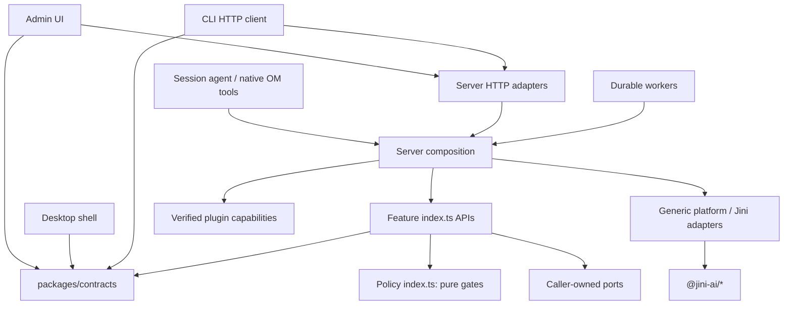

Software Architect(Direct): Persona loaded from `/Users/la/Programming/Open-Marketing/AI-Dev-Shop/agents/software-architect/skills.md`.

# Open Marketing target repository and module architecture

**Date:** 2026-10-01  
**Status:** Architecture proposal for owner review; no implementation or deletion authorization implied.  
**Intended artifact:** `ADS-project-knowledge/reports/2026-10-01-om-target-architecture.md`

This document proposes a Tovu-shaped repository containing an agent-native modular monolith, a Vite admin application, and an Electron console. Features have independent public contracts, tests, and builds. Vendor integrations are installable Agent Plugins. OM imports shared product infrastructure only from `@jini-ai/*`; it copies useful Tovu code with provenance and never imports the Tovu repository.

All inspection was read-only. No files were edited, moved, or deleted. No installs, builds, tests, migrations, or live vendor operations were run.

## 1. Evidence, decisions, and limits

### Confirmed observations

- `git status --short` showed modified `AGENTS.md`, daemon CLI, web `App.tsx`, and `pnpm-lock.yaml`, plus the untracked OM packages, OM chat component, app-control CLI, research pointer, and project-knowledge workspace named in the dispatch.
- OM currently has six application directories and twenty-one package directories. Section 8 accounts for each.
- Tovu’s current tree includes `apps/admin`, `apps/desktop`, `apps/site-chat`, and `apps/website`. Its website source contains `assistant`, `cli`, `contracts`, `features`, `platform`, and `server`.
- Tovu currently keeps its backend features under `apps/website/src/features`; a top-level `features/` directory was not present. OM’s top-level feature workspaces are an intentional refinement requested by this dispatch.
- Tovu’s START-HERE document describes an earlier website/Runner separation. Its current tree contains a desktop application. The current tree is the reference for repository shape; older documentation is evidence of intent, not current ownership.
- The inspected Higgsfield package already has `tovuAuthMode` and `tovuDefaultTools` in `plugin.json` extensions, rather than `mcp.json`. Its namespace is `"tovu"`, which OM must replace with an owner-approved reverse-domain namespace.
- OM’s `spine` implements three pure gates, but its public functions use positional arguments. `om-clock` includes a module-level real clock. Those interfaces need reconciliation with the owner’s current rules before adoption.
- `om-outbox` contains useful lease fencing and uncertain-result handling. Its existing signatures also need reconciliation.
- `om-pg/migrations/0001_spine.sql` combines several future ownership domains. That file must not be casually moved, split, or rewritten without determining whether it has been applied.
- No OM constitution or governance ADR index was found in the inspected `ADS-project-knowledge` workspace.

The codebase graph was consulted first. Both OM and Tovu have existing indexes; no indexing was performed. The graph returned no symbols for the uncommitted OM packages, so current source reads were used for them. Tovu graph results were checked against current source where they informed reuse.

The persona’s coupling reference is Python-only. It cannot establish TypeScript Ca/Ce or abstractness values here; this document reports none.

### External facts checked

Google’s current official MCP guide identifies its server as read-only and explicitly excludes campaign mutations. OM therefore needs a plugin-contained write implementation for Google Search. [Google Ads MCP developer guide](https://developers.google.com/google-ads/api/docs/developer-toolkit/mcp-server)

Google’s average daily budget is not an exact daily spending ceiling: the documented daily spending limit is twice the average daily budget for most campaigns. Budget changes can retain the highest daily budget used that day when determining that limit. OM must model the actual billing bound rather than label the average budget a hard cap. [Spending limits](https://support.google.com/google-ads/answer/10486637?hl=en), [budget changes](https://support.google.com/google-ads/answer/10487143?hl=en)

**Unverified:** Meta’s official hosted endpoint, available mutation tools, mandatory PAUSED creation, activation support, OAuth details, and cap guarantees. Primary connector documentation could not be retrieved in this inspection. These are launch prerequisites, not assumed implementation facts.

Agent Plugins v1.1.0 was inspected directly. Its configuration and extension rules inform section 6. [Agent Plugins specification v1.1.0](https://github.com/agentplugins/agent-plugins-spec/blob/main/spec/1.1.0.md)

### Architectural decision

Use a **modular monolith with feature-owned ports and adapters**, plus a durable backend worker path. Keep the server independently runnable from Electron.

| Candidate | Fit | Adaptability | Evidence basis | Main tradeoff | Decision |
|---|---|---|---|---|---|
| Feature-owned modular monolith | Strong | High | Owner requirements; inspected Tovu structure; analogical assessment | Coordinated deployment, but independent module delivery | Selected |
| Conventional server-wide service/repository layers | Viable | Medium | Existing OD server organization | Simple initial organization; frequent edits cross broad shared layers | Runner-up |
| Microservices per feature | Weak | High at service boundaries | No independent scale or deployment requirement supplied | Adds distributed operational and consistency work | Defer |
| Desktop-only privileged runtime | Rejected for production ads | Low | Always-on conversion requirement; money boundary in build plan | Cannot guarantee workers continue while the laptop sleeps | Sandbox/read-only mode only |

The selected pattern prioritizes replaceability, independent Codex jobs, testability, and low operational overhead. Its meaningful weakness is that one backend outage affects multiple features. Durable jobs, platform-enforced spending bounds, recovery tests, and an independently deployed server address that weakness without introducing microservices.

This is a Direct Mode proposal based on the owner’s dispatch. There is no claimed pipeline preflight PASS, approved spec hash, ratified ADR, or implementation certification.

## 2. Runtime topology

### Applications and execution

- **`apps/admin`:** Vite/React application used in Electron or a browser.
- **`apps/desktop`:** Electron shell, sign-in entry, application connection, window lifecycle, and operating-system integration.
- **`apps/website`:** OM HTTP server, CLI, assistant runtime, host federation, and durable workers. “Website” follows the reference repository’s server naming; it does not imply a CMS or site-hosting product.
- **Production backend:** An always-on instance of `apps/website`, owned by the authenticated user or their deployment.
- **Local backend:** The same application in sandbox/read-only mode, started through `pnpm tools-dev`.

Production conversion delivery, reporting reconciliation, and spending supervision must operate without an agent session and without Electron remaining open.

The older build plan’s prohibition on local production-account custody is retained as the **proposed MVP default**. Production account writes require an always-on backend. The owner must ratify this topology before production activation ships.

### Data and ownership

Propose **PGlite as the initial application database**, with a single owning server process and an injected opener. This preserves a PostgreSQL-shaped migration path and supports encrypted credential storage. It is a proposal, not a claim that current OM migrations work on PGlite.

- Features own their tables and domain queries.
- The platform owns database opening, transaction machinery, migration coordination, and backup plumbing.
- No feature queries another feature’s tables.
- A later Postgres deployment uses the same feature repository contracts. It is added when the deployment requirement is real, not prebuilt speculatively.
- In-memory repositories are mandatory test doubles, never production persistence.
- Media bytes live behind `BlobStorePort`; the database owns metadata and references.

Until repository contracts are explicitly replaced, the existing root **Daemon data directory contract** remains authoritative. New runtime paths derive from its resolved data root. This document introduces no alternative data-root convention.

### Three important distinctions

1. **A budget envelope is financial authorization.** It does not automatically waive tool confirmation.
2. **A local halt blocks OM dispatch.** It does not prove that a platform has stopped serving existing ads.
3. **Conversion delivery is a backend business workflow.** It is not an agent asking an external tool to send arbitrary data.

These distinctions must remain visible in contracts and UI states.

## 3. Target repository tree

```text
Open-Marketing/
├── AGENTS.md                         # OM boundaries, commands, data-root contract, agent entry.
├── START-HERE.md                     # Short product/runtime orientation and reading order.
├── README.md                         # Install, sign in, connect, create, launch, measure.
├── CLAUDE.md                         # Thin agent-host pointer to AGENTS.md.
├── LICENSE                           # Project license and retained upstream obligations.
├── NOTICE                            # Attribution for copied Tovu, OD, and other licensed code.
├── CONTRIBUTING.md                   # Delivery, review, migration, and contribution rules.
├── PRIVACY.md                        # Actual credential, identifier, telemetry, and retention behavior.
├── MARKETING-RESEARCH.md              # Pointer to external marketing research; no copied survey.
├── package.json                      # Pinned toolchain and repo-level/control-plane commands.
├── pnpm-workspace.yaml               # Apps, contracts, features, and development workspaces.
├── pnpm-lock.yaml                    # Reproducible dependency resolution.
├── tsconfig.json                     # Strict ESM/project-reference defaults.
├── eslint.config.mjs                 # Complexity and owner coding rules across first-party code.
├── .dependency-cruiser.mjs            # Import, public-surface, and cycle enforcement.
├── .github/                          # OM CI, PR template, release and review automation.
├── apps/
│   ├── admin/                        # Vite/React authenticated operator UI.
│   │   ├── src/
│   │   │   ├── app/                  # Router, providers, global composition, styles.
│   │   │   ├── pages/                # Home, creative, library, campaigns, measure, settings.
│   │   │   ├── widgets/              # Chat, confirmation cards, account status, report panels.
│   │   │   ├── features/             # Connect, generate, crop, draft, launch, halt, inspect.
│   │   │   ├── entities/             # Asset, campaign, account, job, and metric presentation.
│   │   │   └── shared/               # API client, Jini UI wrappers, browser ports, neutral helpers.
│   │   ├── tests/                    # UI behavior, hooks, and API contract tests.
│   │   └── package.json              # Independent admin build/test/typecheck.
│   ├── desktop/                      # Electron host; no marketing domain or vendor code.
│   │   ├── src/{main,preload}/         # Lifecycle and narrow authenticated bridge.
│   │   ├── tests/                    # Navigation, bridge, lifecycle, and security tests.
│   │   └── package.json              # Independent desktop packaging.
│   └── website/                      # Server and worker application.
│       ├── src/
│       │   ├── index.ts              # Process entry delegates to explicit bootstrap.
│       │   ├── assistant/            # Session agent, native tools, chat, generic cards.
│       │   ├── cli/                  # om commands; HTTP client of the same API as admin.
│       │   ├── contracts/            # Server-local transport mappings; shared DTO re-exports.
│       │   ├── features/             # Feature registration/wiring only; no duplicate domain code.
│       │   ├── platform/
│       │   │   ├── db/               # Driver opening, migration coordinator, transactions.
│       │   │   ├── blobs/            # Filesystem/object-store implementation of blob ports.
│       │   │   ├── http/             # Guarded fetch, outbound policy, limits and timeouts.
│       │   │   ├── process/          # Sandboxed plugin subprocess supervision.
│       │   │   ├── observability/    # Logger/trace/metric adapters and redaction.
│       │   │   └── jini-compat/      # Temporary unpublished-Jini implementations.
│       │   │       ├── db/
│       │   │       ├── oauth/
│       │   │       ├── federation/
│       │   │       ├── secrets/
│       │   │       ├── agent-plugins/
│       │   │       ├── identity/
│       │   │       └── chat-store/
│       │   └── server/
│       │       ├── composition/      # Only application-wide concrete dependency wiring.
│       │       ├── inbound/          # HTTP, conversion ingress, OAuth callback, host MCP.
│       │       ├── workers/          # Job scheduling, conversions, reporting, pacing.
│       │       └── lifecycle/        # Readiness, shutdown, recovery and health.
│       ├── tests/                    # Server, worker, shim, and HTTP integration tests.
│       └── package.json              # Independent server build/test/typecheck.
├── packages/
│   └── contracts/                    # Pure shared DTOs, events, errors and schemas.
│       ├── src/{api,events,values}/    # No Node, React, SQL, Electron, or server imports.
│       ├── src/index.ts              # Its single public entry.
│       └── tests/                    # Schema and consumer fixtures.
├── features/
│   ├── workspaces/                   # Authenticated scope and account-binding ownership.
│   ├── policy/                       # Consent/identity evidence and the three pure gates.
│   ├── audit/                        # Durable action/effect history and exports.
│   ├── credentials/                  # Connection secrets, OAuth state, refresh and revocation.
│   ├── plugins/                      # Agent Plugin install/enable/update/uninstall lifecycle.
│   ├── federation/                   # Host-controlled MCP admission and invocation.
│   ├── safety/                       # Money authorization, caps, halt, confirmations and exposure.
│   ├── jobs/                         # Durable outbox, leases, retry and reconciliation state.
│   ├── media-library/                # Assets, provenance, costs and placement crops.
│   ├── creative/                     # Generation requests, vendor jobs and asset import.
│   ├── campaigns/                    # Paused campaign drafts, launch plans and observed state.
│   └── measure/                      # Tracked links, conversions, snapshots and CAC.
├── content/
│   └── agent-plugins/
│       ├── higgsfield-media/          # Higgsfield skills, connection hints and MCP configuration.
│       ├── google-ads/                # Search skills plus bundled OM-written MCP server.
│       ├── meta-ads/                  # Meta skills, hosted MCP and any required backend capability.
│       └── om-playbook/               # Vendor-neutral creative → launch → measure guidance.
├── development/
│   ├── docs/                         # Product/architecture/developer documentation.
│   ├── e2e/                          # Cross-app, API/CLI parity and desktop journey tests.
│   ├── scripts/                      # tools-dev/tools-pack/tools-serve and repo checks.
│   ├── eslint-rules/                 # Two-object signatures and TSX-body enforcement.
│   ├── evals/                        # Agent behavior and approval-policy evaluations.
│   ├── fixtures/                     # Recorded tool/catalog/vendor-response fixtures.
│   └── experiments/                  # Explicitly isolated spikes; never runtime dependencies.
├── deploy/                           # Always-on backend deployment definitions.
├── ops/                              # Recovery, halt, cap, reconnect and reconciliation runbooks.
├── ADS-memory/                       # OM governance, reports, approved specs, jobs and handoffs.
└── AI-Dev-Shop/                      # Agent framework, retained as its own governed toolkit.
```

Every backend feature uses this shape:

```text
features/<name>/
├── index.ts                          # ONLY public import surface; explicit named exports.
├── package.json                      # @open-marketing/<name>; exports "." only.
├── tsconfig.json                     # Independent compilation against public contracts.
├── __specs__/                        # Approved behavior, invariants and contract notes.
├── src/
│   ├── types.ts                      # Feature-owned domain types.
│   ├── ports.ts                      # Caller-owned I/O and collaboration interfaces.
│   ├── rules.ts                      # Pure decisions.
│   ├── service.ts                    # Effect orchestration through injected ports.
│   ├── adapters/                     # Feature-owned SQL queries and boundary mappings.
│   └── memory.ts                     # Instance-based in-memory port implementations.
├── migrations/                       # Feature-owned additive migration definitions.
└── tests/                            # Unit, repository contract and integration tests.
```

Only create internal files when needed. The template is an ownership map, not a demand for empty abstractions.

`apps/website/src/features` is a composition bridge to top-level feature workspaces. It is not a second home for feature implementations.

## 4. Contract conventions and module catalogue

### Shared conventions

All signatures below are proposed OM contracts, not claims about already-published Jini APIs.

```ts
type Outcome<T> =
  | { readonly ok: true; readonly value: T }
  | { readonly ok: false; readonly error: AppError };

interface Scope {
  readonly ownerId: string;
  readonly workspaceId: string;
}

interface CallContext {
  readonly scope: Scope;
  readonly principal: Principal;
  readonly correlationId: string;
}

interface CallOptions {
  readonly signal?: AbortSignal;
}

interface ClockPort {
  now(required: Record<string, never>): number;
}
```

- Public functions, methods, factories, and owned helpers take at most two object arguments: required values first, optional values second.
- Dependencies and app-specific configuration are required. Optional arguments contain genuinely optional behavior only.
- Constructors/factories have no I/O side effects. Opening databases, migrating, starting workers, and connecting servers are explicit lifecycle operations.
- Expected denials and failures use typed outcomes. Adapter exceptions are mapped at their boundary.
- Pagination, batch sizes, payload sizes, timeouts, and retry horizons are bounded by explicit configuration.
- Ports receive interfaces, not concrete classes.
- Every owned port has an instance-based in-memory implementation. Each module exports any doubles needed by other modules through its own `index.ts`.
- SDK/framework callback ABIs require narrow wrappers. The skeleton job must document and test the foreign-ABI exception rather than pretend a positional third-party callback follows OM’s signature rule.

Feature repositories expose domain operations, not unrestricted SQL handles. SQL adapters stay inside the feature that owns the tables.

### 4.1 `workspaces`

**Responsibility:** Resolve authenticated owner/workspace context and bind accounts/connections to that scope. MVP has one authenticated owner; it does not need speculative enterprise RBAC.

```ts
export function createWorkspaceService(
  required: {
    repo: WorkspaceRepoPort;
    identity: IdentityPort;
    ids: IdPort;
    clock: ClockPort;
  },
  optional?: { observer?: WorkspaceObserverPort },
): WorkspaceService;

export interface WorkspaceService {
  resolveContext(
    required: { session: SessionReference; workspaceId: string },
    optional?: CallOptions,
  ): Promise<Outcome<CallContext>>;

  bindAccount(
    required: { context: CallContext; binding: AccountBinding },
    optional?: CallOptions,
  ): Promise<Outcome<AccountBinding>>;
}
```

**Exports:** `WorkspaceService`, `AccountBinding`, `IdentityPort`, `WorkspaceRepoPort`, factory and memory repository.

**Owns ports:** Workspace repository, identity verification, account-binding lookup.  
**Consumes:** Clock, IDs; Jini identity adapter through `IdentityPort`.  
**Jini:** `@jini-ai/identity`, `./server` when available.  
**Tables:** `workspace`, `workspace_account_binding`. Identity session tables remain owned by the identity integration.  
**Tests:** Forged scope rejected; connection/account belongs to another owner rejected; same external account identifier in two workspaces stays isolated; authenticated user avoids redundant account-approval ceremonies.

### 4.2 `policy`

**Responsibility:** Canonical subject/identifier and consent evidence; **one implementation** of sendability, shareability, and spendability.

```ts
export function createPolicyService(
  required: {
    repo: PolicyRepoPort;
    clock: ClockPort;
    ids: IdPort;
  },
  optional?: { observer?: PolicyObserverPort },
): PolicyService;

export function sendability(
  required: {
    subject: SubjectPolicy;
    channel: MessageChannel;
    purpose: string;
    now: number;
  },
  optional?: Record<string, never>,
): GateDecision;

export function shareability(
  required: {
    subject: SubjectPolicy;
    destination: ShareDestination;
    purpose: string;
    now: number;
  },
  optional?: Record<string, never>,
): GateDecision;

export function spendability(
  required: {
    account: AdAccountPolicy;
    amount: Money;
    window: TimeWindow;
    now: number;
  },
  optional?: Record<string, never>,
): GateDecision;
```

**Exports:** Gates, policy snapshots, `GateDecision`, service/repository interfaces, memory repository.

**Owns ports:** Policy evidence repository and canonical identity resolution.  
**Consumes:** Clock/IDs; evidence supplied through authenticated ingress.  
**Jini:** Neutral `@jini-ai/core` utilities only where useful; DB machinery through its adapter.  
**Tables:** `subject`, `subject_identifier`, `subject_merge`, `consent`, `suppression`; existing holdout evidence preserved if present.  
**Tests:** Withdrawal precedence; exact purpose/destination matching; no grant by default; suppression differs from sharing withdrawal; identity merge isolation; half-open time windows; overflow-safe money; halted/revoked/expired authorization denies.

Spendability is a **pure decision**, not an atomic reservation or permission to invoke a platform. Safety owns those effects.

Sendability is retained as a tested policy contract; messaging endpoints and lifecycle workflows remain out of MVP.

### 4.3 `audit`

**Responsibility:** Durable evidence of attempted actions, approvals, dispatch, provider outcomes, and reconciliation. Audit history is not the application’s event-sourced state model.

```ts
export function createAuditService(
  required: {
    repo: AuditRepoPort;
    clock: ClockPort;
    ids: IdPort;
    redactor: AuditRedactorPort;
  },
  optional?: { observer?: AuditObserverPort },
): AuditService;

export interface AuditService {
  record(
    required: { context: CallContext; entry: AuditEntry },
    optional?: CallOptions,
  ): Promise<Outcome<AuditReceipt>>;

  list(
    required: { context: CallContext; query: AuditQuery },
    optional?: CallOptions,
  ): Promise<Outcome<AuditPage>>;
}
```

**Exports:** Entry/result types, service/repository/redaction ports, factory, memory repository.

**Owns ports:** Audit repository, redaction/export.  
**Consumes:** Clock/IDs; structured entries from caller-owned audit ports.  
**Jini:** `@jini-ai/protocol` correlation conventions where compatible; generic DB kernel.  
**Tables:** `audit_entry`, `audit_export`.  
**Tests:** Scope isolation; redaction of credentials and identifiers; immutable dispatch evidence; approval-to-result correlation; pagination; required audit intent failure prevents a new effect.

Exact reviewed arguments are retained securely where required. Operational logs carry hashes/references, not raw sensitive arguments. Audit retention and deletion policy require owner approval.

### 4.4 `credentials`

**Responsibility:** Encrypted connection credentials, OAuth lifecycle, refresh serialization, revocation, and narrowly scoped credential use.

```ts
export function createCredentialService(
  required: {
    repo: CredentialRepoPort;
    sealer: SecretSealerPort;
    keyring: KeyringPort;
    oauth: OAuthClientPort;
    clock: ClockPort;
    locks: CredentialLockPort;
    audit: CredentialAuditPort;
  },
  optional?: { observer?: CredentialObserverPort },
): CredentialService;

export interface CredentialService {
  beginConnect(
    required: { context: CallContext; request: ConnectRequest },
    optional?: CallOptions,
  ): Promise<Outcome<ConnectChallenge>>;

  completeConnect(
    required: { callback: VerifiedOAuthCallback },
    optional?: CallOptions,
  ): Promise<Outcome<ConnectionSummary>>;

  revoke(
    required: { context: CallContext; connectionId: string },
    optional?: CallOptions,
  ): Promise<Outcome<RevocationReceipt>>;
}
```

**Exports:** Public connection summaries, connect challenges, service and ports. Secret-bearing operations are host-facing capabilities through the same public module boundary, unavailable to UI/agent contracts.

**Owns ports:** Credential repository, OAuth client/store, credential-use broker and refresh lock.  
**Consumes:** Sealer/keyring, guarded fetch through OAuth adapter, clock, audit.  
**Jini:** `@jini-ai/oauth`; `@jini-ai/platform/secrets`, `./secrets/credential-sets`. MCP is not imported by the OAuth implementation.  
**Tables:** `credential_set`, `connection_secret`, `oauth_transaction`, `oauth_client_registration`.  
**Tests:** No plaintext at rest; ciphertext bound to scope/connection/version through AAD; wrong key/scope fails; PKCE/state validation; concurrent refresh runs once; revoked connection cannot dispatch; tokens never appear in cards, transcripts, logs, or agent environment.

Keyring configuration requires `hkdfSalt`, `envVarName`, and `keyFilePath` at its factory boundary. Bootstrap supplies them explicitly. The desktop user does not perform a key ceremony: bootstrap provisions the local key through the chosen operating-system/deployment mechanism.

### 4.5 `plugins`

**Responsibility:** Validate, install, enable, update, disable, and uninstall self-contained Agent Plugins.

```ts
export function createPluginService(
  required: {
    repo: PluginRepoPort;
    lifecycle: PluginLifecyclePort;
    layout: AgentPluginLayoutPort;
    provisioning: AgentPluginMcpProvisioningPort;
    trust: PluginTrustPort;
    audit: PluginAuditPort;
  },
  optional?: { observer?: PluginObserverPort },
): PluginService;

export interface PluginService {
  install(
    required: { context: CallContext; source: PluginSource },
    optional?: CallOptions,
  ): Promise<Outcome<InstalledPlugin>>;

  setEnabled(
    required: { context: CallContext; pluginId: string; enabled: boolean },
    optional?: CallOptions,
  ): Promise<Outcome<InstalledPlugin>>;

  uninstall(
    required: { context: CallContext; pluginId: string },
    optional?: CallOptions,
  ): Promise<Outcome<UninstallReceipt>>;
}
```

**Exports:** Plugin references, lifecycle interfaces, extension descriptors, service, factory, memory repository.

**Owns ports:** Installation metadata, trust/verification, lifecycle, extension discovery.  
**Consumes:** Filesystem/layout, archive/fetch boundaries, federation provisioning, audit.  
**Jini:** `@jini-ai/agent-plugins`, `./lifecycle` when published.  
**Tables:** `installed_plugin`, `plugin_version`, `plugin_capability_binding`.  
**Tests:** Spec fixtures; invalid server entry isolation; path/symlink escape; enable/disable unregisters; update invalidates obsolete fingerprints; uninstall handles running jobs explicitly; vendor replacement preserves domain contracts.

Installing or enabling a plugin does **not** authorize its writes or spending.

### 4.6 `federation`

**Responsibility:** OM’s sole MCP gateway: server admission, namespaced catalog, tool fingerprinting, confirmations, credential injection, execution, bounded results, and audit.

```ts
export function createFederationHost(
  required: {
    connections: FederationConnectionRepoPort;
    transport: McpTransportPort;
    credentials: FederationCredentialPort;
    permissionGate: FederatedToolPermissionGate;
    confirmation: FederatedCallConfirmation;
    approvalRepo: ExternalMcpToolApprovalRepoPort;
    dispatchGate: FederatedDispatchGatePort;
    audit: FederationAuditPort;
    registry: ToolRegistryPort;
    clock: ClockPort;
  },
  optional?: { observer?: FederationObserverPort },
): FederationHost;

export interface FederationHost {
  invoke(
    required: { context: CallContext; call: ExternalToolCall },
    optional?: CallOptions,
  ): Promise<Outcome<ExternalToolResult>>;

  reload(
    required: { context: CallContext; connectionId: string },
    optional?: CallOptions,
  ): Promise<Outcome<ReloadReceipt>>;
}
```

**Exports:** Host, call/result types, connection/transport contracts, factory, test transport.

**Owns ports:** Host connection repository, transport, catalog instance, tool admission.  
**Consumes:** Credentials, safety dispatch/confirmation implementations, audit; all wired through caller-owned ports.  
**Jini:** `@jini-ai/mcp/federation`, `./federation/stdio`; approved subpaths remain provisional.  
**Tables:** `federation_connection`, `federated_tool_catalog`, `federation_admission`. Approval grants belong to safety.  
**Tests:** Read-only/default policy; immutable reviewed arguments; schema/annotation changes invalidate grants; revocation after confirmation; missing gate fails closed; namespaced collision; reconnect; unregister/reset; output limits; untrusted result boundaries; no direct vendor config reaches the agent.

Tovu’s frozen-argument, namespacing, revocation, and result-envelope mechanisms are useful copy candidates. Its optional dispatch gates and old policy behavior must not be copied unchanged.

### 4.7 `safety`

**Responsibility:** Financial authority, universal external-tool confirmation policy, trusted effect classification, platform limit proofs, exposure reservations, account halt, and pacing decisions.

```ts
export function createSafetyService(
  required: {
    repo: SafetyRepoPort;
    policy: SpendPolicyPort;
    confirmations: ConfirmationExchangePort;
    effects: VerifiedEffectResolverPort;
    platformLimits: PlatformLimitEvidencePort;
    accountLocks: AccountDispatchLockPort;
    clock: ClockPort;
    ids: IdPort;
    audit: SafetyAuditPort;
  },
  optional?: { observer?: SafetyObserverPort },
): SafetyService;

export interface SafetyService {
  prepareApproval(
    required: { context: CallContext; request: EffectRequest },
    optional?: CallOptions,
  ): Promise<Outcome<ConfirmationCard>>;

  approveBudget(
    required: { context: CallContext; proposal: BudgetEnvelopeProposal },
    optional?: CallOptions,
  ): Promise<Outcome<BudgetAuthorization>>;

  authorizeDispatch(
    required: { context: CallContext; request: FrozenDispatchRequest },
    optional?: CallOptions,
  ): Promise<Outcome<DispatchPermit>>;

  haltAccount(
    required: { context: CallContext; adAccountId: string },
    optional?: CallOptions,
  ): Promise<Outcome<HaltReceipt>>;
}
```

**Exports:** Envelope/permit/card types, policy decisions, service/ports, memory repository.

**Owns ports:** Safety repository, confirmation exchanges, approved tool grants, effect resolution, platform-limit evidence, dispatch serialization.  
**Consumes:** The single policy spendability implementation, clock/IDs, audit.  
**Jini:** Federation approval interfaces via compatibility adapters; UI card transport through `@jini-ai/ui`/protocol where suitable.  
**Tables:** `ad_account`, `budget_authorization`, `budget_reservation`, `spend_ledger`, `tool_confirmation`, `tool_approval_grant`, `platform_limit_evidence`, `pacing_observation`.  
**Tests:** No spend without financial authorization and required confirmation; cap missing/stale denies; halt race; concurrent reservations; currency/window mismatch; unknown write fails safe; plugin hints cannot downgrade risk; unknown outcome retains reservation; approval scope/fingerprint invalidation.

The spend ledger records financial observations and exposure changes. A submitted budget is not falsely recorded as money already charged.

### 4.8 `jobs`

**Responsibility:** Durable outbox and worker state: bounded claims, leases, retries, idempotency conflicts, cancellation, and uncertain-result reconciliation.

```ts
export function createJobService(
  required: {
    repo: JobRepoPort;
    dispatcher: JobDispatchPort;
    authorization: JobAuthorizationPort;
    clock: ClockPort;
    ids: IdPort;
    retryPolicy: RetryPolicy;
  },
  optional?: { observer?: JobObserverPort },
): JobService;

export interface JobService {
  enqueue(
    required: { context: CallContext; job: JobRequest },
    optional?: CallOptions,
  ): Promise<Outcome<JobReceipt>>;

  processOne(
    required: { worker: WorkerIdentity },
    optional?: CallOptions,
  ): Promise<Outcome<ProcessResult>>;
}
```

**Exports:** Job state machine, service/ports, factory, memory repository.

**Owns ports:** Durable job repository, dispatch/authorization interfaces.  
**Consumes:** Feature handlers injected as instances, clock/IDs, retry configuration.  
**Jini:** Generic DB transactions/locks/migrations. No assumption that Jini already provides OM’s exact outbox semantics.  
**Tables:** `job`, `job_attempt`, `job_handler_binding`.  
**Tests:** Digest conflict; lease fence; stale worker; crash before/after dispatch; uncertain remote outcome; no blind non-idempotent retry; restart recovery; cancellation during in-flight work.

The existing OM outbox is the starting implementation and characterization-test source. It is not discarded.

### 4.9 `media-library`

**Responsibility:** Canonical media assets, provenance, incurred/estimated cost, rights evidence, imports, and non-destructive placement crops.

```ts
export function createMediaLibrary(
  required: {
    repo: MediaRepoPort;
    blobs: BlobStorePort;
    importer: GuardedAssetImportPort;
    transforms: ImageTransformPort;
    clock: ClockPort;
    ids: IdPort;
    audit: MediaAuditPort;
  },
  optional?: { observer?: MediaObserverPort },
): MediaLibrary;

export interface MediaLibrary {
  importAsset(
    required: { context: CallContext; request: AssetImportRequest },
    optional?: CallOptions,
  ): Promise<Outcome<Asset>>;

  createCrop(
    required: { context: CallContext; request: PlacementCropRequest },
    optional?: CallOptions,
  ): Promise<Outcome<PlacementCrop>>;

  list(
    required: { context: CallContext; query: AssetQuery },
    optional?: CallOptions,
  ): Promise<Outcome<AssetPage>>;
}
```

**Exports:** Assets/crops/provenance types, service/ports, factory, memory repository.

**Owns ports:** Media repository, blob/import/transform requirements.  
**Consumes:** Guarded fetch/blob adapters, image library adapter, clock/IDs, audit.  
**Jini:** `@jini-ai/platform` storage/asset primitives where applicable; `@jini-ai/ui` only in UI composition.  
**Tables:** `media_asset`, `media_provenance`, `media_cost`, `media_crop`, `media_import`.  
**Tests:** Import deduplication; SSRF/redirect/MIME/size rejection; partial blob failure cleanup; original preserved across crops; placement dimensions; cost currency; provenance survives repeated import; cross-workspace access denied.

No Higgsfield model names, OAuth rules, CDN assumptions, or tool identifiers belong in this feature.

### 4.10 `creative`

**Responsibility:** Generation request lifecycle, asynchronous provider-job observation, reconciliation, and import into the media library.

```ts
export function createCreativeService(
  required: {
    repo: CreativeRepoPort;
    generation: GenerationCapabilityPort;
    assets: CreativeAssetPort;
    jobs: CreativeJobPort;
    safety: CreativeSpendPort;
    clock: ClockPort;
    ids: IdPort;
    audit: CreativeAuditPort;
  },
  optional?: { observer?: CreativeObserverPort },
): CreativeService;

export interface CreativeService {
  requestGeneration(
    required: { context: CallContext; request: GenerationRequest },
    optional?: CallOptions,
  ): Promise<Outcome<GenerationReceipt>>;

  refreshJob(
    required: { context: CallContext; generationId: string },
    optional?: CallOptions,
  ): Promise<Outcome<GenerationStatus>>;
}
```

**Exports:** Generation request/status types, capability/service ports, factory, memory repository.

**Owns ports:** Generation repository and generic generation capability.  
**Consumes:** Plugin-provided capability, media import, jobs, safety, clock/IDs, audit.  
**Jini:** Agent runtime/tool infrastructure through application wiring. Direct media-provider adapters are not used to move vendor code into core.  
**Tables:** `generation_request`, `generation_attempt`, `generation_asset_link`.  
**Tests:** Async ID handling; non-blocking polls; restart; duplicate import; provider timeout after possible charge; unknown/estimated cost; cancellation does not claim refund; missing capability produces a useful connect/install action.

Image generation can incur money. A charging generation operation receives the spend policy; it is not exempt merely because it is “creative.”

### 4.11 `campaigns`

**Responsibility:** Vendor-neutral campaign plans, creative references, PAUSED creation, launch proposals, and observed platform state.

```ts
export function createCampaignService(
  required: {
    repo: CampaignRepoPort;
    capabilities: CampaignCapabilityPort;
    assets: CampaignAssetPort;
    safety: CampaignSafetyPort;
    jobs: CampaignJobPort;
    clock: ClockPort;
    ids: IdPort;
    audit: CampaignAuditPort;
  },
  optional?: { observer?: CampaignObserverPort },
): CampaignService;

export interface CampaignService {
  createPaused(
    required: { context: CallContext; draft: CampaignDraft },
    optional?: CallOptions,
  ): Promise<Outcome<CampaignReceipt>>;

  proposeLaunch(
    required: { context: CallContext; campaignId: string; flight: FlightProposal },
    optional?: CallOptions,
  ): Promise<Outcome<LaunchProposal>>;

  launch(
    required: { context: CallContext; request: ApprovedLaunchRequest },
    optional?: CallOptions,
  ): Promise<Outcome<LaunchReceipt>>;
}
```

**Exports:** Draft/flight/proposal/observed-state types, capability/service ports, factory, memory repository.

**Owns ports:** Campaign repository and generic platform capability requirements.  
**Consumes:** Plugin capability, assets, safety, jobs, audit, clock/IDs.  
**Jini:** Host federation/agent infrastructure through adapters.  
**Tables:** `campaign`, `campaign_revision`, `campaign_placement`, `campaign_platform_ref`, `campaign_operation`.  
**Tests:** Creation is PAUSED; entity hierarchy readback; no activation by draft creation; creative-set digest binding; failed multi-step creation remains recoverable; activation unknown remains unknown; observed state differs from desired state; unrelated account cannot be targeted.

Vendor-specific Search/Meta payloads and resource structures belong in the corresponding plugin.

### 4.12 `measure`

**Responsibility:** UTM/tracked links, trustworthy signup/trial ingestion, consent-gated server-side delivery, immutable platform snapshots, declared attribution, and CAC.

```ts
export function createMeasureService(
  required: {
    repo: MeasureRepoPort;
    policy: MeasurementShareabilityPort;
    conversions: ConversionDeliveryPort;
    reports: PlatformReportingPort;
    jobs: MeasureJobPort;
    links: TrackedLinkPort;
    clock: ClockPort;
    ids: IdPort;
    audit: MeasureAuditPort;
  },
  optional?: { observer?: MeasureObserverPort },
): MeasureService;

export interface MeasureService {
  createTrackedLink(
    required: { context: CallContext; request: TrackedLinkRequest },
    optional?: CallOptions,
  ): Promise<Outcome<TrackedLink>>;

  ingestConversion(
    required: { source: VerifiedConversionSource; event: ConversionInput },
    optional?: CallOptions,
  ): Promise<Outcome<ConversionReceipt>>;

  reportCac(
    required: { context: CallContext; query: CacQuery },
    optional?: CallOptions,
  ): Promise<Outcome<CacReport>>;
}
```

**Exports:** Link/conversion/snapshot/attribution/report types, service/ports, factory, memory repository.

**Owns ports:** Measure repository, conversion-delivery/reporting/tracked-link requirements.  
**Consumes:** Policy shareability, plugin backend capabilities, jobs, audit, clock/IDs.  
**Jini:** HTTP/DB primitives through adapters. No direct Meta or Google dependency in core.  
**Tables:** `tracked_link`, `touch`, `conversion_event`, `conversion_delivery`, `platform_metric_snapshot`, `attribution_result`, `report_watermark`.  
**Tests:** Redirect allowlist; UTM preservation; authenticated/deduplicated ingestion; duplicate event across retries; consent withdrawal before delivery; platform-specific normalization fixtures in plugins; no agent session needed; zero-signup CAC is undefined; late/restated snapshots; account timezone and currency boundaries.

The initial conversion is signup or trial. Collection of identifiers and their export must be explicit and purpose-bound. Hashing is not treated as anonymization or permission.

Google conversion delivery implementation must follow its current conversion-upload contract, including account configuration and applicable consent requirements. [Google offline conversion guide](https://developers.google.com/google-ads/api/docs/conversions/upload-offline)

### Supporting application modules

`assistant`, `server`, `cli`, and `platform` each have a public `index.ts` at their owned boundary. They do not become general-purpose domain modules.

- **Assistant:** Session execution and native OM tool/card exposure; consumes feature services. Chat persistence uses Jini’s chat-store seam. Host session/run persistence remains separate from transcript CRUD.
- **Server:** HTTP adapters and composition. No vendor-specific routing.
- **CLI:** Uses the same HTTP DTOs/endpoints as admin. Every capability supports machine-readable results.
- **Platform:** Generic I/O implementations and unpublished-Jini compatibility code. No campaign, consent, media, or vendor business rules.

## 5. Dependency rules, contracts, and enforcement

### Allowed graph



This diagram represents composition and permitted dependency direction. It does not authorize every feature to import every other feature.

### Exact module rules

1. Cross-feature imports resolve only to the target feature’s root `index.ts`.
2. Default feature-to-feature source dependency is **none**. A feature owns the interface it needs; composition adapts the other feature’s public API to it.
3. `safety` and `measure` may import pure gate contracts/functions from `policy/index.ts`. This prevents duplicated gate implementations.
4. Feature core imports neither concrete platform implementations nor its own adapters.
5. Feature SQL adapters may import generic Jini DB contracts/implementation entry points. They cannot query other features’ tables.
6. Composition imports feature factories/adapters through feature `index.ts`; no construction through private files.
7. Features do not import assistant, server, CLI, admin, or desktop.
8. Admin and desktop import shared contracts, never website private source or backend feature implementations.
9. Agent plugins are never statically imported by feature core. The host loads verified capabilities through generic contracts.
10. Platform has no vendor identifiers, vendor domains, vendor payload types, or vendor SDK imports.
11. OM has no `file:`, `link:`, relative, alias, or workspace dependency into Tovu or sibling Jini source.
12. Published Jini dependencies use verified registry releases. Temporary source copies are local shims with recorded provenance, not sibling imports.
13. Runtime registries are instances supporting unregister/reset/dispose.
14. Runtime and type-only dependency cycles both fail the target boundary gate.
15. Tests do not become a cross-feature private import escape.

### Contracts and DTOs

- Shared HTTP requests/responses, SSE events, error codes, IDs, money/time representations, and generic capability envelopes live in `packages/contracts`.
- Feature domain types and ports live in their owning feature and are explicitly exported through `index.ts`.
- Vendor schemas, OAuth details, identifiers, SDK types, conversion field mappings, and MCP tool-name bindings live in the plugin.
- `apps/website/src/contracts` contains transport mapping and narrow re-exports, not duplicate shared DTO definitions.
- Agent tools, UI and CLI call the same application use cases. UI and CLI use the same `/api/*` shapes.
- UI never computes a second authoritative spendability or shareability rule.

Representative capability routes:

| Capability | HTTP | CLI |
|---|---|---|
| Plugin lifecycle | `/api/plugins/*` | `om plugins …` |
| Connect/revoke | `/api/connections/*` | `om connections …` |
| Creative jobs | `/api/creative/*` | `om creative …` |
| Assets/crops | `/api/media/*` | `om media …` |
| Campaigns/launch | `/api/campaigns/*` | `om campaigns …` |
| Budgets/halt | `/api/safety/*` | `om budgets …`, `om ads halt …` |
| Measurement | `/api/measure/*` | `om measure …` |
| Audit/jobs | `/api/audit/*`, `/api/jobs/*` | `om audit …`, `om jobs …` |

Long-form inputs support `--prompt-file <path|->`; commands support `--json`. Until the owner approves CLI migration, retain `od` as a compatibility entry to the same command implementation.

### Dependency-cruiser sketch

Generate per-feature rules from one checked module catalogue. The generator is pure and follows the two-object convention.

```js
import { makeFeatureBoundaryRules } from
  "./development/scripts/src/boundary-rules.ts";

export default {
  forbidden: [
    {
      name: "no-cycles",
      severity: "error",
      from: {},
      to: { circular: true },
    },
    {
      name: "no-unresolved-imports",
      severity: "error",
      from: {},
      to: { couldNotResolve: true },
    },
    {
      name: "clients-never-import-server",
      severity: "error",
      from: { path: "^apps/(admin|desktop)/" },
      to: { path: "^(apps/website|features)/" },
    },
    {
      name: "contracts-stay-neutral",
      severity: "error",
      from: { path: "^packages/contracts/" },
      to: {
        path: "^(apps|features|content|development)/",
      },
    },
    {
      name: "feature-core-never-imports-app",
      severity: "error",
      from: { path: "^features/" },
      to: { path: "^apps/" },
    },
    {
      name: "safety-public-api-only",
      severity: "error",
      from: { pathNot: "^features/safety/" },
      to: { path: "^features/safety/(?!index\\.ts$)" },
    },
    ...makeFeatureBoundaryRules({
      cataloguePath: "./development/module-catalogue.json",
    }),
  ],
  options: {
    tsConfig: { fileName: "tsconfig.json" },
    tsPreCompilationDeps: true,
    doNotFollow: { path: "node_modules" },
  },
};
```

This is a sketch: j00 must verify actual tool-version support, `.ts` config-helper loading, aliases, and resolved workspace paths. It must also generate:

- Core-to-adapter restrictions.
- Default forbidden feature-to-feature edges and the explicit policy exceptions.
- Frontend layer order and public API checks.
- No sibling repository dependencies.
- No vendor SDK/domain references outside plugins, with reviewed documentation/fixture handling.
- Production-to-test import restrictions.

Boundary conformance fixtures must prove two- and three-node cycles, a cycle through unchanged source, a deep import, an alias-based bypass, and a forbidden layer edge. An acyclic high-fan-out module is a negative control. Zero findings without working fixtures is inconclusive.

Tovu’s existing configuration contains warning-based rules and grandfathered complexity behavior. Copy its useful mechanisms, not those exemptions.

### Exact target complexity configuration

The skeleton job must implement this gate, with a pinned and tested ESLint toolchain:

```js
import tsParser from "@typescript-eslint/parser";
import sonarjs from "eslint-plugin-sonarjs";
import omRules from "./development/eslint-rules/index.mjs";

export default [
  {
    ignores: [
      "**/node_modules/**",
      "**/dist/**",
      "**/coverage/**",
      ".git/**",
      ".tmp/**",
      "AI-Dev-Shop/**",
    ],
  },
  {
    files: ["**/*.{ts,tsx,mts,cts,js,jsx,mjs,cjs}"],
    languageOptions: {
      parser: tsParser,
      parserOptions: {
        ecmaVersion: "latest",
        sourceType: "module",
        ecmaFeatures: { jsx: true },
      },
    },
    plugins: { sonarjs, om: omRules },
    rules: {
      complexity: ["error", 10],
      "sonarjs/cognitive-complexity": ["error", 10],
      "om/two-object-arguments": "error",
      "om/no-functions-in-component-body": "error",
    },
  },
];
```

The `AI-Dev-Shop` exclusion is for the separately governed framework, not OM-authored source. Generated-output exclusions require a guard proving first-party source was not hidden there. Any additional vendored exclusion requires provenance.

No per-file warning downgrade, inline disable, test exclusion, or `.mjs`/`.cjs` extension escape is allowed for first-party code. Destructured defaults and optional chaining count toward the cyclomatic result.

j00 must test that complexity 10 passes and 11 fails in `.ts`, `.tsx`, `.mjs`, and `.cjs`; it must verify cognitive complexity independently and verify the resolved ESLint config for each extension.

## 6. Plugins, federation policy, and the money boundary

### Plugin package layout

Use an owner-approved reverse-domain namespace. The examples use **`com.example.openmarketing` as a placeholder**, not an adopted namespace.

```text
content/agent-plugins/<plugin>/
├── plugin.json
├── mcp.json
├── skills/
│   └── <skill>/
│       ├── SKILL.md
│       └── references/
├── com.example.openmarketing/
│   ├── capabilities.json             # Generic OM capability/effect declarations.
│   ├── src/                          # Vendor-specific codecs and backend implementation.
│   ├── tests/                        # Vendor contract fixtures.
│   └── dist/                         # Generated plugin artifacts where needed.
├── LICENSE
└── NOTICE
```

The portable manifest/config use version `1.1.0`. OM-specific declarations belong in extensions or their namespace directory. Server entries contain only the declared transport’s allowed fields. Validation uses local supported rules, not runtime schema downloads. [Agent Plugins v1.1.0, §§5–9](https://github.com/agentplugins/agent-plugins-spec/blob/main/spec/1.1.0.md)

### Higgsfield

Copy the inspected Tovu package, preserving attribution and useful failure-mode references. Update the product language and imports.

```json
{
  "$schema": "https://agent-plugins.org/schemas/1.1.0/mcp.schema.json",
  "mcpServers": {
    "higgsfield": {
      "type": "streamable-http",
      "url": "https://mcp.higgsfield.ai/mcp"
    }
  }
}
```

Proposed manifest extension:

```json
{
  "extensions": {
    "com.example.openmarketing": {
      "version": 1,
      "servers": {
        "higgsfield": {
          "authMode": "oauth",
          "defaultTools": {
            "discover": ["models_explore", "job_status"]
          },
          "riskHints": {
            "generate_image": ["write", "spend"],
            "job_status": ["read"]
          }
        }
      },
      "capabilities": {
        "image-generation.v1": {
          "server": "higgsfield",
          "binding": "./com.example.openmarketing/capabilities.json"
        }
      }
    }
  }
}
```

`defaultTools.discover` affects discoverability only. It never grants execution or declares a tool safely read-only.

The skill teaches browser OAuth connection, asynchronous `generate_image`, bounded `job_status` polling, and native media import. Current vendor behavior must be verified during plugin acceptance; the copied Tovu skill is prior implementation evidence, not a vendor guarantee.

### Google Ads Search

MVP uses a bundled, OM-written **stdio MCP server inside the plugin**. It contains Google authentication requirements, API calls, Search resource mapping, reporting, and narrowly defined writes. There is no Google adapter in OM core.

```json
{
  "$schema": "https://agent-plugins.org/schemas/1.1.0/mcp.schema.json",
  "mcpServers": {
    "google-ads": {
      "type": "stdio",
      "command": "node",
      "args": [
        "${PLUGIN_ROOT}/com.example.openmarketing/dist/mcp-server.mjs"
      ],
      "cwd": "${PLUGIN_ROOT}"
    }
  }
}
```

The host selects and provides the approved Node runtime; no runtime `npx` download is required.

Recommended narrow tools:

- Read accounts, campaign state, budgets, and reporting.
- Create a bounded Search campaign plan **PAUSED**.
- Activate a reviewed paused plan.
- Change a bounded budget.
- Pause a specified campaign.
- Reconcile an operation by its stable identifier.

Do not expose unrestricted mutate, arbitrary authenticated HTTP, arbitrary code, or shell tools.

The official Google MCP remains a viable reporting implementation, but bundling its Python runtime is not necessary for the initial plugin. A later vendor-maintained plugin replaces the OM implementation through the same generic capability contract. Google’s official read-only status is verified; the proposed OM tool names are new contracts. [Google MCP guide](https://developers.google.com/google-ads/api/docs/developer-toolkit/mcp-server)

### Meta Ads

Proposed hosted configuration, **pending primary-source and account verification**:

```json
{
  "$schema": "https://agent-plugins.org/schemas/1.1.0/mcp.schema.json",
  "mcpServers": {
    "meta-ads": {
      "type": "streamable-http",
      "url": "https://mcp.facebook.com/ads"
    }
  }
}
```

The plugin contains:

- Connection and campaign skills.
- Tool-to-capability bindings based on the actually discovered schema.
- Meta-specific campaign/creative/reporting codecs.
- Conversion API backend code.
- Cap/status readback and reconciliation behavior.

If the official endpoint cannot implement bounded activation or required cap enforcement, its unsafe writes remain unavailable. The plugin may bundle a replaceable local Meta write MCP implementation; that fallback needs explicit owner acceptance and vendor contract tests. Core remains unchanged.

### OM playbook

A skill-only plugin:

```json
{
  "$schema": "https://agent-plugins.org/schemas/1.1.0/mcp.schema.json",
  "mcpServers": {}
}
```

Skills guide creative briefing, draft review, launch proposals, measurement interpretation, and reconnect/halt recovery. They use generic OM tools and do not duplicate vendor instructions or authority checks.

### One universal external-tool approval rule

| Call class | Default behavior | Available persistent permission |
|---|---|---|
| Host-admitted read-only | Run; audit | No confirmation needed |
| Write or unannotated | Exact-argument confirmation | Owner may choose chat/persistent grant within policy |
| Destructive | Exact-argument confirmation | No Always allow |
| Spend, including charging generation | Financial authority **and** exact-argument confirmation | No Always allow; no broad chat waiver in initial MVP |
| Unknown effect on a spend-capable connection | Treat as potential spend; deny until bounded/classified | None |

A plugin cannot declare `skipConfirmation`, opt into a weaker policy, or supply an execution allowlist. A missing annotation is not read-only. The host admits read-only classifications only for the trusted current server/tool fingerprint; remote hints can increase friction and cannot override host risk classification.

The generic card supports **Allow / Allow for this chat / Always allow / Cancel**. Policy filters unavailable actions:

- Destructive: remove Always allow.
- Spend: remove Always allow; initially disable broad Allow for this chat until the budget-envelope question is resolved.
- Grants are bound to owner, workspace, connection, plugin version/digest, tool schema fingerprint, operation scope, and expiry.
- An Allow decision binds the immutable arguments displayed on the card to the dispatched call.
- Plugin/server changes and newly detected risk invalidate grants.
- CLI confirmation uses the same server exchange and displays the same arguments. Machine-readable `--json` does not bypass confirmation.

### How safety recognizes spend without vendor-shaped core

Safety does not recognize spending by hardcoded vendor tool names or plugin hints.

It uses a **verified generic effect contract**:

```ts
interface EffectEnvelope {
  readonly operationId: string;
  readonly connectionId: string;
  readonly accountId: string | null;
  readonly effects: readonly EffectCategory[];
  readonly argumentsDigest: string;
  readonly moneyExposure: MoneyExposure | null;
  readonly requiredLimit: DailyLimitRequirement | null;
}
```

- Vendor-specific mapping code and tool bindings stay inside the plugin.
- The host verifies bindings against a reviewed package digest and current tool-schema fingerprint.
- Generic safety validates the envelope’s scope, amount, limit evidence, financial authority, and argument binding.
- Unverified plugin hints can only add categories or require confirmation.
- A missing, invalid, contradictory, or outdated spend binding fails closed.
- A tool capable of arbitrary mutations is not admitted as a bounded campaign capability.
- A reviewed server falsely claiming read-only remains a trust risk; metadata cannot cryptographically prove remote implementation behavior. Admission verification and revocation address this limitation.
- An implementation update invalidates the effect contract until reverified.

This verification is capability compatibility and safety evidence, not per-plugin confirmation configuration.

### Platform caps and exposure

Every ad-account write requires host-valid account scope, an unhalted account, and current limit evidence. Budget-changing and activating operations must prove that their submitted platform controls remain within financial authority.

Limit evidence records:

- Configured budget value.
- Currency and platform timezone.
- Which serving entities it controls.
- Whether the control is an average budget, hard limit, or documented maximum billed amount.
- Effective date, readback timestamp, and relevant same-day budget history.
- Conservative exposure over the approved flight.
- Plugin/schema version that supplied the verified semantics.

A nominal Google daily budget cannot be labeled an exact cap. Its documented billing bound must fit the owner’s approved exposure. If a plugin cannot establish a bounded supported control, production activation fails closed. [Google spending limits](https://support.google.com/google-ads/answer/10486637?hl=en)

The backend pacing worker is secondary defense. It never substitutes for platform controls and never claims it can stop spend while offline.

### Budget-envelope approval

An approved envelope binds account, currency, flight window, maximum exposure, creative-set digest, and permitted placement scope.

**Proposed initial behavior:** approving the flight can create the financial authorization and approve its exact initial activation arguments in one review. It does not authorize arbitrary later reallocations.

**Owner decision required:** may one envelope approval also authorize subsequent agent reallocations within it without per-call cards? That changes the stated external-tool confirmation rule. The architecture supports either answer through safety ports, but the implementation must not silently choose.

### Halt semantics

`haltAccount` persists the local halt and prevents new outbound ad-account writes. Dispatch checks the halt under account serialization immediately before leaving the host, after confirmation and credential refresh.

An already transmitted request may complete after halt. Its result is reconciled; halt does not make it disappear.

**Unresolved policy:** a literal “no writes after halt” also blocks remote pause calls. The initial safe implementation reports:

- OM dispatch halted.
- Remote delivery state confirmed paused, still active, or unknown.
- A plugin-supplied platform link for direct owner action when required.

A narrowly constrained stop-only exception would allow the backend to pause existing campaigns after the local halt. It is recommended for owner consideration but must not be implemented without resolving the standing rule.

### Always-on conversion delivery without agent confirmation bypass

Conversion transmission runs through a **typed backend capability inside the plugin**, not an agent-facing `tools/call`.

- Measure commits a verified conversion and a delivery job.
- At dispatch, it rechecks shareability and connection/account state.
- The plugin backend implementation maps the approved event into Meta CAPI or Google conversion fields.
- A generic host egress broker validates origin, method, account, operation, and payload bounds and injects credentials.
- Credentials remain unavailable to the agent and plugin skill.
- Each delivery is audited and deduplicated/reconciled according to the vendor contract.

The permission is a narrow conversion-processing service grant established by the configured measurement workflow. It cannot be used for campaign mutations, arbitrary exports, or arbitrary MCP calls.

This is a deliberate separation of backend event processing from interactive external tools. If the owner interprets rule 10 as requiring human confirmation for **every backend external write**, the always-on conversion requirement conflicts with it. That interpretation is an open question; autonomous MCP tool calls must not be introduced as a workaround.

## 7. Jini seams and temporary shims

The owner’s stated Jini end state takes precedence over older extraction-plan package names. Local manifests are development evidence, not npm publication evidence. Versions and final subpaths must be checked at adoption time.

| Seam | OM-owned port / compatibility contract | Temporary shim location | Swap after publication |
|---|---|---|---|
| OAuth discovery, PKCE, registration, refresh/device flow | `OAuthClientPort`, OAuth stores, guarded fetch/clock | `apps/website/src/platform/jini-compat/oauth/` | Replace copied implementation with `@jini-ai/oauth` adapter; keep stores, callbacks and OM configuration |
| HTTP MCP federation | `McpTransportPort`, federation lifecycle contracts | `…/jini-compat/federation/http/` | Use released `@jini-ai/mcp/federation`; rerun admission/confirmation contract tests |
| Stdio federation | Process supervisor and MCP session ports | `…/jini-compat/federation/stdio/` | Use `@jini-ai/mcp/federation/stdio`; retain host sandbox and runtime policy |
| Approval fingerprint/repository bridge | `ExternalMcpToolApprovalRepoPort`, confirmation/permission ports | `…/jini-compat/federation/approvals/` | Adopt final released subpath; safety tables and universal policy stay OM-owned |
| Secret sealing/keyring | `SecretSealerPort`, `KeyringPort` | `…/jini-compat/secrets/` | Bind `@jini-ai/platform/secrets`; preserve AAD/ciphertext versions and pinned vectors |
| Credential-set primitives | `VendorCredentialSetRepoPort` bridge | `…/jini-compat/secrets/credential-sets/` | Adopt released entry; feature keeps scope/query ownership |
| Plugin manifest validation | `PluginValidationPort` | `…/jini-compat/agent-plugins/validation/` | Use `@jini-ai/agent-plugins`; keep OM extension validation separate |
| Plugin lifecycle | `PluginLifecyclePort`, layout/provisioning ports | `…/jini-compat/agent-plugins/lifecycle/` | Bind `@jini-ai/agent-plugins/lifecycle`; retain trust/review policy |
| Generic DB machinery | Connection/kernel/transaction/migration contracts | `…/jini-compat/db/` | Adopt `@jini-ai/db/core`, `/kernel`, relevant driver/kernel entry and `/migrate` |
| Authenticated identity | `IdentityPort` | `…/jini-compat/identity/` | Bind released identity server API; keep workspace/account ownership |
| Owner-scoped chat persistence | `ChatStore` bridge and host scope mapper | `…/jini-compat/chat-store/` | Adopt planned `@jini-ai/chat/store` and `/store/pglite`; preserve schema and maintenance ownership |

The inspected DB plan’s concrete layout includes:

- `@jini-ai/db/core`
- `@jini-ai/db/{sqlite,pglite,postgres}`
- `@jini-ai/db/kernel`
- `@jini-ai/db/kernel/{sqlite,pglite,postgres}`
- `@jini-ai/db/migrate`

Do not use `@jini-ai/sqlite`.

### Shim rules

1. Copy only the needed, licensed implementation and its closure; record source path/commit or snapshot, license, deviations, and removal trigger.
2. No `file:`/`link:` dependency or runtime import into Tovu/Jini checkouts.
3. Feature contracts depend on OM interfaces while packages are unpublished. Do not create fake ambient declarations pretending unpublished exports exist.
4. Fix required dependencies and owner signature rules at the shim boundary; do not preserve hidden singleton behavior.
5. Preserve cryptographic formats where existing data exists.
6. Keep one implementation active per seam.
7. At swap: update one adapter/composition binding, pin a real published release, run the same port contracts plus packed-consumer/import-isolation checks, then remove obsolete shim code.
8. A shim that cannot be removed without changing feature core has failed its purpose.

Already-published Jini agent/runtime/chat/UI/HTTP infrastructure may be used through its verified public exports. It does not need a speculative compatibility clone.

## 8. Current repository disposition

These are proposals only. **DELETE means remove from the eventual OM target after preservation, dependency closure, and owner review—not delete now.**

For every MOVE/DELETE: first preserve dirty/untracked work, identify licensing and actual consumers, and keep a reversible checkpoint. Unknown content or operational ownership is **ASK OWNER**.

### Every current top-level entry

| Current entry | Disposition | Reason |
|---|---|---|
| `.DS_Store` | DELETE | Machine metadata |
| `.claude/` | ASK OWNER | Preserve personal/agent configuration; inspect hooks before migration |
| `.claude-plugin/` | ASK OWNER | Legacy plugin packaging may contain user-owned configuration |
| `.codebase-memory/` | KEEP | Existing discovery artifact; distinguish shareable metadata from generated indexes |
| `.dockerignore` | KEEP, revise | Still needed for OM backend packaging |
| `.git/` | KEEP | History and reversible migration |
| `.github/` | KEEP, revise | Preserve template/review obligations; replace OD-specific CI/release paths deliberately |
| `.gitignore` | KEEP, revise | Exclude secrets/runtime/build artifacts in target |
| `.node-version` | KEEP | Preserve Node 24 baseline pending explicit change |
| `.od/` | ASK OWNER | Potential runtime/user state; no deletion assumption |
| `.playwright-mcp/` | ASK OWNER | Determine whether evidence or disposable output |
| `.tmp/` | ASK OWNER | Runtime/log ownership; clean only through approved lifecycle |
| `.vaunt/` | ASK OWNER | Purpose not established |
| `ADS-project-knowledge/` | MOVE TO `ADS-memory/` | Preserve all reports/local artifacts; update legacy workspace resolution |
| `AGENTS.md` | KEEP, revise | Establish OM contracts and transitional rules |
| `AI-Dev-Shop/` | KEEP | Required framework |
| `CHANGELOG.md` | KEEP | Preserve provenance/history; future entries describe OM |
| `CLAUDE.md` | KEEP, revise | Thin bootstrap pointer |
| `CONTEXT.md` | MOVE TO `development/docs/legacy-open-design/CONTEXT.md` | Preserve old context without presenting it as OM authority |
| `CONTRIBUTING.md` | KEEP, revise | Current contribution rules need target ownership |
| `LICENSE` | KEEP | Apache license obligations |
| `MAINTAINERS.md` | ASK OWNER | Maintainer identity/governance is an owner decision |
| `MARKETING-RESEARCH.md` | KEEP | External research pointer |
| `PRIVACY.md` | KEEP, rewrite from implementation | Credential/measurement claims must match OM |
| `QUICKSTART.md` | MOVE TO `development/docs/legacy-open-design/QUICKSTART.md` | Superseded onboarding evidence |
| `README.md` | KEEP, rewrite | OM product entry |
| `RELEASE-NOTES-0.10.0.md` | MOVE TO `development/docs/legacy-open-design/` | Upstream release history |
| `ROADMAP.md` | MOVE TO `development/docs/legacy-open-design/ROADMAP.md` | Preserve upstream roadmap; OM backlog lives in ADS-memory |
| `TRANSLATIONS.md` | ASK OWNER | Decide supported locales and preservation before replacing UI |
| `apps/` | KEEP | Restructure as below |
| `assets/` | ASK OWNER | Contains frames, pets and prompts; distinguish licensed source assets from user content |
| `charts/` | DELETE | OD chart authoring surface outside MVP; preserve any owner work first |
| `clipper/` | DELETE | OD capture product outside MVP |
| `console-errors.log` | ASK OWNER | Possible diagnostic evidence; likely generated but not assumed |
| `craft/` | DELETE after selective review | OD craft system is not OM runtime; useful skills must become explicit plugin content |
| `data/` | ASK OWNER | Contains events, contributors and plugin previews; may contain state/evidence |
| `deploy/` | KEEP, replace selected definitions | Always-on OM backend needed; current OD templates are not accepted as compatible |
| `design-browser-task-handoff.md` | MOVE TO `ADS-memory/reports/legacy-open-design/` | Preserve historical handoff |
| `design-systems/` | ASK OWNER | May contain owner brand assets useful to creative; do not discard blindly |
| `design-templates/` | DELETE after selective review | OD rendering catalogue outside MVP |
| `docs/` | MOVE TO `development/docs/legacy-open-design/` | Framework documentation retained as historical reference |
| `e2e/` | MOVE TO `development/e2e/` selectively | Keep applicable harnesses/regression cases; drop OD journeys only after closure |
| `figma-plugin/` | DELETE | Outside OM MVP |
| `flake.lock` | ASK OWNER | Nix packaging commitment unknown |
| `flake.nix` | ASK OWNER | Same decision as Nix |
| `handoffs/` | MOVE TO `ADS-memory/reports/handoffs/` | Preserve chat and integration decisions |
| `mise.toml` | ASK OWNER | Resolve toolchain authority with Corepack/Node baseline |
| `mocks/` | MOVE TO `development/fixtures/agent-replay/` selectively | Preserve relevant recorded-session verification |
| `nix/` | ASK OWNER | Keep/remove as one packaging decision; respect lock hash coupling while active |
| `node_modules/` | ASK OWNER | Generated local installation; outside git; no cleanup in this proposal |
| `package.json` | KEEP, revise | Target workspace and command ownership |
| `packages/` | KEEP | Contracts retained; other dispositions below |
| `plugins/` | ASK OWNER | Legacy format differs from Agent Plugins; inventory custom content before conversion |
| `pnpm-lock.yaml` | KEEP | Preserve current dirty changes; regenerate only in authorized implementation |
| `pnpm-workspace.yaml` | KEEP, revise | Add `features/*` and development workspaces |
| `prompt-templates/` | ASK OWNER | Useful owner prompts may become skills; not wholesale runtime migration |
| `scripts/` | MOVE TO `development/scripts/` selectively | Retain required guards/control-plane checks |
| `skills/` | ASK OWNER | Inventory custom skills; convert useful ones into self-contained plugins |
| `specs/` | MOVE TO `ADS-memory/specs/legacy-open-design/` | Historical specs remain distinguishable from approved OM specs |
| `story/` | DELETE | OD story authoring outside MVP |
| `templates/` | ASK OWNER | User-created templates/provenance not established |
| `todo.md` | MOVE TO `ADS-memory/knowledge/legacy-todo.md` | Preserve before reconciling OM backlog |
| `tools/` | MOVE TO `development/scripts/` selectively | Tovu-shaped tooling; preserve lifecycle contract until replacements pass |
| `vercel.json` | ASK OWNER | Determine whether it serves an owner deployment before removal |

### Every `apps/*` directory

| Current directory | Disposition | Reason |
|---|---|---|
| `apps/daemon` | MOVE selected OM work TO `apps/website`; DELETE remaining OD runtime after cutover | Preserve CLI/app-control and necessary characterization evidence; new server owns features/workers |
| `apps/desktop` | KEEP, replace selected implementation | Retain shell ownership; copy useful Tovu/Jini lifecycle code without CMS/multi-site behavior |
| `apps/landing-page` | ASK OWNER | Decide marketing-site ownership/deployment; not required in core MVP |
| `apps/packaged` | MOVE useful packaging code TO `apps/desktop` and `development/scripts`; DELETE old app after closure | One desktop application, one packaging owner |
| `apps/telemetry-worker` | ASK OWNER | External telemetry/privacy commitment unknown |
| `apps/web` | MOVE selected OM chat TO `apps/admin`; DELETE remaining OD UI after cutover | Vite target; preserve dirty chat/navigation behavior first |

`apps/AGENTS.md` is retained and rewritten during migration. No application imports another application’s private source.

### Every `packages/*` directory

| Current directory | Disposition | Reason |
|---|---|---|
| `agui-adapter` | ASK OWNER | Protocol choice not settled; prefer existing Jini protocol/UI integration if sufficient |
| `components` | MOVE selected primitives TO `apps/admin/src/shared/ui`; DELETE old package after closure | Prefer Jini UI; preserve useful accessible styling without another shared product library |
| `contracts` | KEEP | Replace OD DTOs with shared pure OM contracts incrementally |
| `diagnostics` | ASK OWNER | Retain only if required by desktop/support commitments; likely Jini/platform seam |
| `download` | ASK OWNER | Consumer/behavior not established |
| `host` | ASK OWNER | Host bridge may contain needed desktop behavior; compare with Jini/Tovu before removal |
| `launcher-proto` | ASK OWNER | Launcher/packaging contract needs owner decision |
| `metatool` | MOVE required checks TO `development/scripts`; DELETE old package after closure | Build-control concern, not marketing runtime |
| `om-clock` | MOVE port/double TO contracts and injected platform clock adapter | Preserve tests; remove hidden real-clock singleton |
| `om-outbox` | MOVE TO `features/jobs` | Preserve lease/idempotency/reconciliation behavior; reconcile signatures |
| `om-pg` | MOVE generic primitives TO `apps/website/src/platform/jini-compat/db`; ASK OWNER on migration ownership/application history | Jini will own generic DB machinery; domain tables move only through an approved migration plan |
| `platform` | ASK OWNER | Compare generic process/storage behavior with published Jini; do not assume equivalent |
| `plugin-runtime` | DELETE after Agent Plugins host replacement passes | OD plugin manifest/runtime differs from selected format |
| `registry-protocol` | ASK OWNER | Determine whether useful installer/catalog behavior remains |
| `release` | MOVE needed release policy TO `development/scripts`; DELETE old package after closure | Tooling ownership; preserve channel behavior pending explicit OM release decision |
| `render` | ASK OWNER | Uncommitted lifecycle template work is out of MVP; preserve it, do not repurpose as ad rendering |
| `segments` | ASK OWNER | Uncommitted compiler is out of MVP; preserve for later lifecycle/audience work |
| `sidecar` | DELETE after Jini-backed lifecycle replacement passes | Avoid a second shared infrastructure library |
| `sidecar-proto` | MOVE necessary OM descriptors TO contracts/tooling; DELETE old package after closure | Preserve stamp/namespace invariants while active |
| `spine` | MOVE TO `features/policy`; assign persisted tables to feature owners | Preserve three gates and regression tests; money effects belong to safety |

`packages/AGENTS.md` is retained and revised.

### Migration safety

1. Preserve the current dirty tree and untracked sources through an owner-controlled checkpoint before restructuring.
2. Build the new skeleton alongside the old application; do not rename/delete active runtime directories first.
3. Characterize OM chat, gates, outbox and app-control behavior.
4. Port one runnable vertical slice: sign in → connect Higgsfield → generate → import asset.
5. Add PAUSED campaign creation, then separately prove money authorization and activation.
6. Add backend conversion delivery and measurement.
7. Cut over entry points only after UI/CLI parity and recovery tests.
8. Remove superseded OD runtime through explicit disposition batches.

Before any live-data migration, determine applied migration history and durable-state ownership. Use additive migration/backfill/reconciliation steps; never rewrite an applied migration. Preserve identifiers, currency units, ciphertext/AAD formats, consent evidence and uncertain job states.

## 9. Codex delivery jobs

**Execution profile:** Codex `gpt-6.1-sol`, high reasoning, independent jobs. This is a proposed dispatch plan; no agents were launched.

Each job has a primary file scope, not a read fence. It may read OM, Tovu and Jini. It may minimally edit necessary files outside its map when they are unowned, then list them under **CHANGED FILES**. Shared contracts, root manifests, lockfiles, composition, and live migrations have explicit owners.

### Gates inherited by every job

- `corepack pnpm guard` and `corepack pnpm typecheck`.
- Matching package-scoped tests and builds.
- Complexity ≤10 for both metrics, all first-party extensions.
- Boundary conformance and import isolation.
- Public port contract tests with in-memory doubles.
- UI/CLI/API parity for exposed capabilities.
- Regression test first for bug fixes; record red and green.
- No live account writes or live migrations in automated acceptance.
- Required migration/rollback evidence for persistent changes.
- New dependencies and lockfile changes integrated by one designated owner.
- Existing Nix hash obligations remain active until the owner resolves Nix disposition.

During migration, target and legacy checks must be reported separately. A broken baseline is not represented as a change-induced failure or silently waived.

### Ordered jobs

| ID | Scope/files | Depends on | Contract implemented | Acceptance tests / extra gate |
|---|---|---|---|---|
| **j00 Skeleton** | Root manifests/config; `development/scripts`, lint rules; contracts; empty feature `index.ts` files and interface declarations; target app shells | Owner ratification of architecture/open decisions needed for this phase | Workspace, feature APIs, DTOs, coding and boundary gates | Independently typecheck/build each empty workspace; 10/11 complexity fixtures in all four required extensions; cognitive fixtures; deep-import/alias/cycle failures; TSX-body and signature failures; preserve old lifecycle commands |
| **j01 Platform/Jini seams** | Website `platform/db`, guarded HTTP, blobs, process, `jini-compat`; platform tests; deploy skeleton | j00 | Injected I/O, DB kernel/migration, OAuth/federation/sealing compatibility contracts | Driver ownership/close; transaction failure; migration checksum; SSRF/redirect; process isolation; secret vectors; imports from sibling repos fail |
| **j02 Workspaces/auth** | `features/workspaces`; identity shim binding; scoped tests | j00 | Scope resolution and account binding | Authenticated happy path; forged owner/account/workspace denied; no unnecessary approval ceremony |
| **j03 Audit** | `features/audit` only | j00 | Durable audit port and redaction | Pre-effect intent durability, scope isolation, credential/PII redaction, bounded export |
| **j04 Policy/spine port** | `features/policy`; current spine/clock characterization sources; tests | j00 | Three gates and consent/identity evidence | Existing gate behavior preserved where approved; object signatures; withdrawal, overflow, window and merge adversarial cases |
| **j05 Media library** | `features/media-library`; asset/crop contracts already defined by j00 | j00 | Canonical asset/import/crop/provenance APIs | Guarded import, dedupe, failure cleanup, original preservation, placement crop and cost provenance |
| **j06 Durable jobs** | `features/jobs`; current outbox characterization | j00 | Outbox state machine and worker interface | Stale fence, crash/timeout, uncertain effect, no blind retry, restart recovery |
| **j07 Credentials** | `features/credentials`; credential adapters/tests | j01, j02, j03 | Host-only secrets and OAuth lifecycle | PKCE/state, encrypted storage, AAD, refresh race, revoke-after-card, no token leak |
| **j08 Safety** | `features/safety`; financial/approval fixtures | j02, j03, j04 | Universal cards, financial envelopes, cap proofs, halt/exposure | Unclassified spend denied, forged binding denied, concurrent reservation, halt/dispatch ordering, grant invalidation; owner answers required before exception behavior |
| **j09 Plugin lifecycle** | `features/plugins`; plugin validation/lifecycle shims if still needed | j01, j02, j03 | Spec-conformant installation and capability lifecycle | Invalid manifest/server isolation, traversal, update digest, unregister/reset, no write grants from installation |
| **j10 Federation host** | `features/federation`; federation adapters/tests | j07, j08, j09 | Only MCP execution path and approval gate | Exact displayed/sent args; read-only admission; schema drift; revoked credentials; output limits; no direct agent vendor config |
| **j11 Higgsfield plugin** | `content/agent-plugins/higgsfield-media` only | j00; integration after j10 | Generation capability and OAuth/discovery hints | v1.1 fixtures; namespace migration; async job/poll/import fixtures; charging generation classified spend; no confirmation opt-out |
| **j12 Google plugin** | `content/agent-plugins/google-ads` only | j00; integration after j10 | Search read/write/report/conversion capability | PAUSED creation; scoped narrow writes; budgets and actual exposure semantics; token broker; timeout reconciliation; offline conversion fixtures |
| **j13 Meta plugin** | `content/agent-plugins/meta-ads` only | j00; integration after j10 | Meta capability binding and CAPI backend path | Verify primary claims; capture tool schema; PAUSED behavior; activation/cap readback; CAPI normalization/dedupe; unsupported writes unavailable |
| **j14 Creative jobs** | `features/creative` only | j05, j06; binding tests after j11 | Vendor-neutral generation lifecycle | Session-independent status recovery, unknown charge handling, imported asset/provenance, typed install/connect actions |
| **j15 Campaigns** | `features/campaigns` only | j05, j06, j08; binding tests after j12/j13 | PAUSED campaign plans and reviewed launch | Creative digest, paused hierarchy, launch authority, partial creation, platform state reconciliation |
| **j16 Measure ingestion/links** | `features/measure/src/ingestion`, `links`, associated adapters/tests | j04, j06 | Tracked links and verified conversion inbox | Destination validation, UTM/click-ID preservation, source authentication, duplicate/conflicting events, consent evidence |
| **j17 Measure delivery/reporting** | `features/measure/src/delivery`, `reporting`, associated adapters/tests; no edits to j16 files | j00 contracts; integration after j16/j12/j13 | Backend conversion jobs, snapshots, attribution and CAC | No agent session; withdrawal before dispatch; late/restated metrics; currency/timezone; zero denominator; trusted service grant rejects arbitrary write |
| **j18 Admin shell/chat/cards** | Admin `app`, shared API/UI, chat/confirmation widgets; selected OM chat port | j00; live bindings after j10 | Operator shell and exact-argument confirmation UI | No functions in component bodies; reconnect/cancel; expiry; accessible card buttons; no token exposure; navigation uses native structured tool result |
| **j19 Admin creative/library** | Admin page/slices for creative and media; tests | j05/j14 contracts | Creative and asset UI | Generate/status/import/crop/provenance journey; derived logic in hooks/rules; no vendor branches |
| **j20 Admin campaigns/safety** | Admin campaign/budget/account-status pages/slices | j08/j15 contracts | Draft review, launch, halt and remote-state display | Disabled invalid launch; exact budget review; no Always allow for spend; local halt vs remote state distinction |
| **j21 Admin measure/connections** | Admin measurement and connection/plugin pages/slices | j07/j09/j16/j17 contracts | Connect/install/report/reconciliation UI | Browser sign-in; guided reauth; three truth models labelled; snapshot freshness; no mixed-currency CAC |
| **j22 Server/CLI composition** | Website `server`, `src/features` bridge, `assistant`, `cli`, transport mappings; contracts changes serialized | Completed feature APIs | Same service graph through HTTP, agent tools, workers and CLI | API/CLI/UI contract matrix; `--json`; `--prompt-file`; no privileged bypass; agent sees only OM MCP; worker restart |
| **j23 Desktop/package** | `apps/desktop`; `development/scripts` lifecycle/package tools; deploy/ops integration | j18, j22 | Electron console and independently running backend | Secure preload/navigation; auth/connect flow; quiet-tree packaging; approved concurrent namespaces and stamps; desktop close does not stop production conversions |
| **j24 Playbook/evals** | `om-playbook`; `development/evals`, generic journey fixtures | j11–j17 contracts | Generic agent operating guidance | Agent cannot bypass confirmation, fabricate success, confuse authorization with spend, or blend metrics; vendor-specific instructions stay in vendor plugins |
| **j25 Migration/cutover** | Explicitly assigned legacy paths, docs/AGENTS, import/entrypoint rewrites | All relevant replacement gates | Reversible OD→OM cutover | Dirty-work preservation, characterization parity, migration dry run, record reconciliation, rollback, zero active old imports before each removal batch |
| **j26 Readiness/review** | `development/e2e`, ops runbooks and evidence; corrections assigned to original owners | j22–j25 | Production acceptance | Critical journeys, cap/halt limitations, backup restore, Security review of plugin/credential boundary, published dependency proof |

Large jobs must be split when their acceptance behavior cannot fit one reviewable unit. j01, j22 and j25 are coordination lanes, not permission for a worker to rewrite the repository broadly.

### Parallel execution, maximum five

A dispatcher may use fewer workers. Never run more than five implementation jobs at once.

- After j00: **j01, j02, j03, j04, j05**.
- Next independent contracts: **j06, j11, j12, j13, j18**.
- Once prerequisites pass: **j07, j08, j09, j14, j16**.
- Next: **j10, j15, j17, j19, j24**, starting only as their dependencies allow.
- Then: **j20, j21**, while j22 integrates completed APIs.
- j23 packaging requires a quiet source snapshot.
- j25 removal and migration batches are serialized.
- j26 runs after a coherent integrated snapshot.

j16 and j17 share a feature but own disjoint directories and tests. Root `measure/index.ts`, shared types, migrations, and package configuration belong to j00/the integrator; changes require a handoff.

Do not resolve job collisions by editing another running job’s files. Report `NEEDS: <contract/file/change>`.

### COMMON.md block repeated in every job prompt

```text
OM ENGINEERING CONTRACT — repeat verbatim in every Codex job

1. Feature slices: each module's index.ts is its ONLY public surface.
   No cross-feature deep imports, including tests and type-only imports.
   Collaborate through a public index or a caller-owned port.

2. Replaceability is the primary constraint. Keep changes modular,
   reversible and mechanically swappable. Do not couple core to a vendor,
   database driver, transport, framework or concrete dependency.

3. Inject all I/O and app-specific configuration as ports:
   DB, fetch, clock, filesystem, MCP, secrets, logger, IDs and processes.
   No module-level singletons or append-only runtime registries.
   Registry instances support unregister/reset/dispose.

4. Owned functions/factories/methods have at most two parameters:
   fn(requiredArgsObject, optionalArgsObject?).
   First object contains required values; second contains optional values.
   No positional scalars or hidden app-specific defaults.
   Foreign callback ABIs use the documented narrow wrapper exception.

5. Every first-party function has cyclomatic AND cognitive complexity <=10.
   ESLint complexity and sonarjs/cognitive-complexity are ERRORs.
   The gate covers .ts/.tsx/.mts/.cts/.js/.jsx/.mjs/.cjs.
   Destructured defaults and optional chaining count.
   No warning downgrades, inline disables or extension escapes.

6. Separate pure decisions from effects. Every port has an in-memory double.
   Tests live beside src in tests/ or __tests__, never inside source.
   Every bug fix includes a regression test proven red before the fix.

7. React .tsx component bodies contain markup/composition only.
   No nested functions, inline handlers or callback definitions.
   Handlers, derived values and effects live in *.hooks.ts or rules.ts.

8. Library-first, simplicity and rule-of-two.
   Do not add speculative abstractions. Name the second real caller or
   justified replacement/test adapter. Preserve approved contracts.

9. Design for an authenticated desktop owner. Avoid unnecessary keys,
   setup steps and approval ceremonies. Money receives explicit authority.

10. One host-wide external-tool policy:
    admitted read-only tools run; other tools use exact-argument confirmation.
    Buttons are Allow / Allow for this chat / Always allow / Cancel,
    filtered by policy. Destructive and spend tools never get Always allow.
    Plugins cannot weaken confirmation. Hints only add friction.
    Caps and halt checks remain mandatory regardless of grants.
    Do not implement envelope-based reallocation or stop-after-halt
    exceptions until the owner decision is recorded.

11. All vendor skills, MCP config, SDKs, codecs, OAuth details and backend
    vendor code live inside that vendor's Agent Plugin.
    Add only generic host capabilities when the host needs extension.
    No vendor-shaped code in OM core.

12. You may read OM, Tovu and Jini anywhere. Your file map is a starting map,
    not a fence. Edit additional unowned files minimally and list them under
    CHANGED FILES. Never edit another running job's files: report NEEDS.
    Never modify/apply a live-DB migration without its explicit migration job.

DELIVERY
- Use Codex gpt-6.1-sol, high reasoning.
- Preserve dirty and untracked work; do not restore/reset unrelated changes.
- No Tovu imports or sibling source dependencies; Jini registry APIs or
  recorded local shims only.
- Shared contracts/root manifests/lockfile/composition have one integrator.
- Run guard, typecheck and matching package tests/builds.
- Exposed capabilities close HTTP + UI + CLI together.
- No real spend, real destructive effects or live migration in automated tests.
- Report CHANGED FILES, TESTS (red/green where applicable), CONTRACTS,
  MIGRATIONS, RISKS, NEEDS and HANDOFF.
```

## 10. Load-bearing constraints, analytics, and operations

### Constraints requiring explicit downstream tests

The implementation-outline and critical-constraint triggers apply: this design crosses public contracts, storage, UI/backend boundaries, asynchronous work, secrets, and money.

| Unit | Required constraint | Verification surface | Escalation |
|---|---|---|---|
| Federation confirmation | The displayed arguments and dispatched arguments are the same frozen value/digest | Card exchange and transport capture | Security; irreversible effects |
| Financial admission | Approval cannot replace cap proof, current authorization, halt check or reservation | Denial result, repository state, outbound call count | Irreversible |
| Dispatch/halt boundary | A write cannot cross after a completed halt barrier; already dispatched effects remain reconcilable | Concurrent host transport test | Irreversible |
| Outbox | Stale leases cannot complete; unknown non-idempotent outcomes are not blindly retried | Persistent state and provider-call count | Irreversible |
| Credential lifecycle | Revocation/refresh races cannot disclose tokens or restore revoked authority | Broker result, fake clock/lock, encrypted rows | Security |
| Conversion delivery | Consent is checked at dispatch, not only ingestion; duplicate identity is stable across retry | Delivery outcome and provider capture | Security |
| Plugin admission | A new digest/schema cannot inherit old write/spend authority | Catalog/grant state and denied invocation | Security; irreversible |
| Media import | Untrusted URLs cannot reach private/forbidden destinations or unbounded storage | Guarded fetch/blob boundaries | Security |

No prior OM `critical-internal-constraints.md` artifact was found in the inspected report inventory. These are proposed durable constraints; after ratification, promote them into OM governance so future jobs can discover them.

### Three analytics truth models

Keep separate:

1. **OM ledger:** Verified first-party conversion events, submitted operations, reconciled outcomes, and observed spend facts.
2. **Platform reports:** Immutable snapshots with provider, account, report period, currency, timezone, attribution window/model, retrieval time and restatement lineage.
3. **OM attribution:** A versioned declared model joining touches to first-party conversions.

Initial CAC is **platform-reported spend divided by OM-attributed verified signups/trials for a declared period/model**. The report labels both sources. It is not causal incrementality.

- Do not sum Meta and Google attributed conversion totals.
- Do not divide mixed currencies.
- Do not hide a zero denominator as zero CAC.
- Show source freshness, unmapped campaign/account gaps and late data.
- Preserve snapshots; restatements create new observations.
- No creative-fatigue or lifecycle analytics loop in MVP.

### Observability and recovery

Required signals include correlation/operation/job IDs, typed error codes, dispatch denials, confirmation outcome, cap-evidence age, unknown provider outcomes, conversion delivery lag, report watermarks and credential reconnect state.

Operational logs exclude secrets, raw personal identifiers and sensitive payloads. Audit evidence is separately access-controlled.

`ops/` must contain runbooks for:

- Account halt and remote delivery verification.
- Expired credentials and reconnect.
- Unknown campaign/generation effects.
- Conversion retries/dead letters.
- Restated reports and attribution gaps.
- Plugin quarantine/update rollback.
- Database/media backup and restore.

Backups cover database, media objects, migration history, configuration and encrypted credential records. Key recovery is a separate controlled process. Restore tests must not automatically reactivate campaigns or replay uncertain writes.

**Provisional, owner-unapproved:** daily encrypted backups and a pre-migration backup, stored outside the primary failure domain. Final RPO/RTO/retention and key recovery must be agreed before production readiness. No invented traffic, latency or throughput targets are asserted.

## 11. Proposed OM constitution

**Status:** Draft for owner ratification, derived from Tovu’s eight articles and the twelve standing owner rules. Tovu-specific CMS, site, and unauthenticated-development exceptions are not copied.

### Article I — Replaceability and feature ownership

OM is built as independently testable feature slices. Each slice owns its data and exposes only `index.ts`. Changes must remain reversible and replaceable without rewriting adjacent modules. Boundaries are executable CI rules.

### Article II — Explicit contracts and dependency injection

Owned functions use required/optional object arguments, with no more than two parameters. I/O and application-specific configuration are required injected ports. No hidden singletons or mutable global registries. Foreign ABIs are isolated and documented.

### Article III — Library-first simplicity

Use maintained libraries where they solve the problem. Build domain logic deliberately. An abstraction requires a present requirement and a second real caller or concrete replacement/test implementation. No speculative platform, framework, or service layer.

### Article IV — Test-first evidence

Specify meaningful behavior before implementation. Ports have in-memory doubles and production contract tests. Critical cross-boundary acceptance runs at the integration boundary. Bug fixes require a demonstrated failing regression test.

### Article V — Bounded complexity and declarative UI

Cyclomatic and cognitive complexity are each at most 10, enforced as errors on all first-party source extensions. React component bodies contain markup and composition; handlers and derived logic live beside them in hooks/rules files.

### Article VI — User ease with explicit money authority

The authenticated owner can use routine capabilities without redundant setup or permission ceremonies. Spend is exceptional: financial authorization, bounded platform controls, current halt state, exact review and durable evidence are required.

### Article VII — One external-tool policy and a protected host

Read-only admission and confirmation are host decisions. Plugins cannot weaken them. The agent receives neither vendor credentials nor direct vendor MCP configuration. Generic host capabilities replace vendor-specific core exceptions.

### Article VIII — Self-contained plugins

Vendor skills, OAuth details, MCP configuration, SDKs, tool bindings, codecs and backend implementations reside in the vendor plugin. Plugin updates preserve portable format conformance and invalidate stale authority.

### Article IX — Truth, observability and recovery

OM distinguishes ledger facts, platform reports and its attribution model. Unknown effects remain unknown until reconciled. Writes are correlated and audited; backups, recovery, safe-disable and rollback are part of delivery.

### Article X — Spec integrity and controlled change

Approved intent and contracts govern implementation. Jobs report changed files, tests, migrations, risks and dependencies. They may inspect any relevant repository but cannot overwrite another active job or alter live migrations. Cross-cutting exceptions require a recorded owner decision.

### Article XI — Surface parity

Every user-facing capability closes HTTP, web UI and CLI in the same delivery. Machine-readable output never creates a privileged bypass.

### Governance

Amendments require written rationale, owner approval, affected-contract review and an in-flight migration plan. Exceptions name an owner, scope, verification and removal condition.

**Design compliance assessment:** This proposal supplies mechanisms for all eleven draft articles. None is claimed as implemented or tested. Spec integrity remains a planning gap until the owner ratifies the relevant decisions and the Coordinator creates approved implementation specs.

## 12. Open questions for the owner

| Question | Recommendation / consequence |
|---|---|
| **Does approving a flight authorize autonomous reallocations inside its budget envelope without per-call cards?** | Initial MVP: no. One review may approve the envelope and exact activation. A broader waiver requires an explicit amendment to the external-tool rule |
| **What does “Allow for this chat” mean for spend?** | Disable broad spend grants initially; decide alongside envelope reallocation |
| **May halt permit only platform pause/stop writes after persisting the local halt?** | Recommend a narrowly typed stop-only exception. Until approved, halt guarantees dispatch blocking and reports remote delivery separately |
| **Is always-on production backend custody accepted?** | Recommend yes; desktop is the console, local mode sandbox/read-only. Production activation depends on this decision |
| **Does rule 10 cover typed backend conversion processing, or only external tools invoked by agents?** | Recommend the latter, with a narrow measurement service grant, consent recheck and host egress audit. Otherwise always-on conversion delivery conflicts with per-call cards |
| **Which reverse-domain extension namespace does OM control?** | Replace `com.example.openmarketing`; do not ship the placeholder or `"tovu"` |
| **Are actual maximum billed limits acceptable where vendors expose average budgets rather than exact daily caps?** | Require verified conservative exposure and accurately labelled controls. If an exact hard cap is mandatory and unavailable, refuse activation |
| **Does creative generation receive the same strict spend approval as ads?** | Recommend yes for any charging call; bounded estimate/maximum required |
| **Can Meta’s official connector activate and cap the required hierarchy?** | Unverified. Confirm with primary docs and a non-spending test account before accepting launch support |
| **If Meta hosted writes are insufficient, may OM bundle a replaceable plugin-contained write server?** | Recommend yes; no vendor code enters core |
| **Has `0001_spine.sql` been applied anywhere?** | Determines whether schemas can be reorganized or need additive migration/backfill |
| **PGlite initial store or another deployment requirement?** | Propose one server-owned PGlite store; validate existing SQL. Add Postgres when production scale/deployment requires it |
| **Which existing content/state must survive?** | Owner inventory required for `.od`, `data`, brands, templates, custom skills/plugins and diagnostic artifacts |
| **Retain `segments` and `render` for later lifecycle work?** | Preserve uncommitted work; defer from MVP workspace until disposition is approved |
| **What are OM’s CLI, URI, runtime and release identities?** | Adopt `om` with compatibility `od`; do not silently replace packaged channel/namespace rules |
| **Retain Nix, telemetry worker, landing page and existing updater infrastructure?** | Separate explicit ownership decisions |
| **What are recovery/retention requirements?** | Ratify RPO/RTO, audit/identifier retention and key recovery before production readiness |
| **What is the copied-code provenance policy?** | Retain license/NOTICE and source snapshots; no sibling imports |

## AI Dev Shop handoff contract

**Inputs used**

- Owner dispatch, MVP scope, standing rules and Jini end-state description.
- OM root/framework instructions, Software Architect persona, relevant architecture, boundary, testability, migration, security and observability skills.
- OM git status, repository inventory, repo map, research pointer, current gates/clock/outbox/DB interfaces and migration, OM chat navigation and app-control source.
- Existing OM September architecture/analysis artifacts, inspected as historical context.
- Tovu AGENTS/START-HERE, current tree, constitution, architecture chapters 13–14, boundary/lint configuration, Higgsfield package, federation source, governance index.
- Tovu DB/chat-store and Tovu-to-Jini extraction plans.
- Local Jini package manifests, treated as unpublished development evidence.
- Marketing build plan’s gates, money boundary and three analytics models.
- Agent Plugins v1.1.0 and cited primary Google documentation.

**Output summary**

A complete target tree, twelve feature contracts and data owners, dependency enforcement, four plugin layouts, universal confirmation/spend design, Jini shim/swap map, complete current-entry disposition proposal, ordered independent Codex jobs, shared job rules, draft constitution, and owner questions.

**Risks**

Unverified Meta capabilities; unresolved envelope and halt exceptions; production backend topology approval; unpublished Jini APIs; unknown applied migration history; sensitive existing state; provider spending-limit semantics; and concurrent dirty work. None is represented as resolved or tested.

**Implementation outline:** Required and embedded in this proposal’s contract, file-map and job sections; formal pipeline artifacts should be derived after ratification.

**Critical internal constraints:** Triggered for confirmation binding, financial admission, halt dispatch, outbox uncertainty, credential lifecycle, conversion consent and plugin authority. Proposed constraints appear in section 10; no separate file was written.

**Suggested next assignee:** Coordinator to resolve the owner questions and preserve the dirty tree, then Spec Agent/TDD for j00 and the financial/dispatch invariants. Security and Database specialists should review the credential/plugin boundary and migration ownership before production-capable implementation.